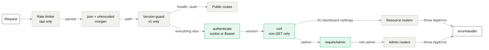

# API Reference

> [!note] Authoritative source
> This note is a map. The field-level contract (every query parameter, body field, response shape
> and failure mode) is `docs/CONTRACTS.md` in the repository, which is kept in sync with the code
> by rule. When the two disagree, `docs/CONTRACTS.md` wins.

The API is a JSON REST surface served by one Express router assembly (`src/routes/api.js`),
mounted at **`/api/v1`** (the contract) and **`/api`** (a compatibility alias) — the same handler
instances answer both (ADR-007). Within v1, changes are additive only.

## Request pipeline

Green = security gates (session, CSRF, role). Unmatched `/api/*` paths, including unknown
versions like `/api/v2`, end at a JSON 404 catch-all.

## Conventions

| Topic | Rule |
|---|---|
| Paths | Client paths only: POSIX, rooted at `/`, relative to `STORAGE_ROOT`. Absolute OS paths never appear in a request or response. See [[Path Containment and Client Paths]]. |
| Reads | Bare body — the payload *is* the response (`[rootNode]`, `{items,total,counts}`, a settings document). |
| Writes | Envelope `{ "success": true, ... }`. Bulk move/copy/delete can answer `200` with per-item failures in `data.failed`. |
| Errors | `{ "success": false, "error": "..." }`, any status. Only authored `AppError` messages reach the client; everything else is masked. See [[Error Contract and Sanitization]]. |
| Time | Integer epoch milliseconds everywhere. |
| Auth | `afm_session` cookie (HttpOnly, SameSite=Lax, 24 h) or `Authorization: Bearer`; `X-CSRF-Token` on every non-GET. See [[Authentication and CSRF]]. |
| Limits | 60 writes / 600 reads per minute per IP; login 10/min; ZIP/delete/move/copy ≤ 500 paths; upload ≤ `UPLOAD_MAX_BYTES` (5 GiB). |

## Endpoints

Access: **public** (no session) · **session** · **admin** (session + `role = "admin"`).

### System and authentication

| Method | Path | Access | Returns |
|---|---|---|---|
| GET | `/health` | public | `{ success, message, apiVersion: 1 }` — the deploy activation gate |
| POST | `/auth/login` | public | `{ success, user, csrfToken }` + `Set-Cookie` · `401` on any failure |
| POST | `/auth/logout` | session | `{ success }`, clears the cookie |
| GET | `/auth/me` | session | `{ id, username, role, status, csrfToken }` |

### Files — `/fs` ([[HTTP API Layer]] → [[Storage Services]])

| Method | Path | Returns |
|---|---|---|
| GET | `/fs/tree?path=` | bare `[rootNode]`, two levels deep |
| GET | `/fs/list?path=&type=&search=&sort=&dir=&page=&limit=&starredOnly=` | bare `{ items, total, counts }` |
| GET | `/fs/download?path=` | file stream, `application/octet-stream` attachment |
| POST | `/fs/download-zip` | ZIP stream (form POST; CSRF token may be a body field) |
| GET | `/fs/thumbnail/capability` | bare `{ available, formats, maxSize }` |
| GET | `/fs/thumbnail?path=&size=` | image bytes, or `X-Preview: unavailable` |
| POST | `/fs/folder` | `201 { success, data }` |
| POST | `/fs/upload` | multipart; send `destination` and `overwrite` **before** `file` |
| POST | `/fs/star` | `{ success, data }` |
| PUT | `/fs/rename` | same-directory only |
| PUT | `/fs/move` · POST `/fs/copy` | bulk, partial-success envelope |
| DELETE | `/fs/delete` | bulk, permanent, partial-success envelope |

All `/fs` routes require a session.

### Dashboard and settings

| Method | Path | Returns |
|---|---|---|
| GET | `/dashboard/summary` | bare object; degrades per capability with `200` — see [[Explicit Unavailability]] |
| GET | `/dashboard/health` | bare array of runtime metrics |
| GET | `/settings` | bare settings document |
| PUT | `/settings` | strict full replace → `{ success, settings }` |

### Administration — `/admin` ([[Auth and Access Control]])

| Method | Path | Returns |
|---|---|---|
| GET | `/admin/users` | bare array of user objects (no hash, no lockout fields) |
| POST | `/admin/users` | `201 { success, user }` |
| POST | `/admin/users/:id/status` | `{ success, user }` — disabling revokes sessions |
| POST | `/admin/users/:id/reset-password` | `{ success, user }` — revokes sessions |
| POST | `/admin/users/:id/revoke-sessions` | `{ success }` |
| DELETE | `/admin/users/:id` | `{ success }` |
| GET | `/admin/files/policies` | bare array |
| GET | `/admin/files/policy?path=` | bare policy or `null` |
| PUT | `/admin/files/policy` | `{ success, policy }` — upsert |
| DELETE | `/admin/files/policy?path=` | `{ success }` |
| GET | `/admin/files/permissions?path=` | bare array |
| POST | `/admin/files/permissions` | `201 { success, permission }` |
| DELETE | `/admin/files/permissions` | `{ success }` |

> [!warning] Policies are stored, not enforced
> Nothing under `/fs` consults a file-access policy. Any authenticated session can read any file
> (ADR-009 design D5). The admin routes manage the data model only — see [[Database]].

## Status codes

| Code | When |
|---|---|
| `200` / `201` | Success (`201` for created folder, user, permission) |
| `400` | Invalid input — name, path, body field, settings document |
| `401` | No/expired/revoked session; failed login |
| `403` | Path traversal or symlink escape, OS permission denial, root deletion, bad CSRF token, non-admin on `/admin` |
| `404` | Missing file/folder/user; unknown endpoint or API version |
| `409` | Name collision; permission before policy; duplicate username |
| `413` | Upload over the size limit; preview source over 50 MiB |
| `415` / `422` | Preview of a non-image / undecodable image |
| `429` | Rate limit or upload concurrency (`Retry-After` on rate limits) |
| `500` | Unmapped failure, corrupt settings/metadata store — message masked |
| `507` | Upload refused for low free space |

## Known API defects

Tracked with fixes in [[Code Review]]; the ones a client can observe:

- Bulk move/copy/delete may place raw (unmasked) error text in `data.failed[].error`.
- `POST /fs/download-zip` names entries by basename, so same-named files from different folders collide.
- A stream error before the first byte returns JSON that still carries `Content-Disposition: attachment`.
- `DELETE /admin/users/:id` answers `500` for any user referenced by the audit log or a policy.
- Activity entries record user `"system"` instead of the authenticated user.
