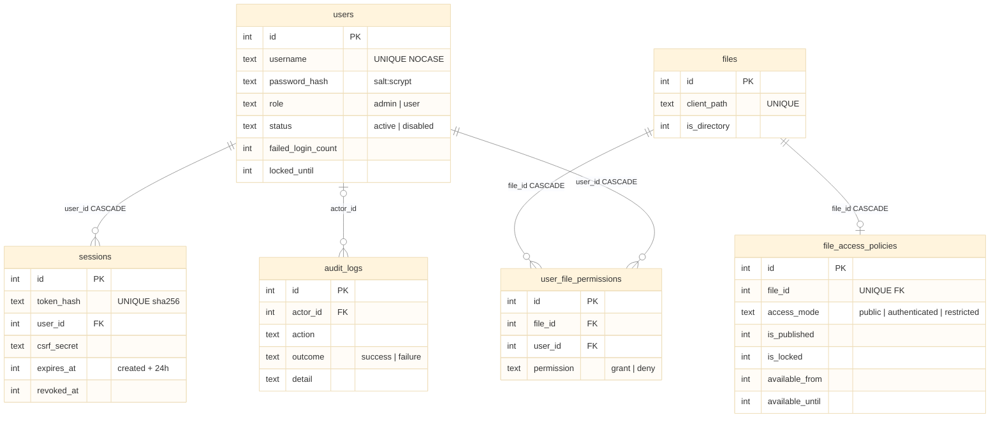

# Database

> [!note] Authoritative source
> Column-level reference, migrations, lifecycle and operations live in `docs/DATABASE.md` in the
> repository. This note is the conceptual map.

Dimension persists three things outside the storage root, all under `AFM_DATA_DIR`. **The
filesystem itself is the database for files** — there is no table mirroring the tree.

| Store | Engine | Owner | Holds |
|---|---|---|---|
| `admin.sqlite` | `node:sqlite`, synchronous, one connection | [[Auth and Access Control]] | users, sessions, audit log, file-access policies |
| `metadata.json` | JSON, cached, atomic replace | [[Metadata and Settings Stores]] | download counts, stars, activity feed (50) |
| `settings.json` | JSON, cached, atomic replace | [[Metadata and Settings Stores]] | 3 operator settings |

No transaction spans two stores. Metadata and policy-path writes that accompany a filesystem
operation are best-effort and never fail it — see [[Concurrency and Consistency]].

## Beginner

> [!tip] Prerequisites
> - What a table, a primary key and a foreign key are
> - That a "migration" is a numbered script that changes a database's structure

### What Is This?

The admin database is a single file, `admin.sqlite`, that remembers who can log in, who is logged in
right now, what administrators changed, and which rules an administrator attached to particular
files. Node.js 24 ships SQLite built in (`node:sqlite`), so there is no database server to install.

### Key Concepts

**Session token** — a long random string the browser keeps in a cookie. The database never stores
the string itself, only its SHA-256 fingerprint, so a stolen database file cannot be replayed as a
login.

**Soft revocation** — logging out does not delete the session row; it stamps `revoked_at`. A
session counts only while it is unrevoked, unexpired and its user is active.

**Sparse `files` table** — a row exists only for a path that has a policy, not for every file.

### How It Works: Main Flow

1. **Boot** — `server.js` opens the file, turns on foreign keys, and applies any missing migrations
   in transactions. A newer schema than the code knows stops the server.
2. **First admin** — if there are no users, one admin is created from
   `AFM_BOOTSTRAP_ADMIN_USERNAME`/`PASSWORD`.
3. **Login** — the password is checked with scrypt; a session row is inserted.
4. **Every request** — the token's hash is looked up and `last_seen_at` is refreshed.
5. **Admin changes** — each one writes an `audit_logs` row, success or failure.

## Intermediate

### Schema

### Design Rationale

- **SQLite over another JSON file** — identity data needs uniqueness, foreign keys and atomic
  multi-row changes; the JSON stores have none of these (ADR-009).
- **Repositories own all SQL** — five singleton repositories in `src/db/repositories/`; services
  never see SQL or a `node:sqlite` type. Every statement is parameterised.
- **Synchronous by design** — `node:sqlite` has no async API; statements are tiny and indexed. A
  documented exception to the async-only rule, like `getHealthMetrics` — see [[Singleton Services]].
- **Rollback journal, not WAL** — one process, one connection; WAL added sidecar files and
  destabilised parallel tests on Windows.

### Patterns Used

**Forward-only migrations** — `MIGRATIONS` is append-only; each runs in its own transaction and is
recorded in `schema_migrations`. **Singleton with a redirectable path** — tests set
`AdminDatabase.dbPath` and call `reset()` before booting the server, the same trick the JSON stores
use.

## Advanced

### Concurrency & State

Single connection, single-threaded event loop, synchronous statements: no two statements ever
interleave, so `UserFilePermissionRepository.upsert` (select-then-write, no transaction) is safe
today. It would not be under a second process or a worker thread. The JSON stores are different:
their writes are async and unlocked — see [[Atomic Replace Writes]].

### Performance Characteristics

Every authenticated request performs one indexed `SELECT` and one `UPDATE` (`touch`) synchronously
on the event loop. Negligible for one operator; it is the first thing to batch if request rates
grow.

### Failure Modes

> [!danger] Deleting a user can fail with 500
> `audit_logs.actor_id`, `file_access_policies.created_by/updated_by` and
> `user_file_permissions.granted_by` reference `users(id)` with no `ON DELETE` action while foreign
> keys are enforced. Deleting any admin who ever acted fails the whole request. Fix: a
> table-rebuild migration to `ON DELETE SET NULL`.

- **No last-admin guard** — the last active admin can be disabled or deleted.
- **Lockout re-arms** — `failed_login_count` is not reset when a lock expires.
- **Folder rename/delete** — policy rows for descendants keep stale paths.
- **No retention** — expired sessions and audit rows are never pruned.

All are tracked in [[Code Review]].

### Invariants & Constraints

- Only token **hashes** are stored; the raw token exists only in the client.
- `role` is the entire authorization model — one `requireAdmin` comparison.
- Policies are **stored, not enforced** on any read path (ADR-009 design D5).
- A permission requires a policy first (`409` otherwise).
- A stored schema version newer than the code refuses boot — release rollback across a migration
  needs the pre-upgrade backup.
