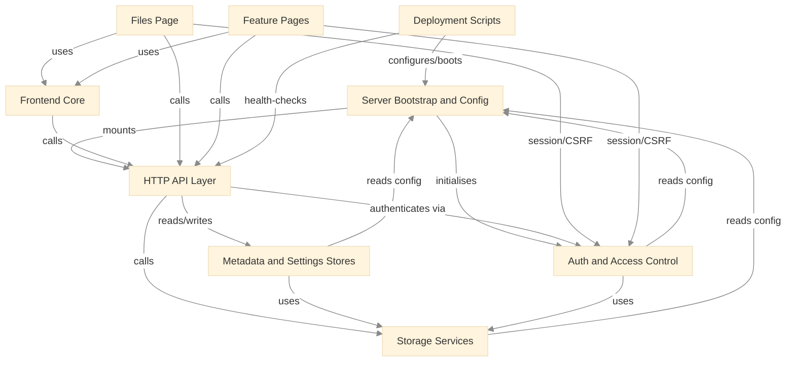

# Dependency Map

Module-level dependency graph for Dimension Files Manager. An arrow points from a module to the module it depends on. The same graph is laid out spatially in `Architecture/System Map.canvas`; the narrative is in [[System Overview]].

> [!warning] Dependency cycle
> [[Server Bootstrap and Config]] → [[HTTP API Layer]] → [[Storage Services]] → [[Server Bootstrap and Config]]. The bootstrap mounts the API, the API calls the services, and the services read configuration owned by the bootstrap module (`src/config/env.js`). [[Metadata and Settings Stores]] and [[Auth and Access Control]] close the same loop by reading config. It is a configuration read rather than a runtime call back into the server, but it means the config module is not a pure leaf. The System Map canvas breaks the cycle for layout by placing the bootstrap ahead of the API and drawing the config-read edges as back edges.

## Dependency Table

| Module | Depends on | Depended on by |
|---|---|---|
| [[Server Bootstrap and Config]] | [[HTTP API Layer]], [[Auth and Access Control]] | [[Storage Services]], [[Metadata and Settings Stores]], [[Auth and Access Control]], [[Deployment Scripts]] |
| [[HTTP API Layer]] | [[Storage Services]], [[Metadata and Settings Stores]], [[Auth and Access Control]] | [[Server Bootstrap and Config]], [[Frontend Core]], [[Files Page]], [[Feature Pages]], [[Deployment Scripts]] |
| [[Storage Services]] | [[Server Bootstrap and Config]] | [[HTTP API Layer]], [[Metadata and Settings Stores]], [[Auth and Access Control]] |
| [[Metadata and Settings Stores]] | [[Server Bootstrap and Config]], [[Storage Services]] | [[HTTP API Layer]] |
| [[Auth and Access Control]] | [[Server Bootstrap and Config]], [[Storage Services]] | [[Server Bootstrap and Config]], [[HTTP API Layer]], [[Files Page]], [[Feature Pages]] |
| [[Frontend Core]] | [[HTTP API Layer]] | [[Files Page]], [[Feature Pages]] |
| [[Files Page]] | [[Frontend Core]], [[HTTP API Layer]], [[Auth and Access Control]] | (none) |
| [[Feature Pages]] | [[Frontend Core]], [[HTTP API Layer]], [[Auth and Access Control]] | (none) |
| [[Deployment Scripts]] | [[Server Bootstrap and Config]], [[HTTP API Layer]] | (none) |
