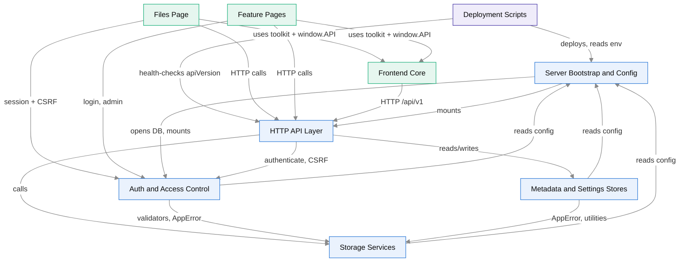
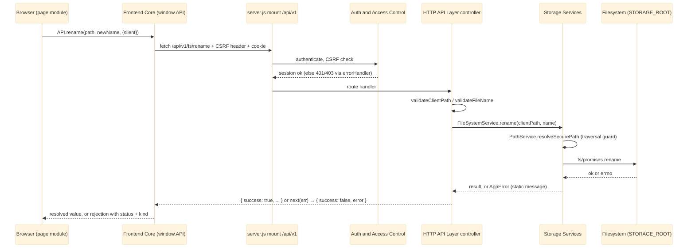

# System Overview

Dimension is a self-hosted admin file manager. It runs as **one Node.js (CommonJS) process**: an Express 5 REST API in front of one sandboxed directory (`STORAGE_ROOT`), and a no-build vanilla JS single-page app that the same process serves from `public/`. The founding idea comes from ADR-001 (`docs/decisions/ADR-001-architecture-baseline.md`). The filesystem *is* the database, and every client-supplied path must pass one secured boundary.

Two small JSON stores sit beside the files. They hold download counts, stars, activity and operator settings. ADR-009 (`docs/decisions/ADR-009-admin-identity-and-file-access-policies.md`) later added a SQLite database for identity, sessions, audit rows and file-access-policy data. The backend is layered `routes → controllers → services → fs`. The API speaks only in POSIX "client paths" rooted at `/`, and absolute OS paths never leave the services.

## Module Map

**Legend:** blue = backend (in-process Node modules), green = frontend (browser SPA), violet = ops (bash tooling outside the process).

The modules:

- [[Server Bootstrap and Config]] is the entry point. `src/config/env.js` builds a plain config object at require time and never exits by itself. `server.js` then:
  - calls `validateStartup()`,
  - opens and migrates the admin database synchronously,
  - assembles the middleware chain and mounts the API,
  - listens, and on a signal drains connections within a 30 s grace.
- [[HTTP API Layer]] holds the routers, controllers and the global `errorHandler`. Controllers validate input, throw `AppError`, and shape either bare read payloads or `{ success: true }` mutation envelopes.
- [[Auth and Access Control]] plugs into the API assembly. It supplies:
  - the `authenticate`, CSRF, rate-limit and `requireAdmin` middleware,
  - the `/auth` and `/admin` routers,
  - a repository layer over `node:sqlite`.

  This is phase 1 of ADR-009: single-tenant with flat authorization. File-access policies are stored but not yet enforced on reads.
- [[Storage Services]] owns all filesystem work:
  - `PathService` is the traversal choke point.
  - `FileSystemService` handles listings, bounded tree walks and mutations.
  - `UploadService` stages multer uploads in hidden `.upload-*.part` files, checks a free-space watermark and places files atomically.
  - `PreviewService` serves optional thumbnails.

  It also holds the shared `validators`, `fileTypes`, `concurrency` and `AppError` utilities.
- [[Metadata and Settings Stores]] keep `metadata.json` and `settings.json` under `AFM_DATA_DIR` as cached singletons with temp-file-then-rename writes.
  - Metadata writes are fire-and-forget. They must never fail the file operation they accompany.
  - The settings store is ADR-006's validated full-replace document.
- [[Frontend Core]] is the shared browser runtime:
  - `api.js` is the only place API URLs are built, and the only holder of the CSRF token.
  - `app.js` provides the toolkit (Toast, Modal, Format, Icons, Store).
  - `router.js` swaps pages in place without a reload (ADR-005).
  - It also includes the sidebar, theme, notifications and the CSS design system.
- [[Files Page]] is the most complex single page. It covers browsing, search, drag-and-drop upload, cut, copy and move, stars, delete and access policies (ADR-003).
- [[Feature Pages]] contains Dashboard (ADR-002), Uploads (ADR-004), Settings (ADR-006), Admin and Login.
- [[Deployment Scripts]] run outside the process and implement ADR-008. In order, a release is:
  1. built from an allow-list `git archive` of one commit and shipped over SSH,
  2. unpacked into an immutable release directory,
  3. gated by the hermetic test suite,
  4. swapped in atomically through a `current` symlink,
  5. health-checked against `GET /api/v1/health`'s `apiVersion`,
  6. rolled back if any of this fails.

  Production config lives only in `/etc/dimension/dimension.env`.

See [[Dependency Map]] for the edge-by-edge breakdown.

> [!note] Config cycle
> The module graph has real cycles, and all of them come from configuration. Server Bootstrap and Config mounts HTTP API Layer and Auth and Access Control. Storage Services, Metadata and Settings Stores, and Auth and Access Control all `require` the config object back. That gives:
> - Server Bootstrap and Config → HTTP API Layer → Storage Services → Server Bootstrap and Config
> - a two-way edge between Server Bootstrap and Config and Auth and Access Control
>
> These are module-level cycles, not file-level `require` cycles. `env.js` and `dataDir.js` are leaves that import nothing from the app, and only `server.js` reaches upward, so the cycle is harmless at load time. It does mean Server Bootstrap and Config is two things: a leaf config provider and the root composer. `UploadService` also partly bypasses the Storage Services → config edge by re-reading `process.env`.

## Architecture Type

**Modular monolith.**

- **Why it is a monolith.** There is one deployable unit, one Node process and one release directory. The API, the static SPA assets, and the SQLite and JSON stores ship and run together. There is no inter-service network protocol.
- **Why it is modular.**
  - The backend modules have enforced seams:
    - the layered rule `routes → controllers → services → fs`,
    - `PathService` as the single path boundary,
    - `AppError` plus `errorHandler` as the single error channel.
  - The frontend is separated from the backend by a versioned HTTP contract (ADR-007), with `api.js` as the only client-side boundary. `test/integration/repo-guardrails.test.js` enforces that boundary.
  - Deployment is an external contract. It is tied to the app only through `apiVersion` and the env file (ADR-008).
- **Why the other labels do not fit.**
  - *Plugin-based:* the one optional extension point is an image transformer probed with `require('sharp')`. That is a capability probe, not a plugin system.
  - *Microservices or hybrid:* nothing runs out of process except the bash deploy tooling.

> [!warning] Caveat
> Because of the config cycle above, the module boundaries are not a strict DAG. Server Bootstrap and Config is both a leaf dependency and the composition root.

## Request Lifecycle

This is a typical authenticated mutation, for example `PUT /api/v1/fs/rename` from the Files page.

1. **Browser → Frontend Core.** A page module calls a `window.API` method. It never calls `fetch` directly or builds an `/api` URL itself. `api.js` resolves `API.BASE_URL` once, in this order: `window.AFM_API_BASE`, then `<meta name="afm-api-base">`, then `/api/v1`. It attaches the CSRF token to every non-GET request.
2. **→ `/api/v1`.** `server.js` mounts the single assembly `src/routes/api.js` as `app.use(['/api/v1', '/api'], ...)` (ADR-007). That mount comes before the `/api` catch-all and the SPA fallback, because anything registered after the catch-all is unreachable.
3. **→ auth.** Inside the assembly, `authenticate` requires a session (the `afm_session` cookie or `Authorization: Bearer`). A CSRF check guards every non-GET request. `GET /health` and `POST /auth/login` are exempt. Admin routes also pass `requireAdmin`.
4. **→ controller.** The [[HTTP API Layer]] controller validates input with `validateClientPath` and `validateFileName`. It wraps its work in `try { } catch (e) { next(e) }`.
5. **→ service.** A [[Storage Services]] class resolves the client path through `PathService.resolveSecurePath()` and does async I/O. Metadata side effects (activity, downloads) go to [[Metadata and Settings Stores]] as fire-and-forget calls.
6. **→ fs.** `fs/promises` or streams touch `STORAGE_ROOT`. Errno codes are mapped to static `AppError` messages, and the global `errorHandler` serializes them as `{ success: false, error }`.

Read endpoints follow the same path but return bare shapes (a bare array or object, with no envelope).

## System-Wide Patterns

| Pattern | What it means here | Main modules |
|---|---|---|
| [[Singleton Services]] | Each stateful component is one process-wide instance with no DI container. Test seams (`dbPath`, `reset()`, `_useTransformer`, `_useFreeSpaceReader`, the injectable `source` of `validateStartup`) let suites redirect state before `server.js` loads. | All backend modules; Frontend Core (IIFEs on `window`, `API` frozen) |
| [[Explicit Unavailability]] | A value that could not be measured is reported as `null` plus an `*Available: false` flag and rendered as `—`, never as `0`. No status is asserted without a real threshold source (ADR-002). | Storage Services, HTTP API Layer, Frontend Core, Feature Pages |
| [[Atomic Replace Writes]] | Writes go to a temp file and are then renamed into place, so state is never half-written. Staged uploads are placed with `fs.link` or `fs.rename`. Deploys swap releases with `atomic_link`. | Metadata and Settings Stores, Storage Services, Deployment Scripts |
| [[Bounded Work Budgets]] | Every potentially unbounded operation has a cap: a 100k-entry / 2000 ms tree-walk budget, an upload gate of 4, list enrichment at concurrency 16, a 500-path bulk cap, per-IP rate limits, and a health poll that stops on its first failure. | Storage Services, HTTP API Layer, Auth and Access Control, Feature Pages |
| [[Re-entrant Page Lifecycle]] | `init()` and `destroy()` can run many times per document (ADR-005). Global listeners and timers are tracked and removed. Shared chrome binds by delegation. Stale async results are dropped by request id or nav token. | Frontend Core, Files Page, Feature Pages |

Other system-wide conventions:

- **AppError contract with static messages.** Expected failures are thrown as `AppError(message, status)` and serialized once as `{ success: false, error }`. No absolute path or errno should reach a client. See [[Error Contract and Sanitization]].
- **Envelope split.** Bare reads, enveloped mutations (AGENTS.md rule 6). A bulk `200` can still carry `data.failed`.
- **Partial-success reporting.** Outcomes are reported per item:
  - bulk move, copy and delete return `failed[]`,
  - Files Page uses `summarizeDelete`, `summarizeMove`, `summarizeCopy`, and `Promise.allSettled` for stars and policies,
  - Uploads batches its outcome toasts.

  See [[Truthful Reporting and Unavailability]].
- **Single client network boundary.** Every transport goes through `window.API`, including named builders for iframe, form and ``. Rejections carry machine-readable `status` and `kind`, and pages pass `{ silent: true }` when they report failures themselves.
- **Fail-fast startup gates.** Problems are caught before serving:
  - `validateStartup()` runs before `listen`,
  - schema migrations refuse an unknown newer version,
  - the deploy runs pre-activation checks and a hermetic `npm test`.

Related cross-cutting notes: [[Path Containment and Client Paths]], [[Authentication and CSRF]], [[Concurrency and Consistency]].

## Architecture Decisions

| ADR | Topic |
|---|---|
| `docs/decisions/ADR-001-architecture-baseline.md` | Filesystem as database, a single path boundary, layered backend |
| `docs/decisions/ADR-002-dashboard-data-architecture.md` | Dashboard figures are instantaneous; unknown values are shown as unavailable |
| `docs/decisions/ADR-003-files-page-integrity.md` | The Files page renders only what exists |
| `docs/decisions/ADR-004-upload-page-integrity.md` | Upload page invariants |
| `docs/decisions/ADR-005-client-side-navigation.md` | `router.js` swaps pages in place without a reload |
| `docs/decisions/ADR-006-settings-store-and-scope.md` | Settings store, validated full replace |
| `docs/decisions/ADR-007-api-versioning-and-boundary.md` | `/api/v1` mount prefix, `/api` alias, `api.js` boundary |
| `docs/decisions/ADR-008-production-deployment.md` | Immutable releases, `apiVersion` activation gate |
| `docs/decisions/ADR-009-admin-identity-and-file-access-policies.md` | Sessions, CSRF, SQLite identity store (phase 1) |
