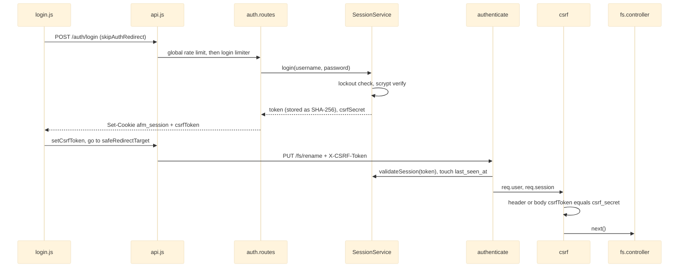

# Authentication and CSRF

## The Concern

Every API endpoint except `GET /health` and `POST /auth/login` requires a session. Every non-GET request also needs a CSRF token. This is phase 1 of ADR-009. It is a **single-tenant, flat-authorization** slice: any active session has the full file-management capability set. The only role check is `requireAdmin` on `/admin` routes. File access policies exist as data but nothing enforces them on file reads yet.

The concern runs from boot (database open, first admin), through the route assembly (where gating order is load-bearing), into the browser (where the CSRF token lives and where login redirects).

## Governing Rules

| Source | Rule |
|---|---|
| ADR-009, decisions 1, 2, 5 | `node:sqlite` stores users, sessions and audit rows under `AFM_DATA_DIR`, separate from the JSON stores. `users.role` is `admin` or `user`. Authentication (login, logout, session cookie, CSRF, login throttle) is built on the first migration. |
| ADR-009, decision 4 | The policy database has no consumer on the download path yet. Enforcement is deferred to a later decision. |
| ADR-007, AGENTS.md rule 4a | One assembly (`src/routes/api.js`) serves `/api/v1` and `/api`, so both prefixes are gated identically. Removing the `/api` alias closes no exposure. |
| AGENTS.md, Hard Constraints | Session via `afm_session` cookie or `Authorization: Bearer`. CSRF header on every non-GET request. CORS stays same-origin unless `AFM_CORS_ENABLED=true` with a validated allowlist. |
| AGENTS.md rule 8 | Pages call the API only through `window.API`. Non-fetch transports get named builders in `api.js`. |

## Login and an Authenticated Mutation

On each later page load `app.js#loadGlobalData` calls `GET /auth/me` to fetch the CSRF token again. The token is held in a closure inside `api.js` and never persisted.

## Module by Module

| Module | Role in the concern |
|---|---|
| [[Auth and Access Control]] | `authenticate` reads the Bearer header first, then the cookie, and attaches `req.user` / `req.session`, or 401. `csrf` skips GET/HEAD/OPTIONS and otherwise compares the `x-csrf-token` header (or a `csrfToken` body field) with `session.csrf_secret`, or 403. `requireAdmin` gates `/admin`. `SessionService` stores tokens as SHA-256 hashes, hashes passwords with scrypt, locks an account for 15 minutes after 10 consecutive failures, and returns an identical 401 for every login failure mode. `createRateLimit` is an in-memory per-IP fixed-window limiter. Admin controllers write `audit_logs` rows synchronously. The cookie is hand-built: `HttpOnly; SameSite=Lax; Max-Age=86400`, plus `Secure` in production. |
| [[Server Bootstrap and Config]] | Opens and migrates the database synchronously before `listen`, runs `ensureBootstrapAdmin()` from `AFM_BOOTSTRAP_ADMIN_USERNAME` / `_PASSWORD`, sets `trust proxy` to one hop so the limiter sees the real client IP behind nginx, registers the global rate limiter before body parsers, and registers `cors` only when enabled. `validateStartup` checks bootstrap credential pairing and length. |
| [[HTTP API Layer]] | `api.js` order: version-segment guard, public `GET /health`, the self-gating `/auth` router, then blanket `authenticate` + `csrf`, then `/fs`, `/dashboard`, `/settings`, `/admin`. `fs.controller.js` calls `FileAccessPolicyService.onPathRenamed` / `onPathDeleted`. |
| [[Frontend Core]] | `api.js` adds `X-CSRF-Token` to every non-safe fetch and XHR, and adds a hidden `csrfToken` field to the ZIP form POST, which cannot set headers. A 401 redirects to login unless the call opts out. `API` is frozen so `BASE_URL` cannot be repointed. |
| [[Feature Pages]] | `login.js` posts credentials, stores the CSRF token, and navigates to `safeRedirectTarget()`, which accepts only root-relative paths. `admin.js` shows a "not an administrator" notice on a 403. |
| [[Files Page]] | Shows the access-policy action to every user and relies on the server's 403 instead of a client role gate. |

## Known Gaps

| Severity | Issue | Module | Detail |
|---|---|---|---|
| medium | `no-last-admin-guard` | [[Auth and Access Control]] | An admin can disable or delete themselves or the last active admin. |
| medium | `lockout-rearms-after-expiry` | [[Auth and Access Control]] | `failed_login_count` is not reset when the lock expires, so one more failure re-locks. Lockout can last indefinitely. |
| medium | `login-enumeration` | [[Auth and Access Control]] | Unknown users skip scrypt, which is a timing leak. A non-string password for a real user gives 500, not 401. |
| medium | `user-delete-fk-500` | [[Auth and Access Control]] | Deleting a user with audit rows is a raw 500. |
| medium | `policy-path-hooks-exact-match` | [[Auth and Access Control]] | Descendant policies go stale on folder rename or delete. |
| medium | `login-open-redirect-backslash-bypass` | [[Feature Pages]] | `safeRedirectTarget` accepts `/\evil.example` and `/%09/evil.example`, which browsers can treat as protocol-relative. |
| medium | `cors-origin-normalization-mismatch` | [[Server Bootstrap and Config]] | Origins are validated after URL normalization but matched raw, so trailing-slash or mixed-case entries never match. |
| low | `csrf-compare-not-constant-time` | [[Auth and Access Control]] | Plain `!==` comparison, and the body-field fallback is accepted on every route, not only the ZIP form. |
| low | `policy-flags-untyped` | [[Auth and Access Control]] | Flags are coerced by truthiness, so `"false"` stores `1`. |
| low | `cookie-decode-throws` | [[Auth and Access Control]] | A malformed cookie throws `URIError` (500). |
| low | `touch-write-every-request` | [[Auth and Access Control]] | A synchronous SQLite `UPDATE` of `last_seen_at` on every request. |
| low | `no-session-audit-retention` | [[Auth and Access Control]] | Expired sessions and audit rows are never pruned. |
| low | `duplicated-ttl-and-parser` | [[Auth and Access Control]] | Session TTL and the env parser are duplicated. |
| low | `csrf-token-race-no-retry` | [[Frontend Core]] | A mutation sent before `/auth/me` resolves, or after rotation, has no valid token and is not retried. |
| low | `activity-user-hardcoded-system` | [[HTTP API Layer]] | Activity entries record `system` instead of the authenticated user. |

Structural limitation, not a bug: authorization is flat and policies are not enforced (ADR-009 decision 4). This code is newer than the filesystem boundary and has not had the same hardening; see [[Limitations]].
