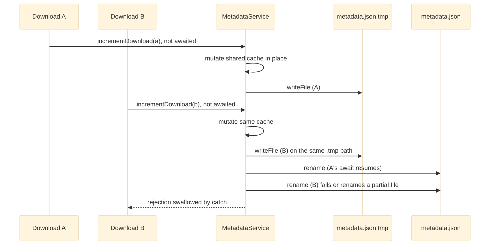

# Concurrency and Consistency

## The Concern

Dimension is one Node process with one event loop. Most of its consistency guarantees rest on that fact rather than on explicit locks:

- The JSON stores assume they are the only writer. They cache the document in memory and never re-read it.
- Metadata is **eventually consistent** and advisory. Writes are fire-and-forget, and disk state always wins.
- The upload concurrency gate is a module-level counter, so it is per process.
- Filesystem collision checks are check-then-act, except uploads, which place files atomically.
- On the client, stale-response guards and attempt counters drop superseded results.
- Shutdown is ordered by nested timeouts across the app, systemd and nginx.

Many of the issues found in this codebase are races at these seams.

## Governing Rules

| Source | Rule |
|---|---|
| ADR-001, decision 1 | Metadata is advisory, written fire-and-forget with atomic temp-file-then-rename writes and an in-memory cache. Disk state always wins. |
| AGENTS.md rule 7 | Metadata writes (`incrementDownload`, `addActivity`, `deletePath`) use `.catch(() => {})` and must never fail or block the filesystem operation. Don't add `await` chains that make metadata failures fatal. |
| ADR-009, decision 1 | The SQLite policy store is a different contract ("a policy table that must be correct") and is kept separate from the best-effort JSON stores. |
| AGENTS.md rule 8, ADR-005 | A page's `init()` can run many times per document. `destroy()` must remove every listener and timer it added. |
| ADR-008, AGENTS.md | Shutdown grace 30 s < systemd `TimeoutStopSec` 45 s < nginx timeouts 600 s. This ordering is load-bearing. Deploys are serialized with `flock`. |
| AGENTS.md, Hard Constraints | Uploads stage into `.upload-*.part` and are placed only after the whole body is parsed. Never write directly to the final name. |

## Where the Single-Writer Assumption Breaks

Two downloads finishing close together each fire an unawaited metadata write:

Because the cache is mutated before `_write`, a failed write leaves memory ahead of disk until restart. The issues are `shared-tmp-write-race` and `cache-mutated-before-write`.

## Shutdown Ordering

Each layer gives up before the one outside it, so the app always gets to report its own failure before being killed.

## Module by Module

| Module | Mechanism |
|---|---|
| [[Metadata and Settings Stores]] | Singleton instances with an in-memory cache that is never invalidated. Every mutator is `_read()`, mutate the cached object in place, `_write()` to a fixed `${dbPath}.tmp`, then `rename`. No lock or write queue. |
| [[HTTP API Layer]] | Fire-and-forget `addActivity`, `incrementDownload`, `deletePath`. `renamePath` is awaited but its failure is only logged. Bulk move, copy and delete run items sequentially. `getList` enriches entries with `mapWithConcurrency(..., 16)` and skips entries that vanish mid-listing. ZIP aborts on client close. |
| [[Storage Services]] | `createDirectory`, `rename`, `move` and `copy` check `exists` and then act. Uploads use atomic placement instead: `fs.link` (EEXIST means no overwrite) or `fs.rename` for overwrite, with copy fallbacks for no-hardlink and cross-device cases. `getTreeStats` re-checks with `lstat` against link swaps. The upload gate (default 4, `AFM_UPLOAD_MAX_CONCURRENT`) is released on response `close` / `finish` and is marked `ponytail:` as per-process only. `discard` retries unlink on `EBUSY` / `EPERM`. |
| [[Auth and Access Control]] | `node:sqlite` `DatabaseSync` and `scryptSync` are synchronous, so each auth call runs to completion on the event loop. Migrations run in their own transactions. The rate limiter is an in-memory per-process `Map`. |
| [[Server Bootstrap and Config]] | SIGTERM / SIGINT call `shutdown()`: `server.close()` drains, idle keep-alive sockets close, and an unref'd 30 s timer forces `exit(1)`. |
| [[Frontend Core]] | `router.js` uses a monotonically increasing `navToken` so a newer navigation supersedes an older one. The page-HTML cache evicts failed fetches. |
| [[Files Page]] | `++listRequestId` / `++treeRequestId` checked after every await. A sequential upload queue with abortable XHR. |
| [[Feature Pages]] | Uploads keeps `activeCount` against `concurrency`, a per-item `attempt` counter that discards callbacks from superseded attempts, and a per-destination verdict cache with in-flight promise reuse. Dashboard's health poll is bounded and stops in `destroy()`. |
| [[Deployment Scripts]] | `flock` on `.deploy.lock` (waits up to `LOCK_WAIT`, default 1800 s). `atomic_link` swaps `current` / `previous` with `mv -Tf`, so the links are never absent. `status` reads without the lock. |

## Known Gaps

| Severity | Issue | Module | Detail |
|---|---|---|---|
| medium | `shared-tmp-write-race` | [[Metadata and Settings Stores]] | Concurrent unlocked writes share one fixed `.tmp` path (both stores). |
| medium | `cache-mutated-before-write` | [[Metadata and Settings Stores]] | A failed write leaves the cache diverged from disk. |
| medium | `copy-partial-tree-on-failure` | [[Storage Services]] | A failed `fs.cp` leaves a half-copied tree with no cleanup. |
| medium | `dashboard-poll-starts-after-destroy` | [[Feature Pages]] | A late `loadSummary` after `destroy()` starts a health poll nothing can stop. |
| medium | `rename-delete-ignore-descendants` | [[Metadata and Settings Stores]] | Path-keyed metadata drifts on folder rename or delete. |
| medium | `policy-path-hooks-exact-match` | [[Auth and Access Control]] | Path-keyed policies drift the same way. |
| low | `rename-move-check-then-act` | [[Storage Services]] | `exists`-then-`rename` collision checks race with concurrent creates. |
| low | `copy-erroronexist-noop` | [[Storage Services]] | `errorOnExist` has no effect because `force` defaults to true, so the copy does not refuse a file that appears after the check. |
| low | `star-set-race` | [[HTTP API Layer]] | The idempotent star set reads then toggles. Concurrent set-true calls can leave the file unstarred. |
| low | `zip-double-next` | [[HTTP API Layer]] | Two error paths can both call `next()`. |
| low | `double-signal-false-clean-exit` | [[Server Bootstrap and Config]] | SIGTERM then SIGINT runs shutdown twice and can exit 0 mid-transfer. |
| low | `upload-queue-not-global` | [[Files Page]] | A second drop starts a concurrent upload loop. |
| low | `upload-tray-hidden-after-reinit` | [[Files Page]] | `init()` never renders the tray after a page swap, while uploads continue. |
| low | `policy-prefill-overwrites-edits` | [[Files Page]] | An async policy prefill can overwrite operator edits. |
| low | `router-concurrent-beforeleave` | [[Frontend Core]] | Overlapping navigations stack leave-confirm dialogs. |
| low | `forced-verify-returns-stale-inflight` | [[Feature Pages]] | `verifyDestination({ force: true })` returns a stale in-flight check. |
| low | `lock-timeout-clobbers-record` | [[Deployment Scripts]] | A lock timeout overwrites `last-deploy.json` without holding the lock. |
| low | `full-rewrite-unbounded-downloads` | [[Metadata and Settings Stores]] | Every download rewrites the whole store, keys are never pruned, and there is no fsync before rename. |

Root cause, per the synthesis: the system relies on event-loop serialization and per-process singletons but has no explicit locks or write queues. Anything that runs a second process against the same `AFM_DATA_DIR`, or interleaves two awaits on one cached document, falls outside the guarantees. See [[Atomic Replace Writes]] and [[Re-entrant Page Lifecycle]].
