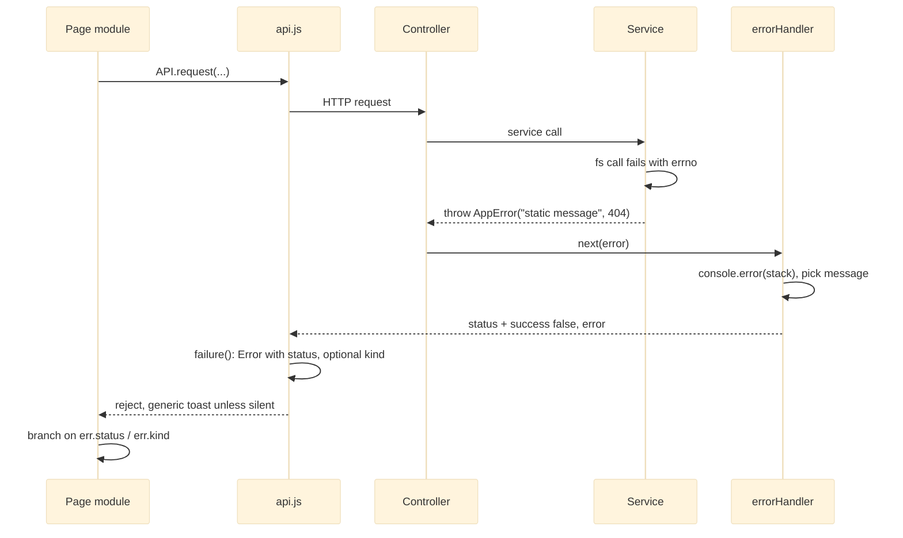

# Error Contract and Sanitization

## The Concern

Every layer can fail, and every failure must reach the browser in one shape: `{ success: false, error: string }` with a meaningful HTTP status. The message must be safe to show. A raw Node error reads like `ENOENT: no such file or directory, open 'C:\...'`, which discloses the server's on-disk layout. The contract therefore has two halves:

- **Shape.** Expected failures are thrown as `AppError(message, statusCode)` and serialized by one global middleware.
- **Sanitization.** Only `AppError` messages, which are authored static strings, reach the client. Anything else becomes a generic message. The full error and stack go to the server log only.

## Governing Rules

| Source | Rule |
|---|---|
| ADR-001, decision 3 | A global `errorHandler` middleware is the sole serializer for `AppError(message, statusCode)`. |
| AGENTS.md rule 5 | Throw `new AppError(message, statusCode)` from any layer. Never `res.status(...).json(...)` an error inline from a route or controller. Never throw raw strings or plain `Error` for expected failures. |
| AGENTS.md rule 6 | Errors always use `{ success: false, error }`, whatever the success envelope of the endpoint. |
| ADR-002 | `AppError` messages carry no path, no errno and no system detail. |
| AGENTS.md, Upload page invariants | Failure kinds come from a machine-readable signal (HTTP status, server `kind`, transport), never from message text. |

## The Error Path

The handler chooses the message by type. An `AppError` keeps its message. Any other error with status 500 or above becomes "An unexpected error occurred on the server." Below 500 it becomes "Request could not be processed." This holds in every environment, including development.

## Module by Module

| Module | Role in the concern |
|---|---|
| [[Storage Services]] | Defines `AppError` (`src/utils/AppError.js`). Every fs call is wrapped, and errno codes (`ENOENT`, `EACCES`, `EPERM`, `EEXIST`, `EXDEV`) map to `AppError`s with static messages. `UploadService.toUploadError` translates Multer errors to 413 or 400. `discard` never throws. |
| [[HTTP API Layer]] | Every async handler is `try { ... } catch (e) { next(e) }`. `errorHandler.js` serializes. Bulk move, copy and delete collect per-item `{ path, error, statusCode }` in `data.failed` and return 200 unless every item failed. Streaming endpoints (download, ZIP) call `next` only while headers are unsent, otherwise they destroy the response. `preview.controller.js` marks failures with `X-Preview: unavailable`. |
| [[Metadata and Settings Stores]] | Non-ENOENT read failures and init failures become `AppError(..., 500)` with the original on `.cause`. A corrupt store fails wholly with 500 rather than substituting defaults. |
| [[Auth and Access Control]] | Every login failure mode returns an identical 401. Middleware throws `AppError` for 401 (no session), 403 (CSRF, `requireAdmin`) and 429 (rate limit, with `Retry-After`). |
| [[Server Bootstrap and Config]] | Registers `errorHandler` last. Owns the `/api` catch-all 404 `{ success: false, error: 'API endpoint not found' }`. |
| [[Frontend Core]] | `api.js` builds every rejection with `failure(message, status, body)`. `status` is `0` when no response arrived, and `kind` is copied when the body has one. A 401 redirects to login unless `skipAuthRedirect`. Without `{ silent: true }` it shows a generic toast. |
| [[Files Page]], [[Feature Pages]] | Pass `{ silent: true }` where they report the failure themselves, and branch on `status` / `kind`. |

> [!note] Where `kind` comes from
> At the analysed commit no file under `src/` emits a `kind` field. The kinds the client sees (`network`, `aborted`) are made by the upload transport in `api.js`. The server-side `kind` channel is supported by the client but unused by the server.

## Known Gaps

| Severity | Issue | Module | Detail |
|---|---|---|---|
| medium | `bulk-raw-error-leak` | [[HTTP API Layer]] | Move, copy and delete put the raw `err.message` into `failed[]`, and an all-failed batch rethrows it as an `AppError`. A non-`AppError` message, which can contain an absolute path, bypasses sanitization. |
| medium | `user-delete-fk-500` | [[Auth and Access Control]] | Foreign keys to `users(id)` have no `ON DELETE`, so deleting an admin with audit rows is a raw 500. |
| medium | `login-enumeration` | [[Auth and Access Control]] | A non-string password for an existing user gives 500 instead of 401 (also a timing leak, see [[Authentication and CSRF]]). |
| medium | `download-errors-invisible` | [[Frontend Core]] | Iframe and form download transports cannot read the error body, so failures are silent. |
| low | `write-errors-not-apperror` | [[Metadata and Settings Stores]] | `SettingsService._write` failures propagate as raw `Error`s. |
| low | `cookie-decode-throws` | [[Auth and Access Control]] | A malformed `afm_session` cookie throws `URIError`, which becomes a 500. |
| low | `audit-in-catch-masks-error` | [[Auth and Access Control]] | An unguarded audit insert inside a `catch` can replace the original `AppError` with a 500. |
| low | `nul-in-client-path-500` | [[Storage Services]] | A NUL byte in a path is a 500, not a 400. |
| low | `filename-length-not-bytes` | [[Storage Services]] | Long multibyte names pass validation, then fail as a 500. |
| low | `zip-unguarded-req-body` | [[HTTP API Layer]] | `downloadZip` reads `req.body.paths` unguarded: 500 instead of 400. |
| low | `error-inherits-attachment-headers` | [[HTTP API Layer]] | A stream error before the first byte returns error JSON that still carries `Content-Disposition: attachment`. |
| low | `zip-double-next` | [[HTTP API Layer]] | The archive error listener and a rejected `finalize()` can both call `next()`. |
| low | `errorhandler-no-headerssent-guard` | [[HTTP API Layer]] | `errorHandler` does not delegate to Express's default handler with `next(err)` when headers are already sent. |
| low | `morgan-after-limiter-and-parsers` | [[Server Bootstrap and Config]] | 429s and JSON parse failures are not request-logged. |

The pattern: the contract holds for the main request path. It leaks at the edges, where code catches and re-wraps errors itself (bulk loops, audit `catch` blocks), and where input is not validated before a library throws (cookies, NUL bytes, foreign keys).
