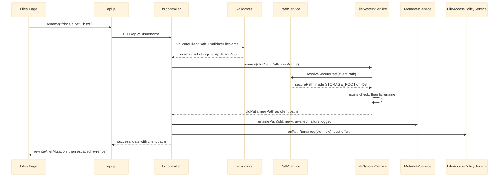
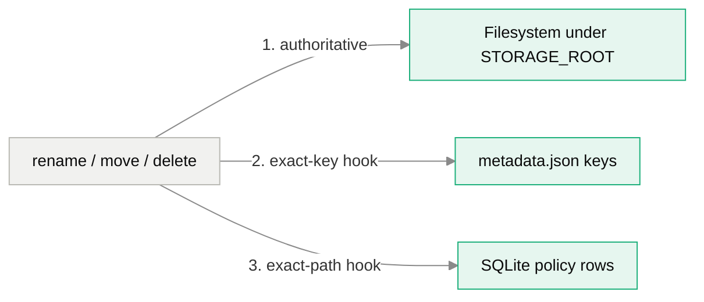

# Path Containment and Client Paths

## The Concern

Dimension exposes one sandboxed directory, `STORAGE_ROOT`, over HTTP. The API speaks only in **client paths**: POSIX strings rooted at `/` such as `/media/clip.mp4`. An absolute OS path (`securePath`) exists only inside the service layer and never appears in a response. Containment is the project's first red line: "No directory traversal, ever."

The concern spans more than the filesystem. Client paths are also the **keys** of two other stores. Download counts and stars live in `metadata.json`, and access policies live in SQLite rows. All three must stay in step when a path is renamed or deleted. Finally, every filesystem-derived string ends up in browser markup, so the frontend is the last place a path can do harm.

## Governing Rules

| Source | Rule |
|---|---|
| ADR-001, decision 2 | A single mandatory path boundary. `PathService.resolveSecurePath()` is the only place a client path becomes an OS path. Services receive client paths only. |
| AGENTS.md rules 2 and 3 | Every client path passes `validateClientPath` / `validateFileName` and then `resolveSecurePath` before touching disk. Don't hand-roll regex checks. |
| AGENTS.md, Hard Constraints | Strict cross-platform filename rules: reject `[<>:"|?*\x00-\x1F]`, reserved Windows names, leading or trailing dots and spaces, `/` and `..`. Deleting the storage root is blocked. Rename stays in the same directory. |
| AGENTS.md rule 10, ADR-003 | Escape every filesystem-derived string with `AFM.escapeHtml` at render time. `Modal.prompt` / `Modal.confirm` take raw HTML. |
| ADR-009, decision 3 | File access policies are per-file rows keyed by path, with no directory inheritance. |

## How a Path Travels

## Module by Module

| Module | Role in the concern |
|---|---|
| [[Storage Services]] | `PathService` holds two guards. `resolveSecurePath` is **lexical**: it resolves the string and checks the separator-bounded prefix against the root. `resolveSecureRealPath` also calls `fs.realpath`, so an in-root symlink or junction that points outside the root is refused (403). `getStats` and the reads built on it use the realpath guard. `toClientPath` maps back and collapses anything outside the root to `/`. `validators.js` holds the name and path shape rules (4096-character path cap, 255-character name cap). `UploadService` validates an early multipart `destination` before writing any byte, and stages into dot-prefixed `.upload-*.part` files that listings and the tree walk skip. |
| [[HTTP API Layer]] | Controllers validate every path and name before calling a service. `downloadFile` re-validates the basename before putting it in `Content-Disposition`. ZIP entries are named by basename. Responses carry client paths only. Rename, move and delete call the metadata and policy hooks. |
| [[Metadata and Settings Stores]] | `MetadataService` keys downloads and stars by client path, in an `Object.create(null)` map so a key such as `__proto__` stays inert. It never imports `PathService`. `renamePath` / `deletePath` keep keys in step with the disk. |
| [[Auth and Access Control]] | `FileAccessPolicyService` keys policy rows by path. `onPathRenamed` / `onPathDeleted` are best-effort hooks and never throw. |
| [[Files Page]] | Path math (`joinPath`, `parentPath`, `ancestorsOf`, `rewriteAfterMutation`) works on client paths only. Every filesystem-derived value goes through `esc()` (`AFM.escapeHtml`) before reaching `innerHTML`. |
| [[Frontend Core]] | `AFM.escapeHtml` is the shared escaper. `Modal` and `ContextMenu` insert caller strings as raw HTML, so callers must escape. |

> [!note] Doc drift: CSP
> AGENTS.md rule 10 says the content security policy is disabled. At the analysed commit `server.js` registers `helmet` with an explicit CSP (`script-src 'self'`, `style-src` allowing `'unsafe-inline'`). Escaping at render time is still the primary defence for markup injection. The CSP limits what injected markup can execute, so it adds a layer rather than replacing escaping.

## Three Stores Keyed by Path

A rename or delete changes the filesystem first. The two other stores follow through hooks:

Green nodes are persistent stores. Disk state always wins (ADR-001). The hooks match **exact** keys only, which is the source of the descendant-drift gap below.

## Known Gaps

| Severity | Issue | Module | Detail |
|---|---|---|---|
| high | `mutations-lexical-guard-only` | [[Storage Services]] | `createDirectory`, `rename`, `move` and `copy` use only the lexical `resolveSecurePath`. An in-root symlink or junction lets a write escape `STORAGE_ROOT`. Reads use the realpath guard, so the boundary is asymmetric. |
| medium | `toclientpath-canonical-root-mismatch` | [[Storage Services]] | `toClientPath` compares canonical paths with the lexical root. With a symlinked `STORAGE_ROOT`, uploads land at the root. |
| medium | `rename-delete-ignore-descendants` | [[Metadata and Settings Stores]] | Renaming or deleting a folder orphans download and star entries for everything beneath it. |
| medium | `policy-path-hooks-exact-match` | [[Auth and Access Control]] | Descendant policies go stale on folder rename or delete. A policy can silently stop applying, or attach to a later file that reuses the path. |
| medium | `login-open-redirect-backslash-bypass` | [[Feature Pages]] | Related string-check habit: `safeRedirectTarget` accepts `/\evil.example` and `/%09/evil.example`. |
| medium | `dir-checks-skip-writability` | [[Server Bootstrap and Config]] | Boot checks only read/execute access, so a read-only `STORAGE_ROOT` passes boot and fails per request. |
| medium | `raw-html-modal-contextmenu` | [[Frontend Core]] | Escaping is opt-in for modal and context-menu callers. |
| low | `nul-in-client-path-500` | [[Storage Services]] | `validateClientPath` does not reject NUL bytes, so the failure surfaces as a 500. |
| low | `filename-length-not-bytes` | [[Storage Services]] | The 255 limit counts UTF-16 units, not bytes. |
| low | `filename-trim-masks-space-rule` | [[Storage Services]] | `validateFileName` trims before the leading/trailing-space check. |
| low | `zip-duplicate-entry-names` | [[HTTP API Layer]] | Same-named files from different folders collide inside a ZIP. |
| low | `app-root-containment-lexical` | [[Deployment Scripts]] | The `APP_ROOT` containment check in `deploy.sh` is a raw string compare. |

The common thread: containment is checked on **strings** in places where it needs to be checked on **resolved paths**. See [[Limitations]] for the wider list.
