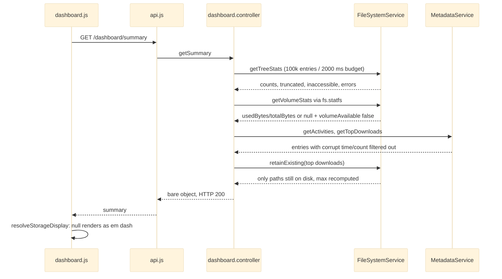

# Truthful Reporting and Unavailability

## The Concern

This is the project's integrity rule. A number on screen is either a real, instantaneous measurement or it is shown as unavailable. A success message appears only for an operation that happened. A control exists only if something consumes it. The rule applies everywhere data turns into a figure: the server's tree walk and store reads, the dashboard controller, and every page that renders the result.

Three distinctions carry the rule:

- **`0` is a real reading.** An empty tree reports 0 files, 0 folders, 0 bytes. Never floor a stat to `1` to make a panel look populated.
- **Unknown is not `0`.** A quantity that could not be measured is `null` plus an `*Available: false` flag on the wire, and `—` on screen.
- **No fabrication.** There is no time-series store, no snapshot table and no parseable log, so trends, sparklines and period-over-period figures cannot exist. The affordance that wanted them is removed.

## Governing Rules

| Source | Rule |
|---|---|
| ADR-002 | Real aggregates, typed absences, bounded walks. Dashboard reads degrade per capability and still answer 200. |
| ADR-003 | Files page: truthful outcomes, no control without a working handler, an outage is an error state with retry, never an empty folder or synthetic tree. |
| ADR-004 | Upload page: consume the shared upload contract, show real activity or no section. Figures derived from the queue state their scope ("since this page opened"). |
| ADR-006 | Settings: every control persists through the store or is removed. A key needs a consumer that changes real behaviour. |
| AGENTS.md, Hard Constraints | "A count of `0` is a real reading", "Never fabricate a metric to fill a UI slot", no `status`/`level` without a real threshold source. |

## From Measurement to Screen

## Module by Module

| Module | Role in the concern |
|---|---|
| [[Storage Services]] | `getTreeStats` is a bounded walk that reports `truncated`, `inaccessible` and per-entry `errors` instead of guessing. `computeCapacity` / `getVolumeStats` return `null` + `volumeAvailable: false` rather than `0`. `getHealthMetrics` returns memory and uptime only. It ships no status field and omits load average, because `os.loadavg()` returns a fabricated `[0,0,0]` on Windows. `retainExisting` drops ranked entries whose files are gone. |
| [[Metadata and Settings Stores]] | `getActivities` drops entries with a missing, non-finite or non-positive `time`. `getTopDownloads` drops non-positive or corrupt counts. A corrupt store fails wholly with 500 rather than returning defaults. |
| [[HTTP API Layer]] | `getSummary` and `getHealth` return bare shapes. `getList` sets folder `size: null` + `sizeAvailable: false` when the recursive walk truncated or hit inaccessible entries. Bulk endpoints report `data.failed`, so a 200 is not "all succeeded". |
| [[Frontend Core]] | `resolveStorageDisplay` / `resolveIdentityDisplay` are pure view-model resolvers. An unmeasured volume renders `—`, sets no `aria-valuenow`, and draws an outlined bar. `Format.duration(null)` renders `—`. |
| [[Files Page]] | `summarizeDelete` / `summarizeMove` / `summarizeCopy` and `Promise.allSettled` for stars and policies make toasts report what actually happened. A cut clipboard drops only items that moved. An outage shows an error state with retry. |
| [[Feature Pages]] | Dashboard uses `UNAVAILABLE_MARK = '—'`, and its health poll stops for good after the first failure. Uploads labels queue-derived figures with their scope, shows remaining time as `—` until a speed is measured, and calls a computed time an estimate. Settings blocks saves while `serverBacked` is unknown. The theme stays browser-local, and the page says so. |

> [!warning] Degradation is per capability, and the docs disagree on one
> A 200 from `GET /dashboard/summary` does not mean every field is populated. Check `volumeAvailable` and the walk flags before rendering. AGENTS.md says a corrupt metadata store makes the summary a 500. The controller at the analysed commit catches the metadata fetch and degrades `activities` / `topFiles` to `[]` (see `dashboard-metadata-silent-empty`). Tree and volume stats run in a bare `Promise.all`, so a failure there *is* a 500, which contradicts the controller's own JSDoc.

## Known Gaps

| Severity | Issue | Module | Detail |
|---|---|---|---|
| medium | `dashboard-metadata-silent-empty` | [[HTTP API Layer]] | A metadata failure is swallowed without logging and becomes `[]`, indistinguishable from "no activity". This is the `0`-for-unknown pattern the rule forbids. |
| medium | `download-errors-invisible` | [[Frontend Core]] | Iframe and form downloads swallow error responses. The user sees nothing happen. |
| medium | `dropped-folder-exists-check-uses-current-page` | [[Files Page]] | Folder existence is decided from the current page of results. An existing folder on another page makes its dropped files silently skipped. |
| medium | `manual-rollback-no-restore` | [[Deployment Scripts]] | A failed manual rollback leaves the service on an unhealthy release and exits 0. |
| low | `clipboard-false-success` | [[Frontend Core]] | The `execCommand` fallback reports success even when copy failed. |
| low | `folder-drop-read-errors-silent` | [[Files Page]] | Folder read errors are swallowed and a partial upload reports success. |
| low | `star-failure-double-toast` | [[Files Page]] | One star failure shows two toasts. |
| low | `top-downloads-retain-after-slice` | [[Metadata and Settings Stores]] | `retain` runs after slicing, so fewer than `limit` entries can return. |
| low | `summary-doc-overstates-degradation` | [[HTTP API Layer]] | JSDoc says no capability can fail the summary; tree and volume stats can. |
| low | `settings-header-claims-missing-consumer` | [[Feature Pages]] | The `settings.js` header claims `defaultUploadFolder` feeds Uploads. It does not. AGENTS.md correctly says it is stored but not yet read. |
| low | `activity-user-hardcoded-system` | [[HTTP API Layer]] | Activity entries always record user `system`, even though `req.user` exists. |
| low | `spa-fallback-masks-missing-assets` | [[Server Bootstrap and Config]] | A missing static asset gets `index.html` with 200. |

Most false-success gaps sit on transports where errors are hard to observe: iframe downloads, drag-and-drop folder readers, the clipboard fallback and systemd. The pattern note [[Explicit Unavailability]] covers the positive side.
