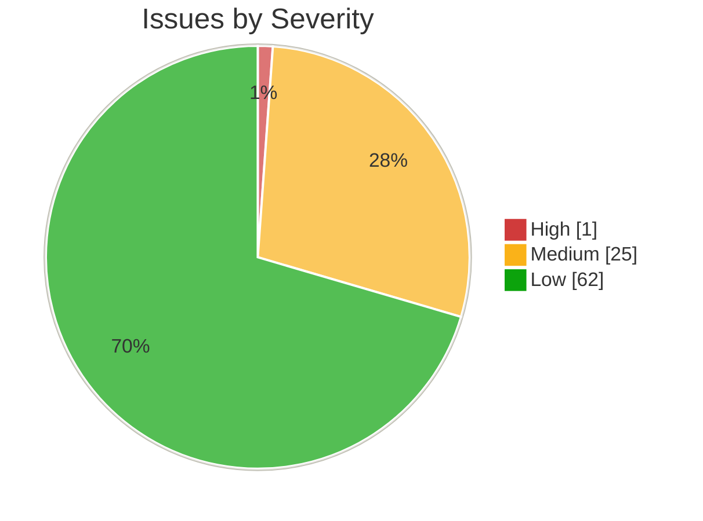
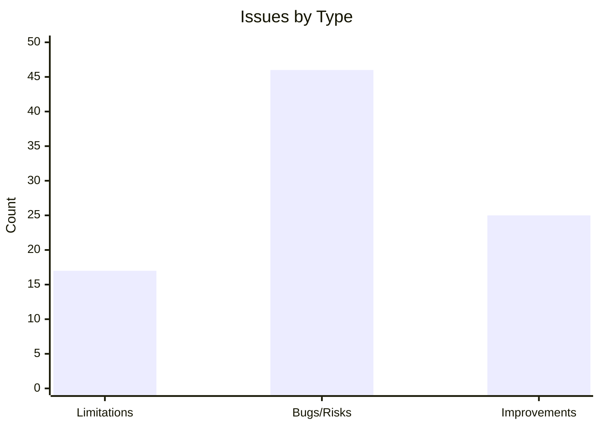
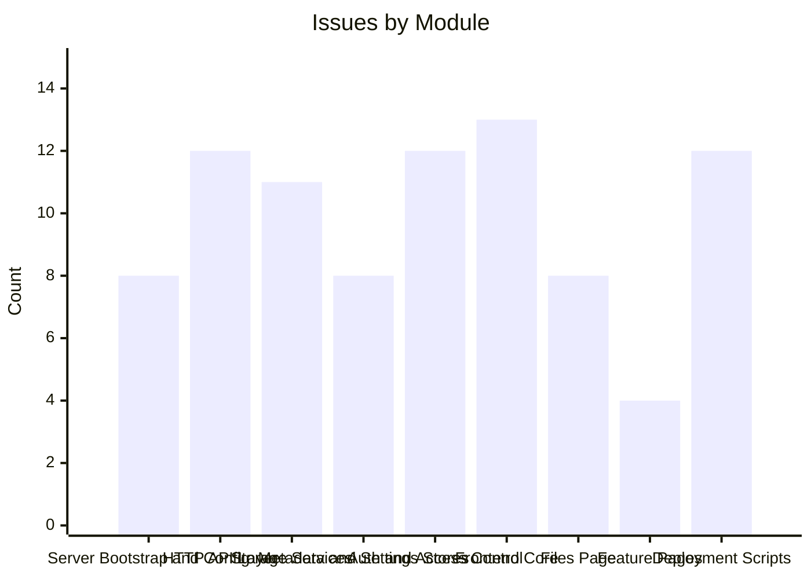

# Health Summary

88 issues were recorded across 9 modules. Details live in [[Limitations]] (design constraints) and [[Code Review]] (bugs, risks and improvements).

## Issues by Severity



| Severity | Count |
|---|---|
| High | 1 |
| Medium | 25 |
| Low | 62 |
| **Total** | **88** |

## Issues by Type



> [!note] `xychart-beta` needs a recent Obsidian Mermaid build; the table below carries the same counts.

| Type | Count |
|---|---|
| Limitations | 17 |
| Bugs/Risks | 46 |
| Improvements | 25 |

## Issues by Module



| Module | Count |
|---|---|
| [[Server Bootstrap and Config]] | 8 |
| [[HTTP API Layer]] | 12 |
| [[Storage Services]] | 11 |
| [[Metadata and Settings Stores]] | 8 |
| [[Auth and Access Control]] | 12 |
| [[Frontend Core]] | 13 |
| [[Files Page]] | 8 |
| [[Feature Pages]] | 4 |
| [[Deployment Scripts]] | 12 |

## Health Documents

```dataview
TABLE title, type, status
FROM #code-docs AND #health
SORT title ASC
```
