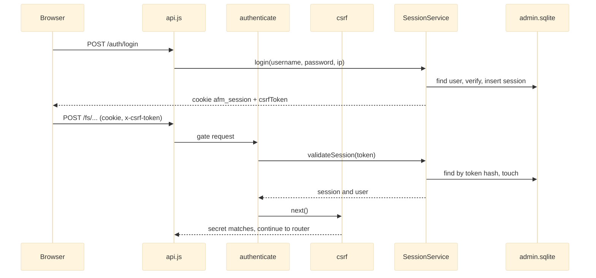

# Auth and Access Control

This module implements ADR-009: phase 1 session authentication and phase 2 admin user and file-policy management. It owns login and logout, the `authenticate` gate that every non-public endpoint passes through, per-session CSRF checking, an in-memory per-IP rate limiter, account lockout, and the admin-only endpoints for managing users and per-file access policies. Its data lives in a dedicated `node:sqlite` database (`<AFM_DATA_DIR>/admin.sqlite`), separate from the JSON stores, reached through a layered routes -> controllers -> services -> repositories -> SQLite stack. Authorization is flat (any active session has the full capability set, and admin routes add a role check); file policies are stored as data only and are not yet enforced on file reads.

## API Reference

HTTP routes (served under both `/api/v1` and `/api`):

| Method & path | Guard | Response |
|---|---|---|
| `POST /auth/login` | public, login-throttled | sets `afm_session` cookie; `{ success, user, csrfToken }` |
| `POST /auth/logout` | authenticate + csrf | revokes session; `{ success }` |
| `GET /auth/me` | authenticate | bare `{ id, username, role, status, csrfToken }` |
| `GET /admin/users` | admin | bare array of public user shapes |
| `POST /admin/users` | admin | 201 `{ success, user }` |
| `POST /admin/users/:id/status` | admin | `{ status }` active/disabled; disabling revokes sessions |
| `POST /admin/users/:id/reset-password` | admin | `{ password }`; revokes all sessions |
| `POST /admin/users/:id/revoke-sessions` | admin | `{ success }` |
| `DELETE /admin/users/:id` | admin | `{ success }` |
| `GET /admin/files/policies` | admin | bare array |
| `GET /admin/files/policy?path=` | admin | bare object or `null` |
| `PUT /admin/files/policy` | admin | upsert -> `{ success, policy }` |
| `DELETE /admin/files/policy?path=` | admin | `{ success }` |
| `GET /admin/files/permissions?path=` | admin | bare array |
| `POST /admin/files/permissions` | admin | `{ path, userId, permission }` -> 201 `{ success, permission }` |
| `DELETE /admin/files/permissions` | admin | body `{ path, userId }` -> `{ success }` |

Middleware and helpers:

```js
authenticate(req, res, next)          // cookie or Bearer token -> req.user/req.session, else 401
SESSION_COOKIE = 'afm_session'; readCookie(req, name)
csrf(req, res, next)                  // non-GET/HEAD/OPTIONS needs x-csrf-token header or body.csrfToken === session.csrf_secret, else 403
csrf.CSRF_HEADER = 'x-csrf-token'
createRateLimit({ writePerMinute?, readPerMinute? }) // fixed-window per-IP limiter, 429 + Retry-After
WINDOW_MS, DEFAULT_WRITE_PER_MINUTE (60), DEFAULT_READ_PER_MINUTE (600)
requireAdmin(req, res, next)          // req.user.role === 'admin', else 403
```

Services and database (singleton instances):

```js
SessionService.login({ username, password, ip, userAgent }) -> { ok:false } | { ok:true, token, csrfSecret, session, user }
SessionService.validateSession(token) -> { session, user } | null
SessionService.revokeSession(sessionId); SessionService.revokeAllForUser(userId)
UserService.create({ username, email, password, role }); .list(); .setStatus(id, status); .resetPassword(id, pw); .delete(id)
FileAccessPolicyService.list(); .getByPath(p); .setPolicy(p, opts); .deletePolicy(p)
FileAccessPolicyService.grantPermission(p, userId, permission, grantedBy); .revokePermission(p, userId); .listPermissions(p)
FileAccessPolicyService.onPathRenamed(oldPath, newPath); .onPathDeleted(path)   // best-effort, never throw
hashPassword(pw); verifyPassword(pw, stored); randomToken(bytes=32); hashToken(token)   // src/utils/crypto.js
AdminDatabase.get(); AdminDatabase.reset(); AdminDatabase.dbPath                         // src/db/connection.js
migrate(db); MIGRATIONS                                                                 // src/db/schema.js
ensureBootstrapAdmin(source = process.env)                                              // src/db/bootstrap.js
```

## Beginner

> [!tip] Prerequisites
> Before reading this section, you should be comfortable with:
> - HTTP requests, headers and cookies
> - What Express middleware is (a function that runs before a route handler and can stop the request)
> - Basic idea of a database table

### What Is This?

This module decides who is allowed to use the file manager. You log in with a username and password; the server checks the password, creates a "session" and gives your browser a cookie that proves you are logged in. Every later request carries that cookie, and the server looks it up before doing anything. Administrators get extra screens for creating users, disabling them, resetting passwords, and recording access rules for particular files. All of this is saved in a small SQLite database file next to the other app data.

### Key Concepts

**Session**
A record saying "this browser is logged in as this user until this time". The browser holds a random token; the server stores only a hash of it, so a leaked database cannot be replayed as cookies.

**Middleware**
In Express, a function `(req, res, next)` that runs before route handlers. `authenticate`, `csrf` and `requireAdmin` are middleware: they either call `next()` to continue or pass an error to stop the request.

**CSRF (cross-site request forgery)**
An attack where another website tricks your browser into sending a request with your cookie. The defence here: every state-changing request must also send a secret (`x-csrf-token` header) that only this app's pages know.

**Password hashing (scrypt)**
Passwords are never stored. A slow one-way function (`scrypt`) with a random salt turns each password into `salt:hash`; login recomputes it and compares.

**Rate limiting and lockout**
Rate limiting caps how many requests one IP can send per minute. Lockout blocks an account for 15 minutes after 10 wrong passwords in a row.

**SQLite and migrations**
SQLite is a database stored in one file. Migrations are numbered scripts that create or change tables, applied once each, so the schema can evolve safely.

### How It Works: Main Flow

What happens from login to a protected request:

1. **Login** — `POST /auth/login` passes the login rate limiter, then `SessionService.login` looks up the user, checks status and lockout, and verifies the password.
2. **Session issued** — a random 32-byte token is created; its SHA-256 hash and a 16-byte CSRF secret are saved as a `sessions` row. The token goes back in an `HttpOnly` cookie, the CSRF secret in the JSON body.
3. **Protected request** — `authenticate` reads the cookie (or `Authorization: Bearer`), hashes it, finds the active session and user, and attaches them to `req`.
4. **CSRF check** — for anything other than GET/HEAD/OPTIONS, `csrf` compares the `x-csrf-token` header with the session's secret.
5. **Admin check** — routes under `/admin` also run `requireAdmin`, which allows only `role === 'admin'`.
6. **Handler runs** — admin actions also write an `audit_logs` row recording who did what.

> [!example] Example
> ```bash
> # 1. Log in; the cookie is saved to jar.txt, the CSRF token is in the JSON response
> curl -c jar.txt -H 'Content-Type: application/json' \
>      -d '{"username":"admin","password":"<your password>"}' \
>      http://localhost:3000/api/v1/auth/login
>
> # 2. A read only needs the cookie
> curl -b jar.txt http://localhost:3000/api/v1/auth/me
>
> # 3. A write also needs the CSRF token from step 1
> curl -b jar.txt -X POST -H 'x-csrf-token: <csrfToken>' \
>      http://localhost:3000/api/v1/auth/logout
> ```

## Intermediate

### Design Rationale

ADR-009 introduces authentication in phases; this module is the phase 1 session gate plus the phase 2 admin surface. Choices visible in the code:

- **A separate SQLite database** instead of extending the JSON stores: users, sessions, audit rows and policies need uniqueness, foreign keys and transactions that the whole-document JSON pattern cannot give. `node:sqlite` is a Node built-in (Node >= 24), so no package was added.
- **Synchronous I/O on the request path** (`DatabaseSync`, `crypto.scryptSync`) is a documented, deliberate exception to the project's async-only rule. It keeps the code linear at the cost of blocking the event loop per query and per hash.
- **Opaque tokens, hashed at rest.** Sessions are server-side rows, so revocation (logout, disable, password reset) takes effect on the next request.
- **Uniform failure.** Every login failure is meant to return the same 401 so attackers cannot probe which usernames exist (the Advanced notes show where this leaks).
- **Mount order is the policy.** `src/routes/api.js` mounts `/health`, then `/auth` before the global gate, then `authenticate` + `csrf` for everything after, then `/admin` with `requireAdmin` — so a new router is protected by default.

### Patterns Used

**Repository pattern** — SQL lives only in `src/db/repositories/*`; services call repository methods and never write queries. Each method calls `AdminDatabase.get().prepare(...)` per call.

**Singleton services** — every service and repository exports `new X()`; `AdminDatabase` exposes a mutable `dbPath` and `reset()` so tests can redirect it before `server.js` loads, mirroring `MetadataService`. See [[Singleton Services]].

**Middleware chain as access policy** — `authenticate` -> `csrf` -> `requireAdmin` compose the access rules declaratively at mount time. See [[Authentication and CSRF]].

**Versioned migrations** — a `schema_migrations` table, each migration in its own `BEGIN`/`COMMIT`, refusing a stored version newer than the code knows (v1: `users`, `sessions`, `audit_logs`; v2: sparse `files`, `file_access_policies`, `user_file_permissions`).

**Fixed-window rate limiting** — an in-memory `Map` of `write:ip` / `read:ip` buckets with lazy sweep; `0` disables a class; env overrides read at module load. See [[Bounded Work Budgets]].

**Response envelope** — mutations return `{ success: true, ... }`, reads return bare shapes (AGENTS.md rule 6); `UserService._publicShape` strips `password_hash`, `failed_login_count` and `locked_until`.

### Module Interactions



Wiring outside the module: `server.js` ([[Server Bootstrap and Config]]) opens the database at boot (`connection.get()`), calls `ensureBootstrapAdmin()` to create the first admin from `AFM_BOOTSTRAP_ADMIN_USERNAME` / `_PASSWORD` when `users` is empty, and reuses `createRateLimit` for the global limiter. The Files controller in the [[HTTP API Layer]] calls `FileAccessPolicyService.onPathRenamed` / `onPathDeleted` as best-effort hooks. `validateClientPath` and `AppError` come from [[Storage Services]]. The [[Feature Pages]] Login and Admin pages are the UI consumers.

### Trade-offs

- **Flat authorization.** Any active session can do everything except `/admin`; there is no tenancy or per-file enforcement yet (tracked in `openspec/changes/admin-identity-and-access-control/`).
- **In-memory rate limiter.** Simple and dependency-free, but per-process and reset on restart.
- **Hand-rolled cookies.** The cookie is built by hand (`HttpOnly; SameSite=Lax; Max-Age=86400`, `Secure` in production) and parsed without `cookie-parser`. Fewer dependencies, more edge cases owned locally.
- **Synchronous audit logging.** Admin controllers write audit rows on success and failure synchronously — the opposite of the fire-and-forget metadata stance. Rationale not documented.
- **Rollback-journal mode, not WAL**, with `PRAGMA foreign_keys = ON`. Rationale not documented.

## Advanced

### Concurrency & State

- All database access is synchronous on the event loop (`DatabaseSync`), so statements never interleave within the process; transactions are manual `BEGIN`/`COMMIT`/`ROLLBACK` (e.g. `FileAccessPolicyRepository.upsertPolicy` spanning `files` and `file_access_policies`).
- The rate limiter's buckets live in a module-level `Map`; limits are per process and lost on restart. Env overrides are read once at module load.
- Lockout state is persisted per user (`failed_login_count`, `locked_until`) and keyed on username alone, independent of IP.
- `AdminDatabase` opens lazily and is a process-wide singleton; `reset()` exists for tests.

### Performance Characteristics

- `scryptSync` blocks the event loop for every login attempt with an existing active username.
- `validateSession` performs two lookups plus `SessionRepository.touch()` — a synchronous write and journal sync — on **every** authenticated request, including Dashboard polling.
- Statements are re-prepared per call (no statement caching).
- `sessions` and `audit_logs` grow without bound: nothing deletes expired/revoked sessions, and `AuditLogRepository.prune` is never called.

### Failure Modes

| Trigger | Result |
|---|---|
| No/invalid/expired/revoked token, or user not active | 401 from `authenticate` |
| Missing or wrong CSRF secret on a non-safe method | 403 |
| Non-admin on `/admin/*` | 403 from `requireAdmin` |
| Rate limit exceeded | 429 with `Retry-After` |
| 10 consecutive bad passwords | account locked 15 minutes; login returns the same 401 |
| Admin validation failure | `AppError` 400/404/409, plus a failure audit row |
| Stored schema version newer than code | migration refuses to run |
| Raw SQLite error (FK violation, locked DB) | not an `AppError`; surfaces as a generic 500 |

> [!danger] Critical Failure Mode
> Account lockout is keyed on username and never resets on expiry: after the first lockout, a single wrong password re-locks the account for another 15 minutes. Anyone who knows an admin's username can keep that account locked indefinitely with one request per 15 minutes, and the per-IP limiter does not prevent it. Combined with the missing last-admin guard, an operator can lose access to the admin panel with no in-app recovery.

### Invariants & Constraints

- `/auth` must be mounted before the global `authenticate` + `csrf` in `src/routes/api.js`; every router mounted after them is protected by default.
- Session tokens are persisted only as SHA-256 hashes; the CSRF secret is stored raw and returned to the client.
- Every login failure path should return an identical 401 (see Code Review Notes for where it does not).
- `ensureBootstrapAdmin` acts only when `users` is empty.
- Policy upserts create `files` rows lazily and merge unspecified fields from the existing row (default `access_mode` `restricted`).
- `onPathRenamed` / `onPathDeleted` must never throw into the filesystem operation that calls them.
- Tests redirect `AdminDatabase.dbPath` before requiring `server.js`.

### Code Review Notes

> [!warning] Deleting a user who ever acted as admin fails with a 500
> **File:** `src/db/schema.js:50-61, 85-96`, `src/services/UserService.js:57-60` | **Severity:** medium
>
> `audit_logs.actor_id`, `file_access_policies.created_by/updated_by` and `user_file_permissions.granted_by` reference `users(id)` with no `ON DELETE` action while foreign keys are on. Every admin action writes an audit row, so deleting any admin who has acted raises a raw FK error and a generic 500. See [[Code Review]].
>
> **Current approach:**
> ```sql
> actor_id INTEGER REFERENCES users(id),
> ```
>
> **Better approach:**
> ```sql
> -- migration v3 table rebuild
> actor_id INTEGER REFERENCES users(id) ON DELETE SET NULL,
> ```
> Audit rows should outlive their actor; alternatively soft-delete users and allow only `status = 'disabled'`.

> [!warning] No guard against removing the last active admin
> **File:** `src/controllers/users.controller.js:43-95`, `src/services/UserService.js:41-60` | **Severity:** medium
>
> An admin can disable or delete themselves or the only other admin, and `ensureBootstrapAdmin` will not recover while other users exist. In `setStatus`/`delete`, refuse with 409 when the target is an active admin and `SELECT COUNT(*) FROM users WHERE role='admin' AND status='active'` is 1; consider refusing `id === req.user.id`. See [[Code Review]].

> [!warning] Lockout re-arms on every failure after it expires
> **File:** `src/services/SessionService.js:27-36`, `src/db/repositories/UserRepository.js:42-56` | **Severity:** medium
>
> `failed_login_count` resets only on success, so once the lock lapses the count is still at least 10 and one wrong password locks again. See [[Code Review]].
>
> **Current approach:**
> ```js
> if (user.locked_until && user.locked_until > Date.now()) return { ok: false };
> ```
>
> **Better approach:**
> ```js
> if (user.locked_until) {
>     if (user.locked_until > Date.now()) return { ok: false };
>     UserRepository.resetLoginFailures(user.id);
>     user.failed_login_count = 0;
> }
> ```
> An expired lock starts a fresh window; consider IP+account throttling instead of a hard account lock.

> [!warning] Login reveals account existence through timing and status codes
> **File:** `src/services/SessionService.js:24-29`, `src/utils/crypto.js:20-23` | **Severity:** medium
>
> Unknown, disabled or locked usernames return immediately while active ones pay for `scryptSync`, and an existing username with a non-string `password` throws `ERR_INVALID_ARG_TYPE` (500) where an unknown one gets 401. See [[Code Review]].
>
> **Current approach:**
> ```js
> const user = UserRepository.findByUsername(String(username || '').trim());
> if (!user || user.status !== 'active') return { ok: false };
> ...
> if (!verifyPassword(password, user.password_hash)) {
> ```
>
> **Better approach:**
> ```js
> if (typeof username !== 'string' || typeof password !== 'string') return { ok: false };
> const user = UserRepository.findByUsername(username.trim());
> const ok = verifyPassword(password, user ? user.password_hash : DUMMY_HASH);
> if (!user || user.status !== 'active' || !ok) { /* existing failure handling */ }
> ```
> Every path now does the same work and returns the same 401, which is what the uniform-failure contract promises.

> [!warning] Policy rows go stale when a directory is renamed or deleted
> **File:** `src/db/repositories/FileAccessPolicyRepository.js:86-94`, `src/services/FileAccessPolicyService.js:91-101` | **Severity:** medium
>
> Exact `client_path = ?` matching leaves descendants' policies under the old path; a deleted path's rows can attach to a new file at the same path, and a rename onto an existing `files` row hits UNIQUE and is swallowed. See [[Code Review]].
>
> **Current approach:**
> ```js
> AdminDatabase.get().prepare('UPDATE files SET client_path = ?, updated_at = ? WHERE client_path = ?')
>     .run(newClientPath, Date.now(), oldClientPath);
> ```
>
> **Better approach:**
> ```sql
> UPDATE files SET client_path = ? || substr(client_path, length(?) + 1), updated_at = ?
> WHERE client_path = ? OR client_path LIKE ? || '/%';
> ```
> Rewriting the prefix moves the whole subtree; delete the destination row first on rename. This matters before enforcement lands.

> [!warning] A malformed session cookie turns into a 500
> **File:** `src/middlewares/authenticate.js:10-19` | **Severity:** low
>
> `decodeURIComponent` throws `URIError` on input like `afm_session=%E0%A4%A`; the throw is forwarded by Express, so every protected endpoint answers 500 until the cookie is cleared. See [[Code Review]].
>
> **Current approach:**
> ```js
> if (part.slice(0, eq).trim() === name) return decodeURIComponent(part.slice(eq + 1).trim());
> ```
>
> **Better approach:**
> ```js
> if (part.slice(0, eq).trim() === name) {
>     try { return decodeURIComponent(part.slice(eq + 1).trim()); } catch { return null; }
> }
> ```
> A garbage cookie is treated as "no cookie" and yields the correct 401.

> [!warning] The CSRF comparison is not constant-time and is not typed
> **File:** `src/middlewares/csrf.js:22-23` | **Severity:** low
>
> `presented !== req.session.csrf_secret` short-circuits, and `body.csrfToken` (any type) is accepted on every route, not just the form-POST ZIP download that justifies it. See [[Code Review]].
>
> **Current approach:**
> ```js
> const presented = req.get(CSRF_HEADER) || (req.body && req.body.csrfToken);
> if (!req.session || !presented || presented !== req.session.csrf_secret) {
> ```
>
> **Better approach:**
> ```js
> const a = Buffer.from(String(presented || '')), b = Buffer.from(req.session.csrf_secret);
> if (typeof presented !== 'string' || a.length !== b.length || !crypto.timingSafeEqual(a, b)) {
> ```
> Constant-time comparison on equal-length buffers; optionally restrict the body fallback to `POST /fs/download-zip`.

> [!note] Further items
> - Policy flags (`isDirectory`, `isPublished`, `isLocked`) are coerced by truthiness, so `"false"` stores `1` — reject non-booleans with 400 (low, [[Code Review]]).
> - Expired sessions and old audit logs are never purged — run a boot-time and interval cleanup plus `AuditLogRepository.prune(retentionMs)` (low, [[Limitations]]).
> - A synchronous `touch()` write on every authenticated request — throttle it: `if (Date.now() - session.last_seen_at > 60_000) SessionRepository.touch(session.id);` (low, [[Code Review]]).
> - The 24h TTL is duplicated in `auth.controller.js` and `SessionService.js`, and `perMinute` is copied from `rateLimit.js` into `auth.routes.js` — export each once (low, [[Code Review]]).
> - A failure-path `audit()` inside a `catch` can throw and replace the original 400/404 with a 500 — wrap it in its own `try {} catch {}` (low, [[Code Review]]).
