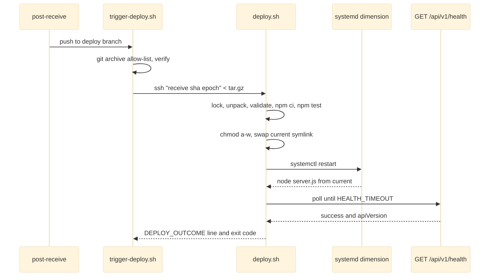

# Deployment Scripts

The deployment module implements the ADR-008 release contract (`docs/DEPLOYMENT.md`) as a two-sided shell pipeline plus host configuration. On the source side, `trigger-deploy.sh` (optionally fired by the bare repository's `post-receive` hook) resolves a ref to one commit, builds an allow-listed `git archive` tarball, verifies it, and streams it over a single SSH session. On the host, `deploy.sh` unpacks it into an immutable `releases/<UTCstamp>-<sha12>` directory, validates contents and the out-of-band config in `/etc/dimension/dimension.env`, installs production dependencies, runs the test suite hermetically, swaps the `current` symlink atomically, restarts the systemd unit, and gates activation on `GET /api/v1/health` reporting the expected `apiVersion` — rolling back to `previous` on failure. Every exit goes through one funnel that records a machine-readable outcome. The remaining files are a hardened systemd unit and two nginx vhosts.

## API Reference

Host side (`scripts/deploy.sh`, invoked as `bash <path>`):

```
bash scripts/deploy.sh deploy <artifact.tar.gz> <commit-sha> [commit-epoch]   # deploy a local artifact (takes the lock)
bash scripts/deploy.sh receive <commit-sha> [commit-epoch] < artifact.tar.gz  # same, artifact on stdin
bash scripts/deploy.sh rollback                                               # swap current back to previous, restart, health-check
bash scripts/deploy.sh status                                                 # active/previous, release list, last-deploy.json (lock-free)
bash scripts/deploy.sh ssh                                                    # forced-command entry; reads $SSH_ORIGINAL_COMMAND,
                                                                              # permits only receive <sha> [epoch], rollback, status
```

Outcome contract:

```
DEPLOY_OUTCOME=<outcome> release=<dir|-> commit=<sha|-> previous=<dir|->     # last stdout line
$APP_ROOT/last-deploy.json  {"outcome","release","commit","previous","at"}    # written on every exit
```

| Exit | Outcome |
|---|---|
| 0 | success |
| 2 | `pre-activation-failed` |
| 3 | `rolled-back` |
| 4 | `rollback-failed` |
| 5 | `superseded` |
| 64 | usage |

Source side:

```
bash scripts/trigger-deploy.sh <ssh-target> [ref]     # package one commit and ship it
bash scripts/trigger-deploy.sh --package-only [ref]   # build and print the artifact path only
scripts/git-hooks/post-receive                        # git config: dimension.deployTarget, dimension.deployBranch, dimension.sshOpts
```

Environment tunables (defaults documented in the script headers):

| Script | Variables |
|---|---|
| `deploy.sh` | `APP_ROOT`, `ENV_FILE`, `SERVICE_NAME`, `SYSTEMCTL`, `KEEP_RELEASES`, `HEALTH_TIMEOUT`, `EXPECT_API_VERSION`, `SKIP_TESTS`, `DEPLOY_ALLOW_OLDER`, `LOCK_WAIT` |
| `trigger-deploy.sh` | `GIT_DIR`, `SSH_OPTS`, `OUT_DIR`, `REMOTE_CMD` |

Host integration points: systemd unit `dimension` (`scripts/systemd/dimension.service`); nginx upstream `dimension_app` -> `127.0.0.1:3000` (`scripts/nginx/dimension.conf`, `scripts/nginx/cloudavid.conf`).

## Beginner

> [!tip] Prerequisites
> Before reading this section, you should be comfortable with:
> - Running commands in a Linux shell and reading simple bash
> - What git commits and SSH are
> - The idea of a background service that a server keeps running

### What Is This?

These scripts move a specific version of the app from the git repository onto the production server and switch the live site over to it safely. Every version gets its own folder that is never edited after it is built. A shortcut called `current` points at the version that is live. Switching versions means pointing that shortcut somewhere else, which is instant. If the new version does not answer its health check, the scripts point the shortcut back at the previous version, so the site keeps working.

### Key Concepts

**Release directory**
A folder like `releases/20261014T050510Z-e2698aedbe42` holding one commit's code and its installed dependencies. It is made read-only before it goes live.

**Symlink**
A file that points to another path. `current` and `previous` are symlinks to release folders; the systemd service always runs `node server.js` from `/opt/dimension/current`.

**`git archive`**
A git command that packs the files of one commit into a tarball. Here it is limited to an allow-list (`server.js package.json package-lock.json .nvmrc .gitignore src public test scripts`), so secrets like `.env` can never be shipped.

**systemd / nginx**
systemd is the Linux service manager that starts and restarts the app. nginx is the web server in front of it, handling HTTPS and forwarding requests to port 3000.

**Health check**
A request to `GET /api/v1/health`; the deploy is only accepted when it answers with `"success":true` and the expected `apiVersion`.

**Exit code**
The number a script returns when it finishes; 0 means success, other numbers name specific failures (see the table above).

### How It Works: Main Flow

What happens when someone pushes to the deployment branch:

1. **Hook fires** — the bare repository's `post-receive` calls `trigger-deploy.sh` for the configured branch.
2. **Package** — one commit is archived with the allow-list and checked for forbidden paths and required files.
3. **Ship** — the tarball is streamed over SSH; the server's deploy key may only run `deploy.sh ssh`, which accepts just `receive`, `rollback` or `status`.
4. **Lock** — `deploy.sh` takes a file lock so only one deployment runs at a time.
5. **Build and check** — unpack into a new release folder, verify contents, check `STORAGE_ROOT` and `AFM_DATA_DIR`, run `npm ci --omit=dev`, then run `npm test` with production variables removed.
6. **Activate** — make the folder read-only, swap `current`, restart the service.
7. **Verify** — poll the health endpoint; on success update `previous` and delete old releases, on failure swap back and restart.
8. **Report** — write `last-deploy.json`, append `deployments.log`, print the `DEPLOY_OUTCOME=` line, and exit with its code.

> [!example] Example
> ```bash
> # From a workstation or CI: ship the tip of main to the host
> bash scripts/trigger-deploy.sh deploy@files.example.com main
>
> # Only build the artifact (no SSH) and print its path
> bash scripts/trigger-deploy.sh --package-only main
>
> # On the host: what is live, and how did the last deploy end?
> bash /opt/dimension/current/scripts/deploy.sh status
>
> # On the host: go back to the previous release
> bash /opt/dimension/current/scripts/deploy.sh rollback
> ```

## Intermediate

### Design Rationale

ADR-008 makes deployment a contract: releases are immutable directories built from one commit, production config lives only in `/etc/dimension/dimension.env`, and stores live only under `AFM_DATA_DIR`, never inside a release. The scripts encode each clause as a gate:

- **Defence in depth on contents** — allow-list `git archive` plus a forbidden-path regex on the source side, then `REQUIRED_PATHS` / `FORBIDDEN_PATHS` again on the host, so a compromised or misconfigured sender still cannot ship `.env` or `data/*.json`.
- **Config without execution** — `env_value` reads one key from the systemd `EnvironmentFile` with a regex (stripping CR, `export` and quotes) instead of `source`-ing it.
- **The suite runs inside the release** with `STORAGE_ROOT`, `AFM_DATA_DIR`, `NODE_ENV`, `PORT` and `UPLOAD_MAX_BYTES` unset, which is why AGENTS.md requires the test suite to be hermetic and production-dependency-only.
- **`apiVersion` is the activation gate** (`EXPECT_API_VERSION`); the API's version and this check must change together (ADR-007/ADR-008).
- **Least privilege over SSH** — the deploy key is bound to a forced command, and `cmd_ssh` validates arity and hex/numeric arguments before dispatching.

### Patterns Used

**Single exit funnel** — every path ends in `finish outcome code`; an `ERR` trap (`on_error`) maps unexpected failures to `pre-activation-failed` or `rollback-failed` based on the `ACTIVATED` flag, and an `EXIT` trap (`cleanup_unactivated`) deletes a half-built release until activation clears it.

**Atomic pointer swap** — `atomic_link` creates `link.tmp.$$` with `ln -sfn` and renames it over the real link with `mv -Tf`, so `current`/`previous` are never absent. The same temp-then-rename idea as [[Atomic Replace Writes]].

**Mutual exclusion via flock** — `take_lock` opens fd 9 on `$APP_ROOT/.deploy.lock` and waits up to `LOCK_WAIT` (default 1800 s); `status` stays lock-free. See [[Concurrency and Consistency]].

**Stale-commit guard** — the commit epoch is written to `.release-epoch`; an older epoch than the active release yields `superseded` (exit 5) unless `DEPLOY_ALLOW_OLDER=1`.

**Timeout ordering contract** — app shutdown grace 30 s < systemd `TimeoutStopSec=45s` < nginx `proxy_read_timeout 600s`; nginx `client_max_body_size 6g` sits above the 5 GiB `UPLOAD_MAX_BYTES` default, with request/response buffering off for streaming. See [[Bounded Work Budgets]].

### Module Interactions



Contract with [[Server Bootstrap and Config]]: `server.js` is the `ExecStart` target and a required release path; the scripts rely on its env contract (`STORAGE_ROOT`, `AFM_DATA_DIR`, `PORT`, `NODE_ENV`, `UPLOAD_MAX_BYTES`) and its 30 s shutdown grace. Contract with the [[HTTP API Layer]]: the health endpoint and `src/routes/api.js` (a required path). Presence checks also cover `src/services`, `src/controllers`, `src/middlewares`, `src/utils`, `public/*.html`, `public/assets/js/api.js` and `public/assets/css`; `data/metadata.json` / `data/settings.json` must be absent from a release and present in `AFM_DATA_DIR` once any release has run.

### Trade-offs

- **Synchronous push-time deploys.** The hook ships and deploys before returning, so the pusher waits for the lock, `npm ci`, the full suite and the health wait. Acceptable for one pusher, as documented.
- **Health check is read-only.** It proves the process boots and speaks the right API version, not that it can write to its storage paths (see the systemd write allow-list limitation below).
- **Shell over a deploy tool.** No extra infrastructure, at the cost of trap-ordering subtleties that a test cannot easily cover. Rationale beyond ADR-008 not documented.
- **Deliberate word-splitting** of `SYSTEMCTL` and `SSH_OPTS` (shellcheck SC2086 disabled inline) allows `sudo -n systemctl` and multi-flag SSH options, but inherits globbing and space-in-path hazards.

## Advanced

### Concurrency & State

- Deployments are serialized by `flock` on fd 9; a waiter blocks up to `LOCK_WAIT`. `status` reads without the lock and can observe a deployment mid-flight.
- Host state is the triple (`current`, `previous`, `releases/*`) plus `last-deploy.json` and `deployments.log`. Pointer changes are individually atomic (rename(2)), but the pair (`current`, `previous`) is updated in two steps, so a crash between them leaves `previous` stale.
- The `ACTIVATED` flag is the only thing that decides whether an unexpected error is classified as pre- or post-activation; the `EXIT` cleanup trap is cleared at the symlink swap.

### Performance Characteristics

- Wall time is dominated by `npm ci --omit=dev` and the full test suite (run per deploy unless `SKIP_TESTS=1`), plus up to `HEALTH_TIMEOUT` of polling.
- The artifact is streamed over one SSH session without an intermediate copy on the sender; `receive` buffers stdin to a temp file on the host.
- Retention keeps the newest `KEEP_RELEASES` by reverse-sorted name, always keeping active and previous; prune failures never fail the deploy. Test logs live in `$APP_ROOT/logs/`, outside `releases/`, so pruning ignores them.

### Failure Modes

| Stage | Trigger | Outcome / exit |
|---|---|---|
| Arguments | bad subcommand or arity | usage, 64 |
| Pre-activation | missing/forbidden paths, bad env file, `STORAGE_ROOT`/`AFM_DATA_DIR` not existing absolute dirs outside `APP_ROOT`, empty data dir after a prior release, `npm ci` or `npm test` failure, lock timeout | `pre-activation-failed`, 2 |
| Supersession | commit epoch older than active release | `superseded`, 5 |
| Post-activation | new release fails the health check, previous restored and healthy | `rolled-back`, 3 |
| Post-activation | restore also fails | `rollback-failed`, 4 |
| Manual rollback | target unhealthy | `rollback-failed`, 4 (service left on the unhealthy target) |

> [!danger] Critical Failure Mode
> In ship mode `trigger-deploy.sh` honours a caller-exported `OUT_DIR` and then runs `rm -rf -- "$out_dir"` unconditionally. With `OUT_DIR=.` or `OUT_DIR=~/builds` set in the shell, a normal deploy recursively deletes that directory and everything in it.

### Invariants & Constraints

- Releases are immutable after activation (`chmod -R a-w`; pruning re-adds `u+w` before `rm -rf`).
- `STORAGE_ROOT` and `AFM_DATA_DIR` must live outside `APP_ROOT`, so pruning can never delete data.
- `EXPECT_API_VERSION` and the API's `apiVersion` must change together.
- Shutdown grace 30 s < `TimeoutStopSec` 45 s < nginx 600 s; reorder these and in-flight uploads are cut off.
- Scripts are invoked as `bash <path>` and must stay LF (`.gitattributes`).
- The test suite must remain hermetic: no local `.env`, no dev packages.
- `post-receive` always exits 0, so a failed deploy never rejects a push.

### Code Review Notes

> [!warning] `rm -rf` of a caller-supplied `OUT_DIR` in ship mode
> **File:** `scripts/trigger-deploy.sh:46-48, 79` | **Severity:** medium
>
> `OUT_DIR` is documented for `--package-only` but honoured in ship mode, and the whole directory is then deleted. Only remove a directory the script created itself. See [[Code Review]].
>
> **Current approach:**
> ```bash
> out_dir="${OUT_DIR:-$(mktemp -d "${TMPDIR:-/tmp}/dimension-pkg.XXXXXX")}"
> ...
> rm -rf -- "$out_dir"
> ```
>
> **Better approach:**
> ```bash
> if [[ -n "${OUT_DIR:-}" ]]; then out_dir="$OUT_DIR"; own_dir=0
> else out_dir="$(mktemp -d "${TMPDIR:-/tmp}/dimension-pkg.XXXXXX")"; own_dir=1; fi
> ...
> if (( own_dir )); then rm -rf -- "$out_dir"; else rm -f -- "$artifact"; fi
> ```
> Ownership decides the cleanup scope: a caller's directory only loses the artifact the script wrote into it. Registering this cleanup in an `EXIT` trap also fixes the temp-dir leak on early `die` paths.

> [!warning] Manual rollback does not restore on failure and misreports its outcome
> **File:** `scripts/deploy.sh:166-182, 330-335` | **Severity:** medium
>
> If the rollback target is unhealthy, the service stays on it even when the replaced release was healthy; `ACTIVATED` is never set, so an unexpected error after the first `atomic_link` reports `pre-activation-failed`; and success exits 0 with `rolled-back`, which the header documents as exit 3. See [[Code Review]].
>
> **Current approach:**
> ```bash
> atomic_link "$CURRENT" "$previous"
> [[ -n "$active" ]] && atomic_link "$PREVIOUS" "$active"
> if restart_service && health_ok; then
>     finish "rolled-back" 0
> fi
> fail "The rolled-back release is not healthy either."
> finish "rollback-failed" 4
> ```
>
> **Better approach:**
> ```bash
> atomic_link "$CURRENT" "$previous"; ACTIVATED=1
> [[ -n "$active" ]] && atomic_link "$PREVIOUS" "$active"
> if restart_service && health_ok; then finish "rolled-back" 0; fi
> if [[ -n "$active" ]]; then
>     atomic_link "$CURRENT" "$active"; atomic_link "$PREVIOUS" "$previous"
>     restart_service && health_ok && { fail "target unhealthy; original release restored"; finish "rollback-failed" 4; }
> fi
> ```
> A failed manual rollback now leaves the system where it started, and errors after the pointer move are classified correctly. Document exit 0 / `rolled-back` as the manual-rollback success code.

> [!warning] systemd write allow-list is hard-coded, independent of the validated config
> **File:** `scripts/systemd/dimension.service:52-54`, `scripts/deploy.sh:229-235` | **Severity:** medium
>
> `ProtectSystem=strict` with `ReadWritePaths=/var/lib/dimension /srv/dimension/storage` makes every other path read-only, but `deploy.sh` accepts any existing absolute `STORAGE_ROOT`/`AFM_DATA_DIR`, and the health check performs no write. A host configured with other paths activates "healthy" and then fails every upload and metadata write. Check both paths against `systemctl show -p ReadWritePaths "$SERVICE_NAME"`, or document the paths as fixed and refuse others. See [[Limitations]].

> [!warning] Epoch is unvalidated on the `deploy`/`receive` paths
> **File:** `scripts/deploy.sh:185, 199-202, 263, 294-301` | **Severity:** low
>
> Only `cmd_ssh` checks the epoch is numeric; a junk value is written to `.release-epoch` and silently disables the stale-commit guard while that release is active. See [[Code Review]].
>
> **Better approach:**
> ```bash
> [[ -z "$epoch" || "$epoch" =~ ^[0-9]+$ ]] || { fail "commit-epoch must be numeric (got '$epoch')"; finish "pre-activation-failed" 2; }
> ```
> Validating at the shared entry point protects every caller, not just the SSH one.

> [!warning] Containment check is lexical, not canonical
> **File:** `scripts/deploy.sh:234-235` | **Severity:** low
>
> A `..` segment or a symlink into `$APP_ROOT/releases` passes the "must live outside APP_ROOT" rule, and the store could then be pruned with a release. See [[Code Review]].
>
> **Current approach:**
> ```bash
> case "$data_dir/" in "$APP_ROOT"/*) fail "AFM_DATA_DIR must live outside $APP_ROOT (releases are pruned)"; finish "pre-activation-failed" 2;; esac
> ```
>
> **Better approach:**
> ```bash
> real="$(realpath -e -- "$data_dir")"
> case "$real/" in "$(realpath -e -- "$APP_ROOT")"/*) fail "..."; finish "pre-activation-failed" 2;; esac
> ```
> Comparing canonical paths is the same lesson as the app's own path containment: resolve first, then compare.

> [!warning] start-limit directive in the wrong section
> **File:** `scripts/systemd/dimension.service:32-33` | **Severity:** low
>
> `StartLimitIntervalSec=` is a `[Unit]` setting; in `[Service]` it is ignored with an "Unknown key" warning and the default 10 s interval applies. See [[Code Review]].
>
> **Current approach:**
> ```ini
> [Service]
> StartLimitIntervalSec=300
> StartLimitBurst=10
> ```
>
> **Better approach:**
> ```ini
> [Unit]
> StartLimitIntervalSec=300
> StartLimitBurst=10
> ```

> [!note] Further items
> - Failed releases occupy retention slots and can push older known-good releases out on the next prune — remove the failed release after a successful restore (low, [[Code Review]]).
> - The header says exit 5 means "equal-or-newer commit active" but the guard is `(( epoch < active_epoch ))` — align comment or comparison (low, [[Code Review]]).
> - Unquoted `${SSH_OPTS}` is glob-expanded and breaks key paths with spaces — use `read -r -a ssh_opts <<< "${SSH_OPTS:-}"` and `"${ssh_opts[@]}"`, or an `~/.ssh/config` alias (low, [[Code Review]]).
> - A lock timeout runs `finish` without the lock and overwrites `last-deploy.json` for a deploy still in progress — print the outcome and exit without touching shared records (low, [[Code Review]]).
> - Deploys run synchronously inside the push; detach the trigger if pushes become frequent (low, [[Limitations]]).
