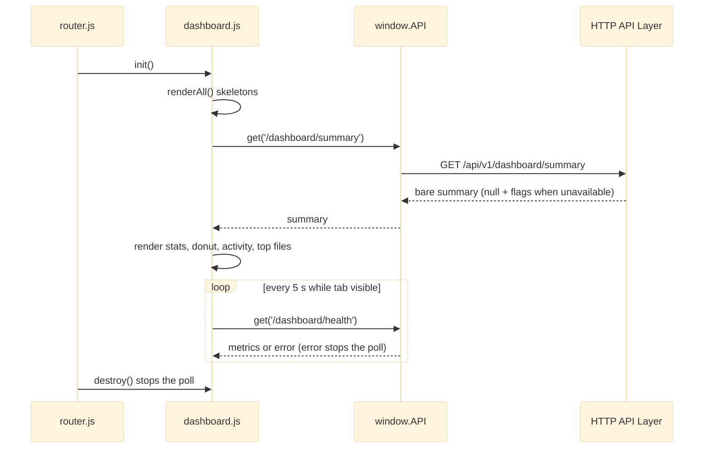

# Feature Pages

Feature Pages groups the five SPA pages other than Files: Dashboard (`index.html` + `dashboard.js`), Uploads (`uploads.html` + `uploads.js`), Settings (`settings.html` + `settings.js`), Admin (`admin.html` + `admin.js`) and Login (`login.html` + `login.js`), each with its own stylesheet. Every routed shell loads `theme.js` in `<head>`, declares `<meta name="afm-api-base" content="/api/v1">`, links the shared CSS stack and sets `<body data-page="…">`; each page module is an IIFE that runs `init()` only when `data-page` matches, and is re-initialised and destroyed by the router from [[Frontend Core]]. The heaviest file is `uploads.js`, a client-side upload scheduler with concurrent XHR transfers; `dashboard.js` renders the summary and polls health; `settings.js` is a table-driven form over the settings store; `admin.js` manages users and file policies from [[Auth and Access Control]]; `login.js` is a standalone sign-in form. Roughly 8,600 lines in all.

## API Reference

```js
window.Dashboard = { init(): Promise<void>, destroy(): void,
  resolvePanelState, resolveHealthPanelState, resolveVolumeLine(storage, resolver?),
  formatGb, toProportion, formatMetric, formatTimestamp, formatStatValue, splitClientPath }
```
Dashboard lifecycle plus pure formatting/state helpers exported for tests.

```js
window.Uploads = { init(), destroy(), presets, DEFAULT_PRESET, DEFAULT_OPTIONS, FAILURE_LABELS,
  pure: { computeProgressPct, computeRemainingSeconds, formatRemaining, scaleTransferred,
          computeQueueCounts, computeQueueTiles, computeGlobalProgress, failureKind, describeFailure,
          normalizeDestination, describeVerdict, flattenTree, selectRecentUploads, buildAnnouncement,
          createDragState, presetTags, renderItemHTML, uploadingMeta },
  _controller: { getState, addFiles, fillActive, startUploads, ... } }
```
`pure` and `_controller` are test seams. `destroy()` keeps the queue and in-flight transfers alive; it only removes window drag/drop listeners.

```js
window.Settings = { init(), destroy(), beforeLeave(): Promise<boolean> }
```
`beforeLeave` is consulted by the router before a client-side navigation (unsaved-edits confirm).

```js
window.Admin = { init(), destroy(), _internal: { renderUsersTable, renderPoliciesTable } }
```

`login.js` exports nothing (closed IIFE). The router reads `body[data-page]` values `dashboard`, `uploads`, `settings`, `admin`, `login`.

**HTTP endpoints called** (relative to `API.BASE_URL`):

```
GET  /dashboard/summary          (dashboard, uploads recent list)
GET  /dashboard/health           (dashboard poll)
POST /fs/folder                  (dashboard quick action, uploads create-destination)
GET  /fs/list?path=&limit=1      (uploads destination probe)
GET  /fs/tree                    (uploads folder picker)
POST /fs/upload  (API.upload)    (uploads)
GET  /settings, PUT /settings    (settings)
GET/POST /admin/users; POST /admin/users/:id/status|reset-password|revoke-sessions; DELETE /admin/users/:id
GET /admin/files/policies; PUT/DELETE /admin/files/policy; GET/POST/DELETE /admin/files/permissions
POST /auth/login                 (login)
```

## Beginner

> [!tip] Prerequisites
> Before reading this section, you should be comfortable with:
> - Basic JavaScript (`async`/`await`, timers like `setInterval`)
> - HTML forms and what "submitting" a form means
> - What [[Frontend Core]] provides (`window.API`, `window.AFM`, the router)

### What Is This?

These are the remaining screens of Dimension, each a self-contained piece:

- **Dashboard** — the home page: how much storage is used, recent activity, most-downloaded files, and a live server-health panel that refreshes every 5 seconds.
- **Uploads** — a dedicated upload queue: drop many files, pick a destination folder, and watch each one upload with progress, pause, resume, retry and cancel.
- **Settings** — a form for the workspace name, default upload folder and default file view, saved on the server. The theme is the one preference kept only in your browser.
- **Admin** — manage users (create, disable, reset password, sign out everywhere) and per-folder access policies.
- **Login** — the sign-in form shown before anything else.

### Key Concepts

**Page module**
One JavaScript object per page (`window.Dashboard`, `window.Uploads`, …) with an `init()` that sets the page up and a `destroy()` that cleans it up. The router calls them when you switch pages.

**Polling**
Asking the server the same question on a timer. The Dashboard asks `/dashboard/health` every 5 seconds, skipping while the browser tab is hidden.

**Upload queue**
A list of files waiting to be sent. Only a few upload at the same time (the "concurrency" setting); the rest wait their turn.

**Dirty tracking**
Remembering whether a form has unsaved changes, so the page can show a save bar and warn you before you leave.

**Open redirect**
A login page that sends you "back where you came from" via `?redirect=`. If it accepts any address, an attacker can craft a link that sends you to their site right after you log in. The login page tries to allow only same-site paths.

### How It Works: Main Flow

Taking the Uploads page as the richest example:

1. **Add files** — you drop files or pick them; `addFiles` puts each in the queue as `queued`.
2. **Check destination** — `verifyDestination` asks the server whether the target folder exists (`GET /fs/list?path=…&limit=1`). The answer is cached per folder, so a hundred files cause one check.
3. **Start transfers** — `fillActive()` starts uploads until `concurrency` are running; each `processUpload` sends the file with `destination` and `overwrite` placed before the file itself.
4. **Track progress** — a 1-second ticker recomputes speed, progress and an estimated time remaining. Before a speed is measured, remaining time shows `—`, not `0`.
5. **Finish** — items move to `done` or `failed`; the next queued item starts, and outcome toasts are batched.

> [!example] Example
> ```js
> // Settings hydrate/extract are table-driven, so the PUT body is always the full document:
> const doc = await window.API.get('/settings');   // fill the form from the store
> // ...user edits; dirty tracking shows the save bar...
> await window.API.put('/settings', extract());     // send the complete document back
> ```

## Intermediate

### Design Rationale

- **One module per page, one shell per page.** Pages stay independently loadable and testable; the router only needs the `init` / `destroy` / `beforeLeave` contract (ADR-005 covers the router).
- **Unavailable is not zero.** Dashboard uses `UNAVAILABLE_MARK = '—'` and `AFM.resolveStorageDisplay`; Uploads uses `Format.duration(null)` as its unavailable marker. No trend or sparkline is shown because no time-series source exists (see [[Truthful Reporting and Unavailability]]).
- **Bounded polling.** The health poll halts permanently on its first failure; the refresh button or the "health" quick action restarts it. That avoids hammering a failing server.
- **Failure kind from data.** Uploads classify failures from `err.status` and the server `kind`, never from message text.
- **Full-document settings PUT.** One field table (`TEXT_FIELDS` / `SEGMENTED_FIELDS`) drives hydrate, extract and dirty detection, so the payload always matches the validated full-replace contract of the settings store in [[Metadata and Settings Stores]] (ADR-006). A tri-state `serverBacked` flag blocks saves until the store has answered.
- **Login is deliberately standalone.** No sidebar, no router, no `layout.css`; it only posts `/auth/login` with `skipAuthRedirect`, hands the CSRF token to `API.setCsrfToken`, and follows a sanitised `?redirect=` (see [[Authentication and CSRF]]).

### Patterns Used

**[[Re-entrant Page Lifecycle]]** — `init()` resets state; window/document listeners are tracked (`listen()` + `globalListeners` in Settings/Admin, a stored `onQuickClick` in Dashboard, named drag handlers in Uploads) and removed in `destroy()`.

**[[Explicit Unavailability]]** — unmeasured figures render as `—` and remaining time is labelled an estimate.

**Revealing-module IIFE** — `const X = (() => { …; return {…}; })(); window.X = X;`, destructuring helpers from `window.AFM` at load time.

**Attempt versioning** — each upload item carries an `attempt` counter; progress and completion callbacks from a superseded attempt (after a retry or cancel) are discarded.

**Promise dedupe cache** — the per-destination verdict cache reuses an in-flight check, so concurrent items share one probe.

**Allow-list before markup** — activity types map through `ACTIVITY_TYPE_CLASSES`, icons through `ICON_ALIASES` / `resolveIconName`, colours through `safeColor`; all dynamic text goes through `escapeHtml`.

### Module Interactions



Uploads, Settings and Admin follow the same shape: `init()` reads through `window.API`, renders into fixed DOM ids, and event handlers mutate through the same client. A 403 on `/admin/users` renders a "not an administrator" notice instead of a table.

### Trade-offs

- Client-side scheduling in `uploads.js` gives pause/resume/retry and per-item progress without server support, at the cost of a lot of shared mutable state mutated from many async continuations.
- `destroy()` on Uploads deliberately keeps transfers alive across page swaps; the user can leave and come back, but the module must stay consistent while unmounted.
- `index.html` does not load `notifications.js`, unlike the other three routed pages; rationale not documented.
- `admin.html` reuses `settings.css` for its pane layout instead of its own; rationale not documented.

## Advanced

### Concurrency & State

- **Uploads.** `state.activeCount` vs `state.concurrency` gates `fillActive()`. Items move through `queued / held / uploading / paused / done / failed`; `held` items wait on a destination verdict and are released when it arrives. After a destination-type failure the destination is re-verified (`recheckAfterFailure`). `checkDestination` never rejects, which keeps `state` consistent across continuations. A forced re-check that finds a check already in flight returns the stale in-flight promise.
- **Dashboard.** `init()` returns `loadSummary().then(ok => ok && startHealthPolling())`. If `destroy()` runs before the summary resolves, the late `.then` still starts the interval on a page that is gone.
- **Settings.** Unsaved edits are guarded by both `beforeunload` and the router's `beforeLeave()`.

### Performance Characteristics

- The Uploads ticker runs every 1 s; progress is patched into existing rows rather than re-rendering the queue. Outcome toasts are batched through a 1.2 s timer, and announcements go to an `aria-live` region.
- Destination probing costs one `GET /fs/list?limit=1` per distinct path, deduplicated in flight.
- The Dashboard health poll costs one request per 5 s while visible; `/dashboard/summary` is a server-side tree walk, so it is read once per page entry.

### Failure Modes

- **Summary failure** renders an error panel; a corrupt metadata store answers 500, not a degraded 200.
- **Health failure** stops polling until the user restarts it.
- **Upload failure** is classified (`failureKind` / `describeFailure`) from status and `kind`; retry starts a new attempt.
- **Settings save** is blocked until `GET /settings` has answered; a failed read leaves the form unsaveable rather than overwriting the store with defaults.
- **Admin 403** shows an explicit notice.

> [!danger] Critical Failure Mode
> The login open-redirect guard can be bypassed with a backslash (`?redirect=/\evil.example`) or a stripped tab/newline (`?redirect=/%09/evil.example`), sending a freshly authenticated administrator to an attacker-controlled site. See the first Code Review Note below.

### Invariants & Constraints

- Every routed shell loads scripts in the order `api.js` → `app.js` → `sidebar.js` → `router.js` → (`notifications.js`) → page module, and sets a matching `body[data-page]`.
- Multipart order for uploads: `destination` and `overwrite` before `file`; `overwrite` other than `"true"` yields 409.
- Every dynamic interpolation, including the in-place progress patch, goes through `escapeHtml`; every icon-only control has an `aria-label` that changes with its meaning (Pause → Resume).
- Settings persists exactly `general.workspaceName`, `general.defaultUploadFolder` and `appearance.defaultView`; `general.defaultUploadFolder` is stored but not read by any page.

### Code Review Notes

> [!warning] Login open-redirect guard bypassable with a backslash or stripped control character
> **File:** `public/assets/js/login.js:18-24` | **Severity:** medium
>
> Browsers treat `\` as `/` in http(s) URLs and strip tabs/newlines, so `/\evil.example` passes the prefix checks and resolves off-site. See [[Code Review]].
>
> **Current approach:**
> ```js
> if (!raw.startsWith('/') || raw.startsWith('//') || raw.includes('://')) return 'index.html';
> return raw;
> ```
>
> **Better approach:**
> ```js
> let url;
> try { url = new URL(raw, window.location.origin); } catch { return 'index.html'; }
> if (!raw.startsWith('/') || url.origin !== window.location.origin) return 'index.html';
> return url.pathname + url.search + url.hash;
> ```
> Validate URLs the way the browser will parse them, not by string prefixes.

> [!warning] Dashboard health poll can start after the page has been destroyed
> **File:** `public/assets/js/dashboard.js:1073-1093` | **Severity:** medium
>
> If the router leaves before the summary resolves, `destroy()` finds no timer, then the late `.then` starts one. `renderHealth()` returns early without `#serverHealth`, so the self-stopping guard never trips and `GET /dashboard/health` fires every 5 s on other pages until reload. See [[Code Review]].
>
> **Current approach:**
> ```js
> return loadSummary().then(ok => {
>   if (ok) startHealthPolling();
> });
> ```
>
> **Better approach:**
> ```js
> let alive = false;
> function init() { alive = true; ...; return loadSummary().then(ok => { if (ok && alive) startHealthPolling(); }); }
> function destroy() { alive = false; stopHealthPolling(); ... }
> ```
> Put the same guard inside `startHealthPolling()` so the refresh and quick-action paths are covered too. Any async continuation that outlives `destroy()` must check liveness.

> [!warning] `verifyDestination({ force: true })` returns a stale in-flight check
> **File:** `public/assets/js/uploads.js:598-609` | **Severity:** low
>
> A forced re-check (after `createFolder` or a failed upload) reuses a probe that started before the change, so a just-created folder can be cached as `missing`. See [[Code Review]].
>
> **Current approach:**
> ```js
> if (known && known.status === 'checking') return known.promise;
> if (known && !force) return Promise.resolve(known);
> ```
>
> **Better approach:**
> ```js
> if (known && known.status === 'checking')
>   return force ? known.promise.then(() => verifyDestination(path, { force: true })) : known.promise;
> if (known && !force) return Promise.resolve(known);
> ```
> Deduplication must not swallow a request whose whole point is to observe newer state; a generation counter is the alternative.

> [!warning] Settings header claims a consumer that does not exist
> **File:** `public/assets/js/settings.js:5-10` | **Severity:** low
>
> The header says `general.defaultUploadFolder` feeds the Uploads destination, but `uploads.js` never reads settings. See [[Code Review]].
>
> **Better approach:** reword to "validated and stored; not yet read by any page", or wire `uploads.js` `initDestination()` to seed `state.destination` from `GET /settings`.
