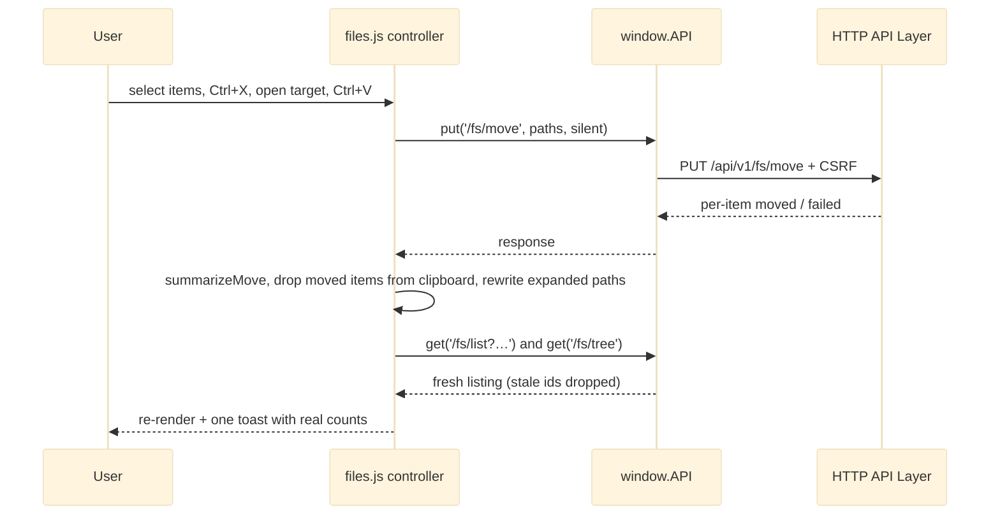

# Files Page

The Files Page is the SPA page for browsing, searching, uploading and changing files under the storage root. It is one static shell (`public/files.html`, `<body data-page="files">`), one stylesheet (`files.css`) and one large IIFE module, `public/assets/js/files.js` (about 2,900 lines), exposed as `window.Files`. Inside, it is organised into bands: constants, pure helpers and HTML-string renderers, request-id-guarded data loaders, a single navigation owner, a delegated controller that funnels every action through `handleAction`, mutations (folder, rename, delete, cut/copy/paste, star, access policy, uploads) and UI chrome (details drawer, bulk bar, upload tray, drop overlay, resizers). It talks to the server only through `window.API` from [[Frontend Core]], against the `/fs/*` and `/settings` endpoints of the [[HTTP API Layer]] and the file-policy endpoints of [[Auth and Access Control]].

## API Reference

```js
window.Files.init(): void
```
Builds state from `AFM.Store` (view, perPage, column widths, tree width), binds events, renders, and starts the tree, list, preview-capability and settings loads.

```js
window.Files.destroy(): void
```
Removes page-scoped listeners, the search timer, resize drags and injected `<style>` sheets on a router page swap. Uploads in flight continue.

```js
window.Files.pure: { TREE_DEPTH, STAGGER_STEPS, PAGE_SIZES, LIBRARY_VIEWS, TYPE_CHIPS, COLUMNS, createState,
  joinPath, parentPath, isSameOrInside, ancestorsOf, rewriteAfterMutation, typeOf, typeLabel, pageCount,
  clampPage, footerRange, buildPageNumbers, pruneSelection, emptyKind, staggerIndex, applyNavigation,
  initExpansion, treeContains, visibleTreePaths, nodeIsExpandable, listQuery, resolveLibraryView,
  summarizeDelete, deleteConfirmCopy, render*Html..., sanitizeColumnWidths, clampColumnWidth,
  columnWidth, columnWidthsCss }
```
Pure helpers and renderers exposed for the frontend test suite.

```js
window.Files._controller: { getState, setPreviewCapability, loadTree, loadFiles, navigateTo, handleAction,
  openDrawer, closeDrawer, onEscape, onPasteShortcut, ..., pasteItems, setAccessPolicy }
```
Test seam that drives the real handlers against a stub DOM. Not used by other runtime modules.

**HTTP endpoints consumed** (via `window.API`, base `/api/v1`):

| Endpoint | Used for |
|---|---|
| `GET /fs/tree[?path=]` | folder tree (depth 2, lazy children) |
| `GET /fs/list?…` | paginated, sorted, filtered listing |
| `GET /fs/thumbnail/capability` | whether previews exist |
| `GET /settings` (silent) | `appearance.defaultView` |
| `POST /fs/folder`, `PUT /fs/rename`, `DELETE /fs/delete` | create, rename, delete |
| `PUT /fs/move`, `POST /fs/copy` | cut-paste, copy-paste |
| `POST /fs/star` | star / unstar |
| `POST /fs/upload` | XHR upload, `destination`/`overwrite` before `file` |
| `GET` / `PUT /admin/files/policy` | bulk "Set access policy" |

Downloads go through `API.downloadFile`, `API.downloadMultipleFiles` and `API.downloadZip`; previews through `API.thumbnailUrl`.

## Beginner

> [!tip] Prerequisites
> Before reading this section, you should be comfortable with:
> - Basic JavaScript (functions, objects, arrays, `async`/`await`)
> - How a file explorer works (folders, paths, selecting items)
> - What [[Frontend Core]] provides (`window.API`, `window.AFM`)

### What Is This?

This is the "file explorer" of Dimension. On the left is a folder tree; in the middle a table or grid of files in the current folder; above it a toolbar with search, filters and buttons. You can open folders, select files, download them (one at a time or as a ZIP), rename, delete, cut/copy and paste, star favourites, upload by picking or dragging files and whole folders, and inspect a file in a side drawer.

The page never touches the disk itself. Every action becomes a request to the server, and the page then redraws from the server's answer.

### Key Concepts

**Client path**
A path like `/media/clip.mp4`, always starting at `/`, which means "the top of the storage folder". The server translates it to a real disk path; the browser never sees that real path. See [[Path Containment and Client Paths]].

**State object**
One JavaScript object (`state`) that holds everything the page currently knows: which folder is open, the visible files, which items are selected, sort order, page number and so on. The page draws itself from this object.

**Render by string**
Each area (tree, list, breadcrumb, footer) is drawn by a function that takes state and returns an HTML string, which is placed with `innerHTML`. Every file name is passed through `escapeHtml` first, so a name containing `<` cannot turn into real HTML.

**Event delegation**
Instead of attaching a click handler to every row, the page attaches one handler to the container and works out which row was clicked. That way redrawing rows never loses handlers.

### How It Works: Main Flow

What happens when you open a folder:

1. **Click** — you click a folder in the tree, breadcrumb or list. The delegated handler calls `handleAction('open', …)`.
2. **Navigate** — `navigateTo(path)` updates `state.currentPath`, clears the selection, resets to page 1 and shows a skeleton.
3. **Load** — `loadFiles()` calls `GET /fs/list` with the current sort, search, type filter and page. Each call takes a new request number; an older answer arriving late is thrown away.
4. **Render** — the list (or grid), breadcrumb, filter chips and footer are redrawn from the new state.
5. **Act** — selecting items shows the bulk bar; actions such as delete ask for confirmation, call the server, and then report exactly what succeeded and what failed.

> [!example] Example
> ```js
> // Everything goes through one switch; the test seam shows the shape:
> Files._controller.navigateTo('/media');            // open a folder
> Files._controller.handleAction('download', id);    // hidden-iframe download of one file
> Files._controller.handleAction('delete', id);      // confirm, DELETE /fs/delete, report results
> ```

## Intermediate

### Design Rationale

- **One closure, one state object.** Everything the page knows lives in `createState()` plus a few module variables (`uploads`, `previewCapability`, `globalListeners`, `searchTimer`, request ids). That keeps the pure renderers trivially testable (`Files.pure`) while the controller owns all mutation.
- **Single navigation owner.** Only `navigateTo(path)` and `syncAfterMutation` write `currentPath`, which makes the path the one source of truth after renames and moves (`rewriteAfterMutation` rewrites paths inside a moved or renamed folder).
- **Partial success is reported honestly.** Delete, move, copy and star responses are summarised (`summarizeDelete`, `summarizeMove`, `summarizeCopy`, `Promise.allSettled`), so toasts say what actually happened. Cut-paste drops only the items that moved from the clipboard; copy keeps it. This follows [[Truthful Reporting and Unavailability]].
- **Server is the gate.** The access-policy action is shown to everyone and relies on a server 403 instead of a client role check, since the client cannot be trusted with authorization anyway.
- **Browser-local layout preferences.** `files-view`, `files-per-page`, `files-col-widths`, `tree-panel-width` live in `AFM.Store`; the server `appearance.defaultView` applies only when no local choice exists (ADR-006 covers the settings store).

### Patterns Used

**[[Re-entrant Page Lifecycle]]** — `init()` can run many times per document under the router. Handlers are bound once in `bindEvents()` through `bind` / `listenGlobal`, which record them so `destroy()` can remove every one.

**Stale-response guard** — `++listRequestId` / `++treeRequestId` are checked after every await. `loadFiles` re-issues itself when the page index falls past the new total.

**Render-by-string with delegation** — containers are re-rendered with `innerHTML` and never re-bound. One delegated listener per stable container (`onContainerClick/Keydown/Change/DblClick/ContextMenu/FocusIn`, `onTreeClick/Keydown/ContextMenu`, `onBreadcrumbClick`, `onChipClick`, `onSearchInput`).

**WAI-ARIA roving tabindex** — the list/grid is an ARIA grid and the tree a `role="tree"` with arrow-key navigation; status changes are announced through an `aria-live` region.

**Silent API calls** — `{ silent: true }` replaces the generic network toast with a page-specific one.

### Module Interactions



Uploads follow a different path: dropped folders are walked with `webkitGetAsEntry` readers, each folder is recreated with `POST /fs/folder`, then files go one by one through `API.upload('/fs/upload', …)` with `destination` and `overwrite` appended before `file` (multer resolves the destination on the first file chunk).

### Trade-offs

- Rendering whole containers by `innerHTML` is simple and fast enough for paged lists, but means focus and scroll must be restored by hand after every render.
- Column widths and tree-panel width are applied through injected `<style>` sheets (`widthSheet`, `treeWidthSheet`) rather than inline styles. The column-hiding breakpoints are duplicated in JS (`COLUMN_BREAKPOINTS`) and CSS media queries.
- Keeping everything in one 2,900-line file avoids load-order coupling with Frontend Core, at the cost of a very large closure. Rationale for not splitting it is not documented.

## Advanced

### Concurrency & State

- Many async continuations (tree loads, list loads, lazy child loads, the capability probe, the settings read, uploads, drag-drop walks, keyboard handlers) mutate the same `state`. Correctness rests on the request-id guards; any new loader must take and check its own id.
- `uploads` is module-level and survives `destroy()` by design, so transfers keep running across router swaps. The tray DOM does not survive, and `init()` does not re-render it.
- `runUploads` runs its own `for … await` loop per call. Two drops in quick succession run two loops in parallel, despite the "one at a time" intent.
- `pasteItems` reconciles partial move results against the clipboard, the current path and the expanded-tree set; it is the most state-sensitive mutation together with the roving-focus keydown handlers.

### Performance Characteristics

- Tree depth is capped at 2 to mirror the server's `GET /fs/tree` cap; deeper levels load lazily per node.
- The list is paginated server-side (`PAGE_SIZES`); the page holds one page of items in `state.files`, never the whole directory.
- Search input is debounced through `searchTimer`; every keystroke burst costs one list request.
- Sequential uploads trade throughput for predictable progress and a single abortable XHR.

### Failure Modes

- **Load failure** renders an error state with retry (`renderErrorHtml`), never an empty folder or synthetic tree.
- **Partial mutations** surface as warning toasts listing what was unchanged.
- **403 on access policy** is the expected outcome for non-administrators.
- **Upload failures** are per job; folder-create failures abort that folder's files.

> [!danger] Critical Failure Mode
> Folder-drop uploads can silently omit files. A dropped folder that exists but is not on the visible page is treated as new, `POST /fs/folder` fails, and its whole subtree is skipped; unreadable entries in a dropped folder are also dropped while the summary toast says "complete". The operator believes data was uploaded when it was not.

### Invariants & Constraints

- Every filesystem-derived value passes `esc()` (`AFM.escapeHtml`) before reaching markup; source-level tests pin this.
- No control without a working handler, no success message for an operation that did not happen, and no `window.open(` in `files.js` (a test fails on it).
- Multipart order: `destination` and `overwrite` before `file`.
- `currentPath` is written only by `navigateTo` and `syncAfterMutation`.
- `TREE_DEPTH` must match the server tree cap; `COLUMN_BREAKPOINTS` must match `files.css` media queries.

### Code Review Notes

> [!warning] Dropped folder that already exists off the current page is skipped instead of merged
> **File:** `public/assets/js/files.js:2108-2134` | **Severity:** medium
>
> The "already exists" test looks only at `state.files`, one page of a paginated, searched, filtered listing. An existing folder off-page is treated as new; the create fails and every file inside is silently left out. See [[Code Review]].
>
> **Current approach:**
> ```js
> const exists = isTop && state.files.some(f => f.isFolder && f.name === entry.name);
> if (!exists) { try { await API.post('/fs/folder', { path: folderPath }); createdFolders++; } catch { return; } }
> ```
>
> **Better approach:**
> ```js
> try {
>   await window.API.post('/fs/folder', { path: folderPath }, { silent: true });
>   createdFolders++;
> } catch (e) {
>   if (e && e.status !== 409) { Toast.error('Folder not created', e.message); return; }
>   // 409: it already exists - merge into it (uploads never overwrite)
> }
> ```
> Ask the server, which knows the truth, instead of inferring existence from what happens to be rendered.

> [!warning] In-flight uploads are invisible after navigating away and back
> **File:** `public/assets/js/files.js:2800-2822, 2046-2070, 2828-2839` | **Severity:** low
>
> `uploads` outlives `destroy()`, but `init()` never calls `renderUploadTray()`, and `updateUploadRow` only patches existing rows, so the tray stays hidden with no progress or cancel. See [[Code Review]].
>
> **Better approach:**
> ```js
> // in init(), after bindEvents()
> renderUploadTray();
> ```
> State that survives a lifecycle must be re-rendered when the view is rebuilt.

> [!warning] "One at a time" upload queue is per drop, not global
> **File:** `public/assets/js/files.js:1967-1999` | **Severity:** low
>
> Each `runUploads` call runs its own loop, so a second drop starts a concurrent one. See [[Limitations]].
>
> **Better approach:** a single module-level drain loop guarded by a `draining` flag; `runUploads` enqueues and starts the drain only if it is not running, reporting per batch when its last job settles.

> [!warning] Folder-drop read errors drop files silently
> **File:** `public/assets/js/files.js:2086-2101, 2112-2114` | **Severity:** low
>
> `readAllEntries` resolves with what it has on error and `fileOf` resolves `null`, which `walk` ignores. See [[Code Review]].
>
> **Better approach:** count skipped entries in `jobsFromEntries` and include them in `reportUploads` (e.g. "3 entries could not be read").

> [!warning] Access-policy modal never settles when dismissed with Escape
> **File:** `public/assets/js/files.js:1638-1720` | **Severity:** low
>
> `Modal.closeAll()` only removes `is-open`; `pickAccessPolicy`'s promise stays pending and a hidden backdrop with fixed ids (`policyAccessMode`, `policyPublished`, `policyLocked`) remains, so the next open duplicates ids. See [[Code Review]].
>
> **Better approach:** listen for Escape on the backdrop (or observe `is-open` removal) and call `finish(null)`; generate unique ids per instance. The shared fix in [[Frontend Core]] (`closeAll` settling pending dialogs) would cover it too.

> [!warning] Policy prefill can overwrite the operator's edits
> **File:** `public/assets/js/files.js:1709-1718` | **Severity:** low
>
> The single-item prefill `GET /admin/files/policy` resolves after the modal opens and overwrites fields already edited; Save then persists values the operator did not choose. See [[Code Review]].
>
> **Better approach:** disable the form until the prefill settles, or skip fields marked dirty by an `input`/`change` flag.

> [!warning] Star failures produce two toasts
> **File:** `public/assets/js/files.js:1759-1760` | **Severity:** low
>
> Unlike `pasteItems` and `setAccessPolicy`, `setStars` is not silent, so a failure shows the generic toast and then the page's own summary. See [[Code Review]].
>
> **Current approach:**
> ```js
> window.API.post('/fs/star', { path: f.path, starred: target })
> ```
>
> **Better approach:**
> ```js
> window.API.post('/fs/star', { path: f.path, starred: target }, { silent: true })
> ```
> One failure, one message.

> [!warning] Column-hiding breakpoints duplicated between JS and CSS
> **File:** `public/assets/js/files.js:83-87`; `public/assets/css/files.css:1245-1265` | **Severity:** low
>
> The table min-width calculation must match the media queries that hide columns; nothing ties them together. See [[Limitations]].
>
> **Better approach:** drive the hiding from the JS-injected width sheet (it already emits `@media` rules) and delete the `.col-*` `display:none` rules from `files.css`, leaving one source.
