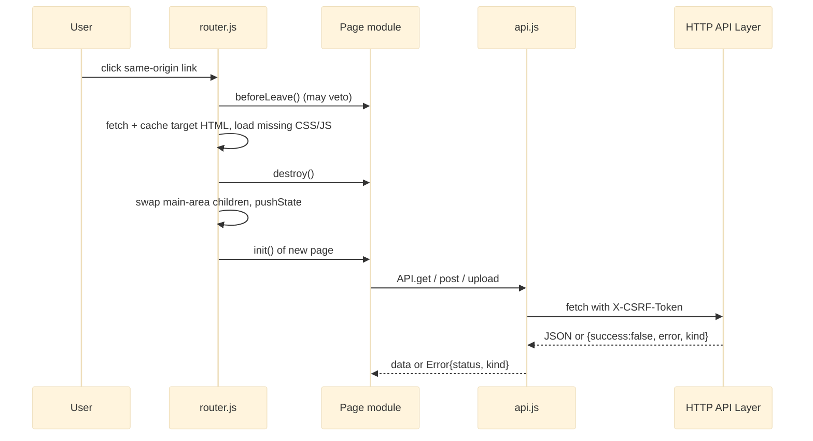

# Frontend Core

Frontend Core is the shared runtime of the no-build single-page app: a set of browser-global scripts (`api.js`, `app.js`, `router.js`, `sidebar.js`, `theme.js`, `notifications.js`) plus a five-layer CSS design system (`tokens.css` → `themes.css` → `base.css` → `layout.css` → `components.css`). `window.API` is the single HTTP and CSRF boundary to the [[HTTP API Layer]]; `window.AFM` is the UI toolkit (icons, formatting, toasts, modals, dropdowns, context menu, `escapeHtml`); `window.Router` swaps the five static pages in place without a reload and drives each page module's `init` / `destroy` / `beforeLeave` lifecycle. The [[Files Page]] and [[Feature Pages]] are its consumers. About 6,400 lines, mostly flat helpers and CSS, with the real ordering and state concerns concentrated in `router.js` and `api.js`.

## API Reference

**`window.API`** (`public/assets/js/api.js`, frozen)

```js
API.BASE_URL: string   // resolved once: window.AFM_API_BASE → <meta name="afm-api-base"> → '/api/v1'
API.get(endpoint, opts?) / API.post(endpoint, body, opts?) / API.put(endpoint, body, opts?) / API.del(endpoint, body?, opts?) -> Promise<any>
API.upload(endpoint, formData, onProgress?) -> { promise, abort }
API.downloadFile(clientPath) / API.downloadMultipleFiles(paths, { gapMs? }) / API.downloadZip(paths)
API.thumbnailUrl(clientPath, size) -> string
API.setCsrfToken(token) / API.clearCsrfToken() / API.redirectToLogin()
```

- JSON wrapper options: `silent` (no toast), `skipAuthRedirect`. Rejects with `Error{ status, kind? }`. Adds `X-CSRF-Token` on non-GET/HEAD. A 401 clears the token and redirects to `login.html?redirect=`.
- `upload` is XHR with progress; transport failures carry `kind: 'network' | 'aborted'`.
- Downloads: hidden iframe GET `/fs/download`; staggered iframes; ZIP is a hidden form POST to `/fs/download-zip` targeted at an iframe, with the CSRF token as a `csrfToken` body field.

**`window.AFM`** (`public/assets/js/app.js`)

```js
AFM.Icons, AFM.icon(name, size?, cls?), AFM.hydrateIcons(root?)
AFM.$, AFM.$$, AFM.el(tag, attrs, html), AFM.on(target, evt, sel, handler)
AFM.Format.{bytes, bytesParts, compact, number, speed, duration, date, dateTime, relative, percent, pad, middle}
AFM.FileTypes, AFM.resolveType(filename, isFolder?)
AFM.Toast.show(type, title, msg, duration)            // + success/error/... helpers; max 4, hover-pause
AFM.Modal.{open, close, closeAll, confirm({...}) -> Promise<bool>, prompt({...}) -> Promise<string|null>}
AFM.Dropdown.{init, closeAll}, AFM.ContextMenu.{show(x, y, items), hide}
AFM.copyToClipboard, AFM.Store.{get, set, remove}      // localStorage JSON wrapper
AFM.debounce, AFM.throttle, AFM.uid, AFM.clamp, AFM.randBetween, AFM.escapeHtml, AFM.countUp, AFM.initScrollReveal
AFM.refreshChrome(root?)
AFM.resolveStorageDisplay(storage), AFM.updateStorageUI(storage)
AFM.resolveIdentityDisplay(me), AFM.updateUserUI(me)
AFM.applyWorkspaceName(name)
AFM.Notifications.{bindTopbarBell, open(bell?), close, isOpen}   // notifications.js
```

> [!warning] Raw HTML inputs
> `Modal.confirm` / `Modal.prompt` insert `title`, `message` and `value` as raw HTML. Callers must pass them through `AFM.escapeHtml`.

**`window.Router`** (`public/assets/js/router.js`)

```js
Router.navigate(href, { push = true }?) -> Promise<void>
Router.resolve(href) -> { url, file } | null
```

Page-module contract consumed: `window[Dashboard|Files|Uploads|Settings|Admin].init()`, optional `destroy()`, optional async `beforeLeave() -> boolean`.

**`window.Sidebar`**: `init, toggle, collapse, expand, getState() -> { collapsed, mobileOpen, mobile }, onChange(fn) -> unsubscribe`

**`window.Theme`**: `init, toggle, set(theme), get, isDark, onChange(fn) -> unsubscribe, refresh`

**DOM/CSS hooks**: `.theme-toggle`, `[data-theme-toggle]`, `.theme-option[data-theme-value]`, `[data-modal-open]`, `[data-modal-close]`, `[data-copy]`, `[data-action="logout"]`, `.mobile-menu-btn`, `.topbar [data-tip="Notifications"]`, `[data-icon]`, `[data-reveal]`, `[data-tip]` / `data-tip-pos`, `--sidebar-width`, root classes `is-ready`, `is-navigating`, `theme-switching`.

## Beginner

> [!tip] Prerequisites
> Before reading this section, you should be comfortable with:
> - Basic HTML (tags, attributes, `<script>` and `<link>`)
> - Basic JavaScript functions and objects
> - The idea that a web page talks to a server over HTTP

### What Is This?

Every page of the Dimension admin tool needs the same plumbing: a way to talk to the server, a way to show pop-up messages and dialogs, a sidebar, a light/dark theme, and a way to move between pages. Frontend Core is that plumbing. Each page (Dashboard, Files, Uploads, Settings, Admin) loads these shared scripts first, then adds its own page logic on top.

It also contains the visual foundation: the colors, spacing, fonts and component styles (buttons, cards, modals, tooltips) that every page shares.

### Key Concepts

**IIFE (Immediately Invoked Function Expression)**
A function that is defined and run at once: `(() => { ... })()`. Variables inside it are private. Here, each file uses one to build an object and attach it to `window` (for example `window.API`), so other scripts can use it without any build tool.

**Global namespace on `window`**
In the browser, `window` is the global object. Putting `API` or `AFM` on it makes them reachable from every later script. That is why script order in the HTML matters: a script can only use what was loaded before it.

**SPA (single-page app) router**
Normally clicking a link loads a whole new page. A router intercepts the click, fetches the new page's HTML in the background, and swaps only the main content area, so the sidebar stays put and nothing flashes.

**CSRF token**
A secret value the server hands out after login. Every request that changes something must include it in a header, which proves the request came from this app and not from another site.

**CSS custom properties (variables)**
Values like `--bg-surface` defined once and reused everywhere. Switching the theme just changes what the variables point to.

### How It Works: Main Flow

Here is what happens when you open any page:

1. **Theme first** — `theme.js` runs in `<head>` before anything is drawn and sets `data-theme` on the page, so there is no white flash in dark mode.
2. **Toolkit loads** — `app.js` and `api.js` create `window.AFM` and `window.API`.
3. **App starts** — on `DOMContentLoaded`, `initApp` draws icons, wires up dropdowns, modals, copy buttons and keyboard shortcuts.
4. **Global data** — `loadGlobalData()` asks the server who you are (`/auth/me`, which also hands back the CSRF token), how full storage is (`/dashboard/summary`, for the sidebar meter) and the workspace name (`/settings`).
5. **Navigation** — when you click a sidebar link, `router.js` fetches the other page, tells the current page module to clean up (`destroy`), swaps the content, and starts the new page (`init`).

> [!example] Example
> ```js
> // From any page module: read a folder listing, without a generic error toast
> const data = await window.API.get('/fs/list?path=%2F', { silent: true });
>
> // Ask before doing something permanent; escape names before they become HTML
> const ok = await AFM.Modal.confirm({
>   title: 'Delete file?',
>   message: `Delete ${AFM.escapeHtml(name)} permanently?`,  // Modal inserts raw HTML
> });
> if (ok) AFM.Toast.success('Deleted', AFM.escapeHtml(name));
> ```

## Intermediate

### Design Rationale

- **No build step.** Plain scripts on `window` keep the frontend inspectable and deployable as static files; the price is that load order is a contract and there is no module system to catch missing globals. Rationale beyond "no bundler" is not documented; the router itself is described in ADR-005.
- **One network boundary.** All API URLs are built inside `api.js`. Transports that are not `fetch` (iframe download, form POST, `` thumbnail) get named builders such as `API.thumbnailUrl`, so `BASE_URL` (resolved once, then frozen) is the only place the API prefix lives. This is what lets `/api/v1` versioning (ADR-007) be a one-line meta tag.
- **Downloads never navigate the main frame.** Hidden iframes and an iframe-targeted form keep the SPA state intact during downloads.
- **Machine-readable errors.** Rejections carry `status` (0 = no response) and the server's `kind`, so callers branch on data rather than message text.
- **Theme stays browser-local.** It lives in `localStorage['afm:theme']` and deliberately not in the server settings store (ADR-006 covers the settings store).
- **Honest unavailability.** `resolveStorageDisplay` and `resolveIdentityDisplay` are pure view-model resolvers; an unmeasured volume renders `—` with an outlined bar and no `aria-valuenow`, never `0`.

### Patterns Used

**[[Singleton Services]] (IIFE singletons)** — one instance per namespace with closure-held state. `API` is `Object.freeze`d so `BASE_URL` cannot be repointed, and the CSRF token lives in a closure variable that is never persisted.

**[[Re-entrant Page Lifecycle]]** — the router calls `init` / `destroy` / `beforeLeave` on page modules and re-runs `AFM.refreshChrome()` and `Theme.refresh()` after each swap. Topbar controls are bound by document-level delegation, guarded by flags in `Notifications.bindTopbarBell` and `Theme.init` against double binding.

**[[Explicit Unavailability]]** — the sidebar storage meter and identity block render an explicit unavailable state when the server could not measure something.

**Superseding token** — `router.js` keeps a monotonically increasing `navToken`; a newer navigation invalidates an older in-flight one at each await point. Fetched HTML is cached as a `Map` of promises (evicted on failure) and warmed on `pointerover` / `focusin`.

**Two-phase init** — `theme.js` applies the theme synchronously at parse time, then attaches `matchMedia` and cross-tab `storage` listeners on `DOMContentLoaded`.

### Module Interactions



At bootstrap, `app.js#loadGlobalData` calls `GET /auth/me` (→ `API.setCsrfToken`), `GET /dashboard/summary` (sidebar meter) and `GET /settings` (workspace name), each in its own try/catch. Any router failure falls back to `window.location.assign`.

### Trade-offs

- Globals and script order instead of modules: zero tooling, but ordering mistakes fail at runtime only. `sidebar.js` and `notifications.js` assume `AFM` exists; `theme.js` stays dependency-free and uses `localStorage` directly rather than `AFM.Store` so it can run in `<head>`.
- Render-by-string toolkit (`Modal`, `ContextMenu`) is compact but puts escaping on every caller; `Toast` escapes internally, so the toolkit is inconsistent.
- A large CSS layer stack (~3,600 lines) with semantic theme variables makes theming a variable swap, at the cost of a long cascade. `themes.css` comments are in Persian.
- Google Fonts are pulled via `@import` in `tokens.css`, which is simple but adds a third-party runtime dependency.

## Advanced

### Concurrency & State

- Single-threaded event loop, but `router.js#navigate()` interleaves several awaits: async `beforeLeave` vetoes (with history restoration on back/forward), cached document fetches, ordered script loading, and stale-navigation checks at three points, with a `finally`-based loading flag. The `navToken` check runs only after `beforeLeave()` resolves, so two overlapping navigations can both run it.
- Teardown on every swap closes shared overlays (ContextMenu, Dropdown, Modal, Notifications) and clears `inert` / `aria-hidden` / `overflow` left on the shell. Child nodes are snapshotted before `adoptNode`.
- Module-scoped state: CSRF token (closure in `api.js`), the HTML cache `Map`, sidebar state persisted via `AFM.Store` (`sidebar-collapsed`, `sidebarWidth` clamped 200–420 px), theme in `localStorage`.
- `document.body.style.overflow` is written by Modal, the mobile sidebar and the router independently.

### Performance Characteristics

- Bootstrap reads are serial: `/auth/me`, then `/dashboard/summary` (a server-side tree walk), then `/settings`. Only the first is a prerequisite.
- The page HTML cache lives for the document lifetime; hover/focus prefetch makes most navigations instant.
- `Toast` caps the stack at 4. `sidebar.js#onResize` re-runs `applyState` (store write + listener notify) on every desktop resize event.
- Render-blocking font `@import` from `fonts.googleapis.com` delays first paint on offline or air-gapped installs.

### Failure Modes

- **401** from any JSON call clears the token and redirects to login (unless `skipAuthRedirect`).
- **403 on mutation** when the CSRF token is missing or stale (request issued before `/auth/me` resolved, or after a re-login in another tab). There is no refresh-and-retry.
- **Download errors are silent.** Error bodies render into a 0x0 iframe and are discarded after 60 s / 15 s; callers get no promise.
- **Router failure** degrades to a full page load via `window.location.assign`.
- **Stranded dialogs.** Escape and router teardown call `Modal.closeAll()`, which never settles a pending `confirm`/`prompt` promise.

> [!danger] Critical Failure Mode
> With CSP disabled, `AFM.escapeHtml` at render time is the only XSS defence. `Modal.confirm`, `Modal.prompt` and `ContextMenu.show` insert caller strings raw, so a single caller that forgets to escape a filesystem-derived name injects markup. See [[Error Contract and Sanitization]].

### Invariants & Constraints

- No `/api` literal or `API.BASE_URL` concatenation outside `api.js`; a repo guardrail test enforces it.
- Script order: `theme.js` in `<head>`, then `app.js`, `api.js`, `sidebar.js`, `notifications.js`, page modules, and `router.js` after `sidebar.js`.
- Every listener or timer a page module adds must be removed in its `destroy()`, because `init()` can run many times per document.
- `initApp` is skipped on the login page.
- Storage severity thresholds are 75% / 90%; an unmeasured volume is never rendered as `0`.

### Code Review Notes

> [!warning] Escape / router teardown strands `Modal.confirm` and `Modal.prompt` promises
> **File:** `public/assets/js/app.js:446-573, 844-849` | **Severity:** medium
>
> `confirm()` / `prompt()` settle only through their own `finish()`. `closeAll()` (global Escape, router teardown) just strips `is-open`, so awaiting callers such as a `beforeLeave()` confirm hang forever and hidden backdrops pile up. See [[Code Review]].
>
> **Current approach:**
> ```js
> function closeAll() {
>   $$('.modal-backdrop.is-open').forEach(b => b.classList.remove('is-open'));
>   ...
> }
> ```
>
> **Better approach:**
> ```js
> const pending = new Set();             // cancel callbacks of open confirm/prompt dialogs
> function closeAll() {
>   pending.forEach(cancel => cancel()); // resolves false / null and removes the node
>   $$('.modal-backdrop.is-open').forEach(b => b.classList.remove('is-open'));
>   ...
> }
> // in confirm(): const cancel = () => finish(false); pending.add(cancel); finish() deletes it
> ```
> A promise-returning API owns the duty to settle on every exit path, not just the happy ones.

> [!warning] "System" theme cannot stay selected
> **File:** `public/assets/js/theme.js:104-113, 176-208, 220-238, 267-270` | **Severity:** medium
>
> Choosing System removes the stored key, but `apply()` writes the concrete `'light'`/`'dark'` back whenever the theme changes, and `onSystemChange` does the same. `updatePickerCards(current)` then marks Light/Dark active. See [[Code Review]].
>
> **Current approach:**
> ```js
> try { localStorage.setItem(STORE_KEY, JSON.stringify(theme)); } catch (e) {}
> ```
>
> **Better approach:**
> ```js
> // apply(theme, animate, persist = true)
> if (persist) try { localStorage.setItem(STORE_KEY, JSON.stringify(theme)); } catch (e) {}
> // onSystemChange and the 'system' card call apply(t, true, false);
> // updatePickerCards marks 'system' active when no key is stored
> ```
> Separating the stored preference from the applied value keeps "follow the OS" a real, durable choice.

> [!warning] Shared widgets insert caller strings as raw HTML
> **File:** `public/assets/js/app.js:485-503, 530-550, 645-655` | **Severity:** medium
>
> Safety depends on every caller escaping; a `"` in a filename breaks the `value` attribute. `Toast` already escapes, so the toolkit is inconsistent. See [[Code Review]].
>
> **Current approach:**
> ```js
> <input class="input" type="text" value="${value}" ...>
> ```
>
> **Better approach:**
> ```js
> const input = backdrop.querySelector('input'); input.value = value;
> ```
> Escape-by-default (with an explicit `messageHtml` opt-in) removes the failure mode instead of policing it.

> [!warning] Download failures are invisible to the user
> **File:** `public/assets/js/api.js:288-400` | **Severity:** medium
>
> A 401/403/404/500 renders into a hidden iframe and is discarded; callers get no error signal. See [[Limitations]].
>
> **Current approach:** fire-and-forget iframe or form, removed on a timer.
>
> **Better approach:** listen for the iframe `load` event (it fires when the response rendered as a document, i.e. an error body, not an attachment) and return a promise that rejects on it.

> [!warning] `copyToClipboard` reports success when the copy failed
> **File:** `public/assets/js/app.js:689-705` | **Severity:** low
>
> `execCommand('copy')` returns `false` rather than throwing when blocked, so the success toast fires anyway. This contradicts "no success message for an operation that did not happen" ([[Truthful Reporting and Unavailability]]). See [[Code Review]].
>
> **Current approach:**
> ```js
> try { document.execCommand('copy'); Toast.success(successMsg); }
> catch { Toast.error(...); }
> ta.remove(); return true;
> ```
>
> **Better approach:**
> ```js
> let ok = false;
> try { ok = document.execCommand('copy'); } catch {}
> ta.remove();
> ok ? Toast.success(successMsg) : Toast.error('Copy failed', 'Your browser blocked clipboard access');
> return ok;
> ```
> Read the return value of APIs that signal failure by value, not by exception.

> [!warning] Bootstrap reads are serial and the summary read toasts
> **File:** `public/assets/js/app.js:997-1031` | **Severity:** low
>
> Three awaited reads run one after another; a corrupt metadata store (a 500 by contract) pops a "Network Error" toast on every page load; after a 401 the later reads still fire. See [[Code Review]].
>
> **Better approach:** after `/auth/me`, run the other two with `Promise.allSettled`, pass `{ silent: true }` to the summary read, and return early on a 401.

> [!warning] CSRF token only exists after `/auth/me` resolves
> **File:** `public/assets/js/api.js:55-65, 111-113, 223, 382-388` | **Severity:** low
>
> An early mutation or one after a token rotation fails with 403 with no retry; `downloadZip` silently omits the field. See [[Limitations]].
>
> **Better approach:** expose a `ready` promise from the `/auth/me` read that `request()` awaits for non-GET methods, and on a CSRF 403 refetch `/auth/me` once and retry.

> [!warning] Overlapping navigations can each run `beforeLeave()`
> **File:** `public/assets/js/router.js:182-200` | **Severity:** low
>
> The `navToken` check comes after `beforeLeave()`, so a second click stacks a second leave-confirm. See [[Code Review]].
>
> **Better approach:** keep a module-level `leavePending` promise and reuse it (or ignore new navigations) while one is in flight.

> [!warning] Page HTML cache never invalidates
> **File:** `public/assets/js/router.js:35, 58-70` | **Severity:** low
>
> A tab open across a deploy keeps swapping in pre-deploy markup against already-loaded scripts. Acceptable for an admin tool; key the cache on a version marker (e.g. `apiVersion` from `/health`) if releases matter. See [[Limitations]].

> [!warning] Sidebar width not restored after starting on a narrow viewport
> **File:** `public/assets/js/sidebar.js:103-118, 286-291` | **Severity:** low
>
> `init()` applies the stored width only on desktop and `onResize()` never calls `setWidth`. See [[Code Review]].
>
> **Better approach:**
> ```js
> // in onResize(), desktop branch
> applyState(stored, false);
> setWidth(AFM?.Store?.get(WIDTH_STORE_KEY, WIDTH_DEFAULT), false);
> ```

> [!warning] `document.body.style.overflow` has three uncoordinated owners
> **File:** `public/assets/js/app.js:453, 465, 471`; `public/assets/js/sidebar.js:92, 100`; `public/assets/js/router.js:158` | **Severity:** low
>
> Closing a modal opened over the mobile drawer re-enables page scroll while the drawer is still up. See [[Code Review]].
>
> **Better approach:** a scroll-lock counter in `app.js` (`AFM.lockScroll()` / `unlockScroll()`) used by all three owners.

> [!warning] Fonts load from Google at runtime
> **File:** `public/assets/css/tokens.css:6-7` | **Severity:** low
>
> Render-blocking `@import` stalls offline installs and exposes the operator's IP to a third party. See [[Limitations]].
>
> **Better approach:** vendor DM Sans and Inter under `public/assets/fonts/` with `@font-face` and `font-display: swap`.

> [!warning] Duplicated chrome logic in `initApp`
> **File:** `public/assets/js/app.js:1124-1148` | **Severity:** low
>
> `initApp` re-implements `refreshChrome` line for line, so the two can silently diverge. See [[Code Review]].
>
> **Better approach:**
> ```js
> function initApp() {
>   Dropdown.init(); initModalBindings(); initCopyButtons(); initShortcuts(); attachRipples();
>   refreshChrome();
>   loadGlobalData();
>   document.documentElement.classList.add('is-ready');
> }
> ```
