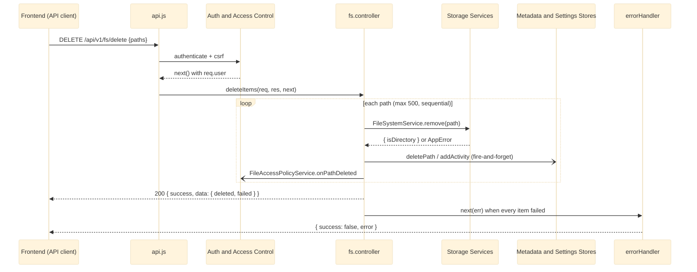

# HTTP API Layer

The HTTP API Layer is Dimension's REST surface: Express routers that declare verbs and paths, controllers that validate input and shape responses, and the global `errorHandler` that serialises every failure as `{ success: false, error }`. `src/routes/api.js` is the single assembly, mounted by [[Server Bootstrap and Config]] at both `/api/v1` and `/api` (ADR-007). It rejects foreign version segments, exposes the public `GET /health`, hands `/auth` to [[Auth and Access Control]], then applies `authenticate` + `csrf` before the `/fs`, `/dashboard`, `/settings` and `/admin` routers. Controllers delegate all disk work to [[Storage Services]] and all persistence to [[Metadata and Settings Stores]]. Most of the complexity sits in `src/controllers/fs.controller.js` (709 of the module's 1174 lines).

## API Reference

**Module exports**

| Export | Signature | Purpose |
|---|---|---|
| `src/routes/api.js` | `module.exports = router` | Assembled API router mounted at `/api/v1` and `/api`. |
| `errorHandler` | `(err, req, res, next)` | Global error serialiser; only `AppError` messages reach the client, others get a generic string. |
| `fsController` | `{ getTree, getList, createFolder, renameItem, moveItems, copyItems, deleteItems, downloadFile, uploadFile, downloadZip, setStar, LIST_ENRICH_CONCURRENCY /*16*/, LIST_MAX_LIMIT /*200*/, LIST_SORT_KEYS }` | Filesystem handlers and listing constants. |
| `dashboardController` | `{ getSummary, getHealth }` | Bare Dashboard aggregates. |
| `settingsController` | `{ getSettings, replaceSettings }` | Thin pass-through to `SettingsService`. |
| `previewController` | `{ getThumbnailCapability, getThumbnail }` | Thumbnail capability and bounded render. |

**HTTP routes** (each served under both `/api/v1` and `/api`)

| Method | Path | Body / query | Response |
|---|---|---|---|
| GET | `/health` | - | Public liveness `{ success, message, apiVersion: 1 }` (deploy activation gate) |
| GET | `/fs/tree` | `?path=` | Bare `[rootNode]`, 2-level tree with `childrenLoaded` flags |
| GET | `/fs/list` | `?path&page&limit&sort&dir&search&type&starredOnly` | Bare `{ items, total, counts }` |
| GET | `/fs/download` | `?path=` | `application/octet-stream` attachment; increments download count |
| GET | `/fs/thumbnail/capability` | - | Bare `{ available, formats, maxSize }` |
| GET | `/fs/thumbnail` | `?path&size` | Bounded image buffer, or error with `X-Preview: unavailable` |
| POST | `/fs/folder` | `{ path }` | `201 { success, data: { path } }` |
| POST | `/fs/upload` | multipart `destination`, `overwrite`, `file` (in that order) | `201 { success, data: { name, path, size } }` |
| POST | `/fs/star` | `{ path, starred? }` | `{ success, data: { path, starred } }` (toggle, or idempotent set) |
| POST | `/fs/download-zip` | `{ paths }` (may be a JSON string from a form post) | Streams `application/zip` |
| PUT | `/fs/rename` | `{ oldPath, newName }` | `{ success, data: { oldPath, newPath } }` (same directory) |
| PUT | `/fs/move` | `{ paths, destination }` | `{ success, data: { moved, failed } }` |
| POST | `/fs/copy` | `{ paths, destination }` | `{ success, data: { copied, failed } }` |
| DELETE | `/fs/delete` | `{ paths }` | `{ success, data: { deleted, failed } }` |
| GET | `/dashboard/summary` | - | Bare `{ stats, storage, storageBreakdown, activities, topFiles, health }` |
| GET | `/dashboard/health` | - | Bare health-metrics value |
| GET | `/settings` | - | Bare settings document |
| PUT | `/settings` | full settings document | `{ success, settings }` (strict full replace) |

## Beginner

> [!tip] Prerequisites
> Before reading this section, you should be comfortable with:
> - What an HTTP request is (method such as GET or POST, a path, an optional body)
> - JSON as a data format
> - Basic JavaScript functions and `async`/`await`

### What Is This?

The browser and the server talk through an API: a list of web addresses the frontend can call to ask for something or to change something. This module is that list. When the Files page wants to show a folder, it calls `GET /api/v1/fs/list?path=/media`. When you delete a file, the page calls `DELETE /api/v1/fs/delete`. This module receives those calls, checks that they are well-formed and allowed, asks the storage code to do the actual work, and sends back an answer in JSON.

### Key Concepts

**Router**
An Express object that maps a method and a path (for example `PUT /fs/rename`) to a function. The route files in `src/routes/` contain only these mappings.

**Controller**
The function a route points to. It reads the request, validates it, calls a service, and builds the response. Controllers never touch the disk themselves.

**Envelope**
A wrapper around the response data. In Dimension, requests that *change* something answer `{ success: true, ... }`; requests that only *read* an aggregate answer the data directly with no wrapper. Errors always answer `{ success: false, error: "..." }`.

**`AppError`**
An error type that carries an HTTP status code, such as `new AppError('Folder already exists.', 409)`. Controllers throw it and the global `errorHandler` turns it into the error JSON.

**Streaming**
Sending a file to the client piece by piece instead of loading it into memory first. Downloads and ZIP archives are streamed.

**API versioning**
The same routes are reachable at `/api/v1/...` (the official contract) and `/api/...` (an older alias kept for compatibility).

### How It Works: Main Flow

Here is what happens when the Files page renames a file.

1. **Request arrives** - `PUT /api/v1/fs/rename` with `{ "oldPath": "/docs/a.txt", "newName": "b.txt" }`.
2. **Version and auth checks** - `api.js` confirms the version segment, then `authenticate` checks the session and `csrf` checks the CSRF header.
3. **Routing** - `fs.routes.js` sends the request to `fsController.renameItem`.
4. **Validation** - the controller checks the path with `validateClientPath` and the new name with `validateFileName`.
5. **Do the work** - the controller calls `FileSystemService.rename` in [[Storage Services]].
6. **Side effects** - the metadata store is updated and an activity entry is recorded, without making the request wait on or fail because of them.
7. **Respond** - `{ success: true, data: { oldPath, newPath } }`. If anything threw, `errorHandler` answers `{ success: false, error }` instead.

> [!example] Example
> ```bash
> # List a folder (read-only aggregate: bare object, no envelope)
> curl -b cookies.txt "http://localhost:3000/api/v1/fs/list?path=/media&page=1&limit=50&sort=name&dir=asc"
>
> # Create a folder (mutation: enveloped). Non-GET requests also need the CSRF header
> # issued at login (see Auth and Access Control).
> curl -b cookies.txt -X POST -H "Content-Type: application/json" \
>      -d '{"path":"/media/new-folder"}' http://localhost:3000/api/v1/fs/folder
> # -> 201 { "success": true, "data": { "path": "/media/new-folder" } }
> ```

## Intermediate

### Design Rationale

- **Routes hold declarations only.** Each route file is a verb/path table, so the full surface is reviewable at a glance and no filesystem call can hide in a route (AGENTS.md rule 1).
- **One assembly, two prefixes (ADR-007).** Route modules never declare a version segment. A guard in `api.js` inspects `req.baseUrl` and rejects case-mismatched or foreign segments such as `/api/V1` with `next('router')`, because Express mount matching is case-insensitive.
- **Auth ordering.** `GET /health` is public (it is the deploy activation gate). `/auth` is mounted before the blanket `authenticate` + `csrf` because it gates itself (login must be reachable without a session). Everything after that requires a session (ADR-009).
- **Envelope split.** Read-only aggregates answer bare shapes; mutations answer `{ success: true, ... }`. This is the project convention (rule 6), not an accident.
- **No DashboardService.** DTO shaping (`buildStats`, `buildStorageBreakdown`) lives in `dashboard.controller.js`, which composes existing [[Storage Services]] and [[Metadata and Settings Stores]] calls. This is by design.
- **Settings validation lives in the store**, so `settings.controller.js` is a pass-through.

### Patterns Used

**Uniform controller shape** - every async handler is `try { ... } catch (e) { next(e) }`, and expected failures are `AppError`s. Nothing serialises an error inline. See [[Error Contract and Sanitization]].

**Bulk partial-failure contract** - `moveItems`, `copyItems` and `deleteItems` process up to 500 paths sequentially and collect `{ path, error, statusCode }` per failure. A 200 can carry `data.failed`; only when every item fails is the first failure rethrown.

**Fire-and-forget side effects** - `addActivity`, `incrementDownload` and `deletePath` are called with `.catch(() => {})`. `renamePath` is awaited but its failure is only logged. Rename, move and delete also notify `FileAccessPolicyService.onPathRenamed` / `onPathDeleted` in [[Auth and Access Control]]. See [[Concurrency and Consistency]].

**Bounded concurrency and bounded recursion** - `getList` primes the metadata cache with one read, then enriches entries with `mapWithConcurrency(..., 16)`. `getTree` walks only two levels and marks deeper nodes `childrenLoaded: false` so the client asks again. See [[Bounded Work Budgets]].

**Per-capability degradation** - folder sizes become `null` + `sizeAvailable: false` when the walk truncated or hit inaccessible entries; the Dashboard degrades `activities`/`topFiles` when metadata fails. See [[Explicit Unavailability]].

**Upload callback bridge** - `uploadFile` is deliberately non-async. It wraps the Multer-based `UploadService.middleware` and, on any failure, awaits `UploadService.discard(staged)` before `next(error)`.

### Module Interactions



### Trade-offs

- Sequential bulk processing keeps per-item error reporting simple and avoids hammering the disk, at the cost of latency for large batches.
- The Dashboard catches metadata failures and degrades to `[]` rather than failing with a 500. AGENTS.md still says a corrupt store makes the summary a 500, so code and documentation disagree; the code comment says the store failure "must not become a 500 here". Which behaviour is intended is not otherwise documented.
- `getList` computes folder sizes for every candidate before paginating, which makes size sorting correct but makes every page pay for every walk (see Code Review Notes).
- Activity entries record `user: 'system'` even though `req.user` is available. Rationale not documented.

## Advanced

### Concurrency & State

The layer holds no state of its own; it relies on the services' singletons. Concurrency inside a request is bounded: `getList` enriches with a limit of 16, and bulk handlers are strictly sequential. Across requests there is no locking. `setStar`'s idempotent set reads `starred` and then calls `toggleStar` when it differs, so two concurrent `{ starred: true }` requests can both read `false` and both toggle, ending unstarred. Metadata writes are eventually consistent by design (AGENTS.md rule 7).

### Performance Characteristics

- `getList` is the hot path. Every folder in the listed directory gets a bounded `FileSystemService.getTreeStats` walk (16 in flight) before sorting and pagination, including on each search keystroke. Directories with many large subfolders make every page slow.
- `getTree` is O(entries in two levels) by construction.
- Downloads use `fs.createReadStream(...).pipe(res)`; ZIPs pipe an archiver 8 `ZipArchive` to `res` and abort it when `req` closes. Neither buffers files in memory.
- The thumbnail endpoint returns a bounded buffer (at most 512 px) only when a transformer is installed; none is today.

### Failure Modes

| Failure | Class | Result |
|---|---|---|
| Invalid path or name | Expected | `AppError` 400 via `validateClientPath` / `validateFileName` |
| Missing session / CSRF header | Expected | Rejected by `authenticate` / `csrf` before any controller |
| Foreign version segment (`/api/V1`) | Expected | `next('router')`, ends at the `/api` catch-all 404 |
| Partial bulk failure | Expected | 200 with `data.failed[]` |
| All items in a bulk request fail | Expected | First failure rethrown as `AppError` |
| Tree/volume stats reject in `getSummary` | Infrastructure | 500 (bare `Promise.all`) |
| Metadata store corrupt in `getSummary` | Infrastructure | Silent degrade to empty `activities` / `topFiles` |
| Stream error before headers | Infrastructure | `next(AppError)`; after headers, `res.destroy(err)` |
| ZIP request with no parsed body | Bug | `req.body` is `undefined` under Express 5, so `TypeError` and 500 instead of 400 |

> [!danger] Critical Failure Mode
> Bulk move, copy and delete copy `err.message` verbatim into `data.failed[]`. A raw fs error embeds absolute OS paths (`ENOENT: no such file or directory, rename 'D:\storage\...'`). A partial failure returns that text in a 200 body, and an all-failed batch wraps it in a new `AppError`, which `errorHandler` then trusts and returns. This breaks the rule that absolute paths never leave the services layer. See [[Path Containment and Client Paths]].

### Invariants & Constraints

- `api.js` must stay mounted before the `/api` catch-all in `server.js`.
- Within v1, changes are additive only; removals and retypes wait for a v2.
- Controllers never touch `fs` except to pipe a stream for a path a service has already resolved; all paths pass `validateClientPath` first.
- `downloadFile` re-validates the basename with `validateFileName` before putting it in `Content-Disposition`.
- Multipart field order is load-bearing: `destination` and `overwrite` before `file`.
- Metadata failures must never fail or block the filesystem operation they accompany.
- Archiver needs forward slashes, so `securePath` backslashes are normalised before `archive.file` / `archive.directory`.

### Code Review Notes

> [!warning] Bulk handlers leak unsanitized error messages
> **File:** `src/controllers/fs.controller.js:348-359` (move), `407-418` (copy), `464-475` (delete) | **Severity:** medium
>
> `errorHandler` withholds non-`AppError` messages because raw fs errors contain absolute paths. The bulk loops bypass that twice: in the 200 body, and by rethrowing the first raw message as a trusted `AppError`.
>
> **Current approach:**
> ```js
> results.failed.push({
>     path: clientPath,
>     error: err.message,
>     statusCode: err.statusCode || 500,
> });
> ```
>
> **Better approach:**
> ```js
> const safe = err instanceof AppError ? err.message : 'Operation failed.';
> results.failed.push({ path: clientPath, error: safe, statusCode: err.statusCode || 500 });
> ```
> Sanitise where the message is collected, so the same rule `errorHandler` applies holds for per-item errors too. See [[Code Review]].

> [!warning] Dashboard metadata failure is silent and indistinguishable from "empty"
> **File:** `src/controllers/dashboard.controller.js:127-140` | **Severity:** medium
>
> The bare `catch {}` neither logs nor flags the failure, so a client cannot tell "no activity yet" from "store unreadable". The project rule is that an unmeasurable quantity is marked unavailable, never shown as empty.
>
> **Current approach:**
> ```js
> } catch {
>     activities = [];
>     rawTopFiles = [];
> }
> ```
>
> **Better approach:**
> ```js
> } catch (err) {
>     console.error('[Dashboard] metadata unavailable:', err.message);
>     metadataAvailable = false;
> }
> // ... res.json({ ..., activities, topFiles, metadataAvailable })
> ```
> An additive flag is allowed within v1; AGENTS.md and `docs/CONTRACTS.md` should be updated in the same change. See [[Code Review]] and [[Truthful Reporting and Unavailability]].

> [!warning] `getSummary` doc comment overstates degradation
> **File:** `src/controllers/dashboard.controller.js:110-125` | **Severity:** low
>
> The JSDoc says no capability may fail the whole response, but `getTreeStats` / `getVolumeStats` run in a bare `Promise.all`, so either rejecting is a 500.
>
> **Current approach:**
> ```js
> const [tree, volume] = await Promise.all([
>     FileSystemService.getTreeStats('/'),
>     FileSystemService.getVolumeStats('/'),
> ]);
> ```
>
> **Better approach:** correct the comment, or wrap each call as its own capability with an explicit unavailable flag. See [[Code Review]].

> [!warning] Non-atomic idempotent star set
> **File:** `src/controllers/fs.controller.js:596-599` | **Severity:** low
>
> Read-then-toggle lets two concurrent "set starred" requests cancel each other out.
>
> **Current approach:**
> ```js
> const current = (await MetadataService.getFileMeta(clientPath)).starred;
> const result = starred === undefined || starred !== current
>     ? await MetadataService.toggleStar(clientPath)
>     : current;
> ```
>
> **Better approach:**
> ```js
> const result = starred === undefined
>     ? await MetadataService.toggleStar(clientPath)
>     : await MetadataService.setStar(clientPath, starred); // absolute write inside the store
> ```
> An absolute write inside the store's own write is idempotent under concurrency; toggle stays for the no-`starred` case. See [[Code Review]].

> [!warning] ZIP entries collide on duplicate basenames
> **File:** `src/controllers/fs.controller.js:636-685` | **Severity:** low
>
> Entries are named `path.posix.basename(clientPath)`, so `/a/report.pdf` and `/b/report.pdf` (or the same path sent twice) produce two entries with one name.
>
> **Current approach:**
> ```js
> name: path.posix.basename(clientPath) || 'item',
> ```
>
> **Better approach:** de-duplicate `rawPaths`, then suffix colliding names (`report (2).pdf`) before calling `archive.file` / `archive.directory`. See [[Code Review]].

> [!warning] `downloadZip` dereferences `req.body` without a guard
> **File:** `src/controllers/fs.controller.js:617` | **Severity:** low
>
> Under Express 5, `req.body` is `undefined` when no body parser matched, so the handler throws a `TypeError` (500) instead of answering 400.
>
> **Current approach:**
> ```js
> let rawPaths = req.body.paths;
> ```
>
> **Better approach:**
> ```js
> let rawPaths = (req.body || {}).paths;
> ```
> Every other handler already uses this guard. See [[Code Review]].

> [!warning] Error responses inherit download headers
> **File:** `src/controllers/fs.controller.js:508-527, 650-662` | **Severity:** low
>
> `Content-Disposition: attachment` is set before the stream opens. If it errors before the first byte, the hidden download iframe saves the `{ success: false }` JSON under the original file name.
>
> **Current approach:**
> ```js
> if (!res.headersSent) {
>     return next(new AppError('Failed to generate ZIP archive.', 500));
> }
> ```
>
> **Better approach:**
> ```js
> if (!res.headersSent) {
>     res.removeHeader('Content-Disposition');
>     return next(new AppError('Failed to generate ZIP archive.', 500));
> }
> ```
> Alternatively have `errorHandler` clear it. See [[Code Review]].

> [!warning] Possible double `next()` on ZIP errors
> **File:** `src/controllers/fs.controller.js:656-662, 687-690` | **Severity:** low
>
> The `archive.on('error')` listener calls `next(...)`, and `await archive.finalize()` can reject with the same error, so the outer `catch` calls `next(error)` again and may raise `ERR_HTTP_HEADERS_SENT`.
>
> **Current approach:**
> ```js
>         await archive.finalize();
>     } catch (error) {
>         next(error);
>     }
> ```
>
> **Better approach:**
> ```js
> let failed = false;
> archive.on('error', (err) => { failed = true; /* existing handling */ });
> // ...
> } catch (error) {
>     if (!failed) next(error);
> }
> ```
> Exactly one path owns the error. See [[Code Review]].

> [!warning] `errorHandler` does not guard `res.headersSent`
> **File:** `src/middlewares/errorHandler.js:24-43` | **Severity:** low
>
> An error reaching the handler after a response started streaming makes `res.status().json()` throw. Controllers guard this today, but the global handler is the safety net.
>
> **Better approach:**
> ```js
> if (res.headersSent) return next(err); // let Express close the connection
> ```
> See [[Code Review]].

> [!warning] `getList` walks every listed folder before paginating
> **File:** `src/controllers/fs.controller.js:168-207, 221-226` | **Severity:** medium
>
> Every candidate folder pays for a `getTreeStats` walk on every request, though only `sort=size` needs the totals.
>
> **Better approach:** compute folder sizes only for `sort=size` or only for the sliced page, returning `sizeAvailable: false` otherwise, or cache tree stats briefly. See [[Limitations]].

> [!warning] Bulk partial-failure loop is triplicated
> **File:** `src/controllers/fs.controller.js:311-485` | **Severity:** low
>
> Move, copy and delete repeat the validation, per-item try/catch, `failed[]` shape and all-failed rethrow, so the sanitising fix above must be applied three times.
>
> **Better approach:**
> ```js
> async function runBulk(paths, worker) {
>     const ok = [], failed = [];
>     for (const p of paths) {
>         try { ok.push(await worker(p)); }
>         catch (err) { failed.push({ path: p, error: err instanceof AppError ? err.message : 'Operation failed.', statusCode: err.statusCode || 500 }); }
>     }
>     if (ok.length === 0 && failed.length > 0) throw new AppError(failed[0].error, failed[0].statusCode);
>     return { ok, failed };
> }
> ```
> Plus a shared `assertPathList(paths)`. See [[Code Review]].

> [!warning] Activity log always records `user: 'system'`
> **File:** `src/controllers/fs.controller.js:252-258` (and 288-294, 338-344, 398-404, 455-461, 556-562) | **Severity:** low
>
> `authenticate` attaches `req.user`, yet every activity entry is hard-coded, so the audit trail cannot say who changed a file.
>
> **Current approach:**
> ```js
> MetadataService.addActivity({
>     type: 'folder',
>     user: 'system',
> ```
>
> **Better approach:** pass the user's id or display name from `req.user`, falling back to `'system'`. See [[Limitations]].
