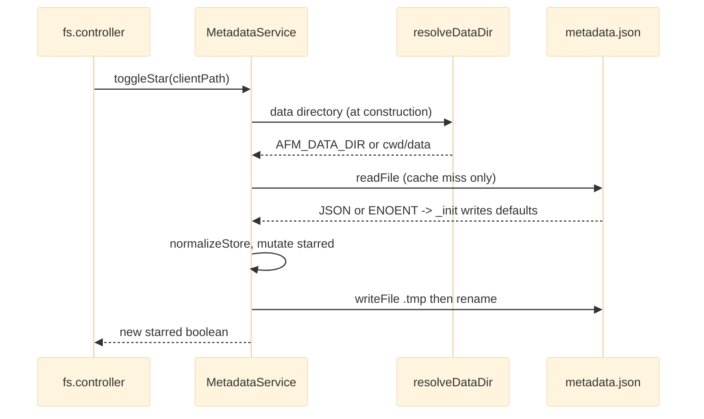

# Metadata and Settings Stores

Two small sibling services persist the application's non-filesystem state as JSON documents under the data directory (`AFM_DATA_DIR`, default `<cwd>/data`). `MetadataService` owns `metadata.json` (per-file download counts, starred paths and a capped activity log that feeds the Dashboard); `SettingsService` owns `settings.json` (the operator settings document behind `GET`/`PUT /api/settings`). Both are module-level singleton instances with an in-memory cache, bootstrap their file on first run, write through a temp-file-then-rename swap, and fail wholly with a static-message `AppError` 500 when their store is corrupt rather than inventing defaults. They key everything by client paths and never touch any file other than their own store.

## API Reference

`MetadataService` — singleton instance (`module.exports = new MetadataService()`):

| Member | Signature | Behaviour |
|---|---|---|
| `dbPath` | `string` | Mutable store path; tests repoint it at a temp file |
| `getFileMeta` | `async (clientPath) -> { downloads: number, starred: boolean }` | Download count (0 if absent) and starred flag |
| `incrementDownload` | `async (clientPath) -> void` | Increments the counter and persists |
| `toggleStar` | `async (clientPath) -> boolean` | Toggles membership in `starred`; returns the new state |
| `addActivity` | `async ({ type, user, action, target, folder }) -> void` | Prepends with `time: Date.now()`; caps the log at 50 |
| `getActivities` | `async (limit = 10) -> object[]` | Recent activities; drops entries with missing/non-finite/non-positive `time` |
| `getTopDownloads` | `async (limit = 5, { retain? }) -> Array<{ path, downloads, max }>` | Top-N by count (ties by path), excludes non-positive/corrupt counts, optional `retain` filter, `max` over the retained set |
| `renamePath` | `async (oldPath, newPath) -> void` | Moves the count key and star entry; writes only if changed |
| `deletePath` | `async (clientPath) -> void` | Removes count and star; writes only if changed |

`SettingsService` — singleton instance (`module.exports = new SettingsService()`):

| Member | Signature | Behaviour |
|---|---|---|
| `dbPath`, `cache` | `string`, `object \| null` | Tests repoint both |
| `getAll` | `async () -> object` | Full settings document (served bare by the controller) |
| `replace` | `async (payload) -> object` | Strict full replace validated by `validateSettingsPayload` (throws `AppError` 400), persisted atomically, returns the normalized document |

Store shapes:

```js
// metadata.json
{ downloads: { "<clientPath>": number }, starred: string[], activities: object[] }
// settings.json  (null = unset)
{ general: { workspaceName, defaultUploadFolder }, appearance: { defaultView } }
```

## Beginner

> [!tip] Prerequisites
> Before reading this section, you should be comfortable with:
> - Basic JavaScript objects and arrays
> - What a JSON file is
> - The idea of `async`/`await` (code that waits for disk without freezing the program)

### What Is This?

The file manager needs to remember a few things that are not files themselves: how many times each file was downloaded, which files you starred, what happened recently (the activity feed), and your preferences (workspace name, default view). Instead of a database server, these facts are stored in two plain JSON text files on disk. This module is the only code allowed to read and write those two files, so the rest of the app just calls simple methods like "toggle the star on this file" or "give me the settings".

### Key Concepts

**JSON document store**
A JSON file holding one big object. To change one value, the program reads the whole object, edits it in memory, and writes the whole object back.

**Singleton**
A single shared object for the whole program. Both services export one already-created instance (`new MetadataService()`), so every part of the app talks to the same copy and the same in-memory cache.

**Cache**
A copy of the file's contents kept in memory after the first read, so later reads skip the disk.

**Atomic write (temp file then rename)**
The new contents are written to `metadata.json.tmp` first, then renamed over the real file. A rename is all-or-nothing, so a reader never sees a half-written file.

**Client path**
A path as the browser sees it, like `/media/clip.mp4`. These are used as keys in the store; real disk paths are never stored here.

### How It Works: Main Flow

Here is what happens when a user stars a file.

1. **Controller calls the service** — the Files controller calls `MetadataService.toggleStar('/docs/a.pdf')`.
2. **Read** — `_read()` returns the cached object, or reads and parses `metadata.json`. If the file does not exist yet, `_init()` creates the folder and writes a default document.
3. **Modify** — the path is added to (or removed from) the `starred` array.
4. **Write** — `_write()` writes the whole object to a `.tmp` file and renames it over `metadata.json`, then updates the cache.
5. **Return** — the new starred state (`true`/`false`) goes back to the controller, which sends it to the browser.

> [!example] Example
> ```js
> const MetadataService = require('./src/services/MetadataService');
> const SettingsService = require('./src/services/SettingsService');
>
> await MetadataService.incrementDownload('/media/clip.mp4');
> const meta = await MetadataService.getFileMeta('/media/clip.mp4'); // { downloads: 1, starred: false }
> const top = await MetadataService.getTopDownloads(5);             // [{ path, downloads, max }, ...]
>
> const settings = await SettingsService.getAll();                  // whole document
> // replace() is a FULL replace: send every key, not just the one you changed
> await SettingsService.replace({ ...settings, appearance: { defaultView: 'grid' } });
> ```

## Intermediate

### Design Rationale

The project's rule is that Node's filesystem is the database; these two services are the small, explicit exception for state that has no file of its own. Each is a self-contained document store with the same skeleton (`_read` / `_init` / `_write`), consumed only through controllers (`fs.controller.js`, `dashboard.controller.js` for metadata; `settings.controller.js` for settings), which keeps the layered `routes -> controllers -> services -> fs` flow intact. Settings persistence as a validated full-replace document is recorded in ADR-006.

Two different consistency stances are deliberate: metadata writes are fire-and-forget at the call sites (AGENTS.md rule 7: metadata must never fail or block the filesystem operation it accompanies), while a corrupt store fails wholly with a 500 instead of being reset to defaults — substituting defaults would silently erase counts and stars and present fabricated state (see [[Truthful Reporting and Unavailability]]).

### Patterns Used

**Singleton service instance** — one exported, pre-constructed object per store. This module uses it so every request shares one cache, and tests can repoint `dbPath` (and `SettingsService.cache`) before requiring `server.js`. See [[Singleton Services]].

**Atomic replace write** — write a temp file, then `rename` over the target. Used by both `_write` methods so a crash mid-write leaves the previous document intact. See [[Atomic Replace Writes]].

**Normalize on read / sanitize on query** — `normalizeStore()` coerces parsed metadata into the documented shape (`downloads` built with `Object.create(null)` so a key like `__proto__` stays inert; non-finite counts, non-string stars and non-object activities are dropped), and `getActivities` / `getTopDownloads` filter zero or invalid timestamps and counts rather than rendering them. See [[Explicit Unavailability]].

**Static-message error wrapping** — non-ENOENT read failures and init failures become `AppError(..., 500)` with the original on `.cause`, so no path or errno reaches the client. See [[Error Contract and Sanitization]].

### Module Interactions



`SettingsService.replace` follows the same read/write path but first calls `validateSettingsPayload` from `src/utils/validators.js` ([[Storage Services]]), which throws a 400 `AppError` for an invalid document. The data directory comes from `src/config/dataDir.js` ([[Server Bootstrap and Config]]). Dashboard queries pass a `retain` callback (backed by `FileSystemService.retainExisting`) into `getTopDownloads` so deleted files are not ranked.

### Trade-offs

- **Simplicity over concurrency safety.** Mutators are unlocked read-modify-write on a shared cached object; correctness relies on the process being the sole writer and on the event loop interleaving. Cheap and dependency-free, but see the race notes under Advanced.
- **Whole-document rewrites.** Every download re-serializes the entire metadata store. Fine at current scale; cost grows with history.
- **Metadata normalizes on read, settings validates on write.** `SettingsService` caches parsed JSON raw and trusts its write-time validation; a hand-edited file of the wrong shape is not caught. Rationale for the asymmetry not documented.
- **Duplicated skeleton.** The two services copy `_init`/`_read`/`_write` nearly verbatim instead of sharing a helper; rationale not documented.

## Advanced

### Concurrency & State

- State is a per-process `this.cache` object, populated on first read and replaced on every successful `_write`; it is never invalidated otherwise, so an out-of-band edit of the JSON file is invisible until restart.
- Every mutator does `_read()` -> mutate the cached object **in place** -> `_write()`. Concurrent calls share the same object; there is no lock or write queue, so overlapping writes are routine (a download's `incrementDownload` plus `addActivity`, or two concurrent requests). Two concurrent cold reads can both enter `_init`.
- `_write` stages to a single fixed `${dbPath}.tmp` per store, so overlapping writers truncate and rewrite the same temp file.
- Because the cache is mutated before the write, the "update cache only after rename" step offers no protection for metadata: memory can diverge from disk after a failed write.

### Performance Characteristics

- Reads are O(1) after the first (cache hit). Each write is O(size of store): full `JSON.stringify` (pretty-printed) plus a file write and a rename.
- `downloads` keys are pruned only by `deletePath`; files removed out of band leave entries forever, so write cost grows monotonically. The activity log is capped at 50.
- `getTopDownloads` is O(n log n) over all download entries per call (filter, map, sort with deterministic tie-break).
- No `fsync` precedes `rename`, so durability across power loss is not guaranteed.

### Failure Modes

| Trigger | Result |
|---|---|
| Store file missing (or its directory) | `_init()` creates the directory, writes defaults, logs `[store] First run: ...` |
| Init fails | `AppError(..., 500)` with `.cause`; cache untouched so a later read retries |
| Unparseable JSON / non-ENOENT read error | `AppError(..., 500)`; the Dashboard summary becomes a 500, not a degraded 200 |
| `replace` with invalid document | `AppError(..., 400)` from `validateSettingsPayload` |
| `_write` fails (ENOSPC, EACCES, rename race) | Raw `Error` propagates (not wrapped); for metadata the in-memory change is already applied |
| Settings file is valid JSON but `null` | Cache stays falsy; every read re-hits disk and `getAll()` returns `null` |

> [!danger] Critical Failure Mode
> Two overlapping writes share one `.tmp` file opened with truncation. If the later payload is shorter, trailing bytes of the earlier one survive, and the renamed store is invalid JSON — which the next cold read treats as a fatal 500, taking the Dashboard down until the file is repaired by hand. The second `rename` can also fail with `ENOENT` or, on Windows, `EPERM`/`EBUSY`.

### Invariants & Constraints

- The process is assumed to be the only writer of `metadata.json` and `settings.json`.
- Keys are client paths only; this module never imports `PathService` and never stores absolute OS paths.
- Callers must keep metadata writes fire-and-forget (`.catch(() => {})`); they must not make a filesystem operation depend on them.
- `defaultSettings()` returns a fresh object each bootstrap so the cache never aliases a module constant.
- Tests must repoint `dbPath` (and `SettingsService.cache`) to a temp file before requiring `server.js`; the real stores are never touched by the suite.
- Settings `replace` is a strict full replace: partial payloads are rejected.

### Code Review Notes

> [!warning] Concurrent writes share one fixed temp-file name
> **File:** `src/services/MetadataService.js:115-127`, `src/services/SettingsService.js:105-117` | **Severity:** medium
>
> Unlocked, fire-and-forget writers overlap and share `${dbPath}.tmp`, which can leave a truncated-and-overwritten store that the module itself treats as a fatal 500. Serializing writes per store removes the race at the source. See [[Code Review]].
>
> **Current approach:**
> ```js
> async _write(data) {
>     const tempPath = `${this.dbPath}.tmp`;
>     await fs.writeFile(tempPath, JSON.stringify(data, null, 2), 'utf8');
>     await fs.rename(tempPath, this.dbPath);
>     this.cache = data;
> }
> ```
>
> **Better approach:**
> ```js
> _write(data) {
>     this._queue = (this._queue || Promise.resolve()).catch(() => {}).then(async () => {
>         const tempPath = `${this.dbPath}.${process.pid}.${Date.now()}.tmp`;
>         await fs.writeFile(tempPath, JSON.stringify(data, null, 2), 'utf8');
>         await fs.rename(tempPath, this.dbPath);
>         this.cache = data;
>     });
>     return this._queue;
> }
> ```
> A promise chain makes writes strictly sequential, and a unique temp name means even an accidental overlap can never interleave bytes in one file.

> [!warning] Cache is mutated in place before the write succeeds
> **File:** `src/services/MetadataService.js:145-167, 174-191, 268-313` | **Severity:** medium
>
> If `_write` fails, memory already reflects the change while disk does not; the next successful write silently persists it, and `toggleStar` returns a 500 although the star has flipped in memory (a retry flips it back). Mutate a copy (`structuredClone(db)`) and let `_write` install it, or reset `this.cache = null` on failure so the next read reloads from disk. See [[Code Review]].

> [!warning] Write failures escape as raw errors
> **File:** `src/services/MetadataService.js:115-127`, `src/services/SettingsService.js:105-117, 140-144` | **Severity:** low
>
> `_read` and `_init` wrap failures in static-message `AppError`s, but `_write` does not, so `toggleStar` and `replace` can leak a path/errno message — inconsistent with AGENTS.md rule 5. See [[Code Review]].
>
> **Current approach:**
> ```js
> await this._write(validated);
> ```
>
> **Better approach:**
> ```js
> try { await this._write(validated); }
> catch (error) { const e = new AppError('Settings store could not be written', 500); e.cause = error; throw e; }
> ```
> The client gets a stable message; the original error stays available on `.cause` for logs.

> [!warning] Rename/delete only touch the exact key, not descendants
> **File:** `src/services/MetadataService.js:268-313` | **Severity:** medium
>
> The controller calls `renamePath`/`deletePath` for folders too, but only the exact key moves. Counts and stars under a renamed folder are orphaned, and under a deleted folder they linger and reappear if the folder is recreated. See [[Limitations]].
>
> **Current approach:**
> ```js
> if (db.downloads[oldPath] !== undefined) {
>     db.downloads[newPath] = db.downloads[oldPath];
>     delete db.downloads[oldPath];
>     hasChanges = true;
> }
> ```
>
> **Better approach:**
> ```js
> for (const key of Object.keys(db.downloads)) {
>     if (key === oldPath || key.startsWith(oldPath + '/')) {
>         db.downloads[newPath + key.slice(oldPath.length)] = db.downloads[key];
>         delete db.downloads[key]; hasChanges = true;
>     }
> }
> ```
> Prefix matching with a trailing `/` moves every descendant without catching siblings such as `/a-b` when renaming `/a`.

> [!warning] Settings store is cached raw without shape checks
> **File:** `src/services/SettingsService.js:80-99` | **Severity:** low
>
> A hand-edited but valid-JSON document of the wrong shape (`null`, `[]`, missing `general`) is served as-is. Run the parsed document through `validateSettingsPayload` on read and treat failure as the existing fail-wholly 500. See [[Code Review]].

> [!warning] `getTopDownloads` can return fewer than `limit` entries
> **File:** `src/services/MetadataService.js:247-252` | **Severity:** low
>
> `retain` runs after `slice(0, limit)`, so deleted top-N files shrink the result even when valid lower-ranked entries exist. See [[Limitations]].
>
> **Current approach:**
> ```js
> const bounded = candidates.slice(0, limit);
> const retained = typeof options.retain === 'function' ? options.retain(bounded) : bounded;
> ```
>
> **Better approach:**
> ```js
> const retained = typeof options.retain === 'function' ? options.retain(candidates) : candidates;
> const bounded = retained.slice(0, limit);
> ```
> Filtering before slicing keeps the "top N" promise (at the cost of checking existence for more candidates; a larger window is a middle ground).

> [!note] Further items
> Whole-document rewrites with an unbounded `downloads` map (low, [[Limitations]]) and the duplicated `_init`/`_read`/`_write` skeleton across both services (low, [[Code Review]]) — extracting a small `JsonStore` helper taking `{ fileName, defaults, normalize, label }` would let each fix above land once.
