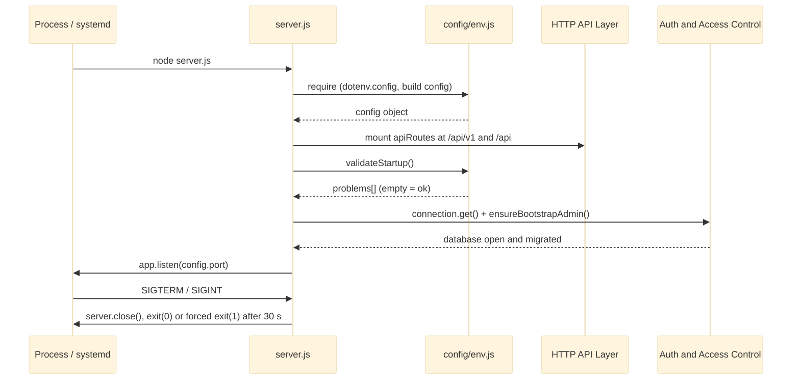

# Server Bootstrap and Config

`server.js` is the process entry point of Dimension. It loads the environment through `src/config/env.js` (dotenv plus a plain `config` object), builds the Express app with a fixed, load-bearing middleware order (proxy trust, helmet CSP, optional CORS, rate limiting, body parsers, logging, static files, the versioned API assembly from [[HTTP API Layer]], an `/api` catch-all, the SPA fallback and the global error handler). It then validates configuration fail-fast, opens and migrates the admin database owned by [[Auth and Access Control]], listens, and drains connections on SIGTERM/SIGINT within a 30 s grace. `src/config/dataDir.js` is a side-effect-free resolver for the store directory, shared with the JSON stores. The module is 416 lines across three files.

## API Reference

| Export / surface | Signature | Purpose |
|---|---|---|
| `server.js` default export | `module.exports = server` | The `http.Server` returned by `app.listen`; tests read its bound port and close it. |
| `server.js` `.app` | `module.exports.app = app` | The Express application, so tests can assert middleware settings (e.g. `trust proxy`) without re-booting. |
| `config` (`src/config/env.js`) | `{ port, env, storageRoot, dataDir, cors: { enabled, allowedOrigins, allowWildcard }, uploadFreeSpaceBytes, DEFAULT_UPLOAD_FREE_SPACE_BYTES, validateStartup }` | Process-wide configuration derived from `process.env` after `dotenv.config()`. |
| `config.validateStartup` | `(source = process.env) => string[]` | Returns configuration problems; empty array means bootable. |
| `resolveDataDir` (`src/config/dataDir.js`) | `(source = process.env) => string` | Absolute store directory: `path.resolve(AFM_DATA_DIR)` or `<cwd>/data`. |

**Environment variables read:** `NODE_ENV`, `PORT`, `STORAGE_ROOT`, `AFM_DATA_DIR`, `UPLOAD_MAX_BYTES`, `AFM_UPLOAD_FREE_SPACE_BYTES`, `AFM_CORS_ENABLED`, `AFM_CORS_ALLOWED_ORIGINS`, `AFM_CORS_ALLOW_WILDCARD`, `AFM_BOOTSTRAP_ADMIN_USERNAME`, `AFM_BOOTSTRAP_ADMIN_PASSWORD`.

**HTTP surface owned directly here:**

| Request | Response |
|---|---|
| `ALL /api/*` with no matching route | `404 { success: false, error: 'API endpoint not found' }` |
| `GET` any non-`/api` path | `public/index.html` (SPA fallback) |
| Static files | served from `public/` |

## Beginner

> [!tip] Prerequisites
> Before reading this section, you should be comfortable with:
> - Running a Node.js program from a terminal (`npm start`)
> - The idea of a web server that answers HTTP requests
> - Environment variables (named settings passed to a program from outside)

### What Is This?

Every program needs a starting point. For Dimension, that starting point is `server.js`. When you run `npm start`, this file reads the settings you gave it (such as which folder on disk to manage), checks that those settings make sense, prepares the web server, and starts listening for browser requests. When the machine asks the program to stop, the same file finishes the requests that are already running before it exits.

The "config" half of the module is the code that reads those settings. It turns raw text values such as `PORT=3000` into a JavaScript object that the rest of the application can use, and it lists anything that is wrong with them.

### Key Concepts

**Environment variable**
A named text value supplied to a process by the operating system or a `.env` file, for example `STORAGE_ROOT=/srv/files`. Node exposes them as `process.env`. Dimension uses the `dotenv` package to load a local `.env` file into `process.env` without overwriting values that are already set.

**Express and middleware**
Express is a Node.js web framework. A *middleware* is a function that sees each request in turn and either answers it or passes it on with `next()`. The order in which middleware is registered is the order requests visit it, so in this file order matters.

**Fail-fast startup**
Instead of starting and then failing on the first request, the server checks its configuration up front. If anything is wrong it prints `FATAL CONFIGURATION ERROR` and exits with status 1, so the operator sees the problem immediately.

**Graceful shutdown**
When the process receives a stop signal (SIGTERM or SIGINT, for example Ctrl+C), it stops accepting new connections, lets running uploads and downloads finish, and only then exits. A 30 second timer forces an exit if that takes too long.

**SPA fallback**
The frontend is a single-page application (SPA): one HTML shell whose JavaScript swaps the page content. Any browser request that is not for the API is answered with `public/index.html` so the frontend can decide what to show.

### How It Works: Main Flow

Starting the server goes through these steps in order.

1. **Load configuration** - `src/config/env.js` loads `.env` and builds the `config` object. It never exits on its own.
2. **Build the app** - security headers (helmet), optional CORS, a rate limiter on `/api`, body parsers, request logging and static files are registered.
3. **Mount the API** - the API routes from [[HTTP API Layer]] are attached at `/api/v1` and its older alias `/api`.
4. **Add the fallbacks** - unknown `/api` paths get a JSON 404; other GETs get `index.html`; errors go to the global error handler.
5. **Validate** - `config.validateStartup()` checks `STORAGE_ROOT`, `AFM_DATA_DIR` and the other settings. Problems stop the process.
6. **Open the admin database** - the database from [[Auth and Access Control]] is opened and migrated, and a bootstrap admin is created if configured.
7. **Listen** - `app.listen(config.port)` starts accepting requests.
8. **Shut down on signal** - SIGTERM/SIGINT closes the server, closes idle connections, and exits.

> [!example] Example
> ```bash
> # .env (local development) - STORAGE_ROOT must be an existing absolute directory
> STORAGE_ROOT=/home/me/dimension-files
> PORT=3000
>
> npm run dev        # nodemon, http://localhost:3000
> curl http://localhost:3000/api/v1/health   # public liveness check, reports apiVersion: 1
> ```

## Intermediate

### Design Rationale

- **Validation is deferred, not done at require time.** `env.js` builds `config` but only reports problems through `validateStartup(source)`, which `server.js` calls before `listen`. Test suites load the config with string-only roots, and an exit at require time once made the suite depend on a developer `.env`. The `source` parameter makes validation injectable.
- **One API assembly, two mount points.** `app.use(['/api/v1', '/api'], apiRoutes)` serves the versioned contract and its compatibility alias from one router (ADR-007). It must be registered before the two-argument `/api` catch-all, which never calls `next()`.
- **The rate limiter runs before the body parsers**, so a flood is refused before its body is parsed.
- **CORS is absent unless enabled.** The `cors` middleware is not registered at all unless `AFM_CORS_ENABLED=true`, and then only for a validated allowlist with `credentials: false`.
- **Proxy trust is exactly one hop** because production sits behind nginx (ADR-008).
- **The admin DB opens synchronously before `listen`**, so a schema or migration failure stops boot the same way a configuration error does.
- **Shutdown timeouts are ordered:** app grace 30 s < systemd `TimeoutStopSec` 45 s < nginx `proxy_read_timeout` 600 s, so each outer layer waits for the inner one (see [[Deployment Scripts]]).
- **`dataDir.js` is split out** so that [[Metadata and Settings Stores]] can resolve their directory without loading the full config and its dotenv side effect.

### Patterns Used

**Module-level singleton configuration** - a plain object built once when first required and shared by every importer. Services in [[Storage Services]], the stores and the auth controller all read the same `config`. Parse helpers (`parseBool`, `parseCorsAllowedOrigins`, `parseUploadFreeSpaceBytes`) normalise raw strings; `parseUploadFreeSpaceBytes` returns `undefined` on bad input and leaves rejection to `validateStartup`. See [[Singleton Services]].

**Validation as a pure function returning problems** - `validateStartup` returns a list of strings instead of throwing, so a caller can print every problem at once and tests can assert on the list.

**Order-sensitive middleware chain (chain of responsibility)** - each middleware either answers or passes on; the documented order is part of the contract.

**Conditional middleware registration** - security-relevant middleware (CORS) is only added to the chain when explicitly enabled.

### Module Interactions



Reverse dependencies: [[Storage Services]] reads `config.storageRoot` and upload limits, [[Metadata and Settings Stores]] use `resolveDataDir`, and [[Deployment Scripts]] rely on the `/api/v1/health` `apiVersion` and the shutdown timeout ordering.

### Trade-offs

- Validation uses `fs.statSync` / `fs.accessSync`. Synchronous I/O is acceptable here because it only runs at boot, never on the request path.
- Splitting validation from loading keeps `env.js` importable everywhere, at the cost that a caller other than `server.js` must remember to call `validateStartup` itself.
- `dataDir.js` uses `'use strict'` while `env.js` and `server.js` do not. Rationale not documented.

## Advanced

### Concurrency & State

The config object is built once at require time and is never mutated afterwards. The only runtime state in `server.js` is the listener and the signal handlers. `process.once` is registered per signal, so SIGTERM followed by SIGINT runs `shutdown()` twice (see Code Review Notes). The forced-exit timer is `unref`'d, so it never keeps the event loop alive by itself.

### Performance Characteristics

Nothing here is on a hot path except the middleware order. The rate limiter sits ahead of `express.json` / `express.urlencoded`, so refused requests cost no body parsing. `morgan('dev')` logs on response finish. Startup does synchronous filesystem checks and a synchronous database open/migration, which delays `listen` but runs only once.

### Failure Modes

| Failure | Trigger | Behaviour |
|---|---|---|
| Configuration problem | Missing, relative, foreign-platform or non-existent `STORAGE_ROOT`; malformed `UPLOAD_MAX_BYTES` / `AFM_UPLOAD_FREE_SPACE_BYTES`; production without `AFM_DATA_DIR`; bad CORS allowlist; unpaired or short bootstrap-admin credentials | `FATAL CONFIGURATION ERROR` lines, exit 1 |
| DB open/migration failure | Schema error in the admin database | Boot stops before `listen` |
| Bind failure | `EADDRINUSE`, `EACCES` | Unhandled `'error'` event, raw stack trace (no listener attached) |
| Invalid `PORT` | `PORT=abc` or out of range | Not validated; Node treats a non-numeric value as a pipe path, out-of-range throws `RangeError` |
| Slow drain | In-flight transfers outlive the grace | Forced `exit(1)` after 30 s |

> [!danger] Critical Failure Mode
> A second shutdown signal makes `server.close(cb)` run on a server that is no longer listening. The callback ignores its `ERR_SERVER_NOT_RUNNING` error, logs "All connections closed" and exits with status 0 while uploads and downloads are cut off. Supervisors and logs then report a clean shutdown that was not clean.

### Invariants & Constraints

- `env.js` must never call `process.exit` at require time; only `server.js` acts on `validateStartup()`.
- The API assembly must be mounted before the `/api` catch-all, or every route is unreachable.
- The rate limiter must stay ahead of the body parsers.
- Shutdown grace (30 s) < `TimeoutStopSec` (45 s) < nginx timeouts (600 s).
- `GET /api/v1/health` reporting `apiVersion: 1` is the activation gate for [[Deployment Scripts]].
- CORS middleware is either absent or allowlisted; it is never globally permissive by default.

### Code Review Notes

> [!warning] CORS allowlist is validated in normalized form but matched as a raw string
> **File:** `src/config/env.js:141-149, 167-182`; `server.js:69-81` | **Severity:** medium
>
> `validateCorsOrigin` accepts `https://app.example.com/` and `https://App.Example.com`, and the duplicate check normalises with `new URL(origin).origin.toLowerCase()`. At request time `server.js` compares the browser's `Origin` against the raw strings with `allowedOrigins.includes(requestOrigin)`. A browser never sends the trailing slash or mixed case, so an origin that passed validation is silently refused. It fails closed, but with no warning.
>
> **Current approach:**
> ```js
> return raw.split(',').map((s) => s.trim()).filter((s) => s.length > 0);
> ```
>
> **Better approach:**
> ```js
> .map((s) => { try { return s === '*' ? s : new URL(s).origin; } catch { return s; } })
> ```
> Normalise once at parse time so the stored value is exactly what a browser sends. Alternatively, reject any value where `new URL(value).origin !== value`. See [[Code Review]].

> [!warning] Directory checks do not test writability
> **File:** `src/config/env.js:184-199` | **Severity:** medium
>
> `directoryProblems` checks read and execute only. A read-only `STORAGE_ROOT` or `AFM_DATA_DIR` passes startup and then fails on every upload, rename, delete or store write, which is exactly the per-request failure fail-fast boot is meant to prevent.
>
> **Current approach:**
> ```js
> fs.accessSync(dir, fs.constants.R_OK | fs.constants.X_OK);
> ```
>
> **Better approach:**
> ```js
> fs.accessSync(dir, fs.constants.R_OK | fs.constants.W_OK | fs.constants.X_OK);
> ```
> One extra flag moves the failure from the first write request to boot. See [[Limitations]].

> [!warning] `PORT` is never validated
> **File:** `src/config/env.js:41`; `server.js:148` | **Severity:** low
>
> Every other numeric setting goes through `validateStartup`, but `PORT` is passed raw to `app.listen`. `PORT=abc` becomes a pipe path, so the server "boots" without a TCP port.
>
> **Current approach:**
> ```js
> port: process.env.PORT || 3000,
> ```
>
> **Better approach:**
> ```js
> // in validateStartup
> if (source.PORT !== undefined) {
>     const n = Number(source.PORT);
>     if (!/^\d+$/.test(source.PORT) || n < 1 || n > 65535) problems.push('PORT must be an integer between 1 and 65535.');
> }
> ```
> A bad port then appears as a `FATAL CONFIGURATION ERROR` line instead of a silent misbind. See [[Code Review]].

> [!warning] Listener errors are not handled
> **File:** `server.js:148-155` | **Severity:** low
>
> With no `'error'` listener, `EADDRINUSE` or `EACCES` crashes with a raw stack trace instead of the boot-error format used for configuration and database problems.
>
> **Current approach:**
> ```js
> const server = app.listen(config.port, () => { /* startup banner */ });
> ```
>
> **Better approach:**
> ```js
> server.on('error', (err) => {
>     console.error(`FATAL STARTUP ERROR: cannot listen on port ${config.port}: ${err.code || err.message}`);
>     process.exit(1);
> });
> ```
> All boot failures then share one readable format. See [[Code Review]].

> [!warning] A second shutdown signal reports a clean exit while transfers are in flight
> **File:** `server.js:168-184` | **Severity:** low
>
> `process.once` per signal lets SIGTERM then SIGINT run `shutdown()` twice; the second `server.close` callback ignores `ERR_SERVER_NOT_RUNNING` and exits 0.
>
> **Current approach:**
> ```js
> server.close(() => {
>     console.log('[shutdown] All connections closed; exiting.');
>     process.exit(0);
> });
> ```
>
> **Better approach:**
> ```js
> let shuttingDown = false;
> function shutdown(signal) {
>     if (shuttingDown) { process.exit(1); }   // repeat signal = explicit forced exit
>     shuttingDown = true;
>     // ... grace timer as today ...
>     server.close((err) => process.exit(err ? 1 : 0));
> }
> ```
> A guard flag and a checked callback make the exit status tell the truth. See [[Code Review]].

> [!warning] Requests rejected before morgan are never logged
> **File:** `server.js:86-90` | **Severity:** low
>
> `morgan('dev')` is registered after the rate limiter and body parsers, so 429 floods and malformed-JSON errors (which jump to `errorHandler`) never reach the request log.
>
> **Current approach:**
> ```js
> app.use('/api', createRateLimit());
> app.use(express.json());
> app.use(express.urlencoded({ extended: true }));
> app.use(morgan('dev'));
> ```
>
> **Better approach:**
> ```js
> app.use(morgan('dev'));
> app.use('/api', createRateLimit());
> app.use(express.json());
> ```
> Morgan logs on response finish, so registering it first costs nothing and captures the events operators most want to see. See [[Code Review]].

> [!warning] SPA fallback answers missing static assets with `index.html`
> **File:** `server.js:113-120` | **Severity:** low
>
> Every non-`/api` GET, including a mistyped `/assets/js/missng.js`, gets `index.html` with 200, so a broken asset shows up as a MIME/nosniff refusal instead of a 404.
>
> **Better approach:** only fall back when `req.accepts('html')`, or skip paths with a file extension and let them 404. See [[Code Review]].

> [!warning] Stale doc comment in `dataDir.js`
> **File:** `src/config/dataDir.js:9-11` | **Severity:** low
>
> The comment says `config/env` "exits without STORAGE_ROOT". It no longer does; the exit moved to `server.js` via `validateStartup`. The remaining difference is that `env.js` runs `dotenv.config()` on load.
>
> **Better approach:** reword to "unlike config/env, which loads `.env` on require". See [[Code Review]].
