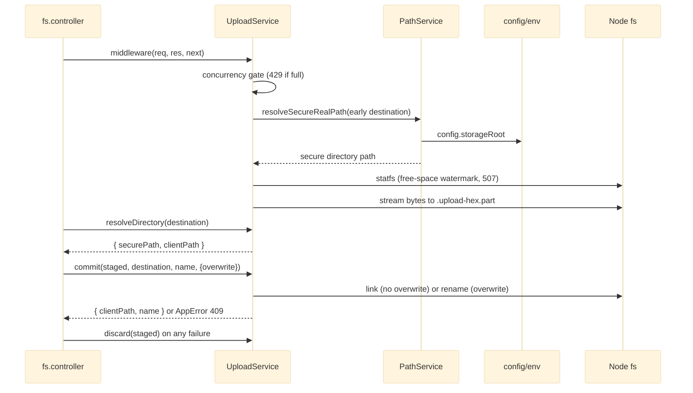

# Storage Services

Storage Services is the bottom of Dimension's `routes -> controllers -> services -> fs` stack and the only code that touches the storage tree on disk. It consists of four static-class singletons and four utility modules. `PathService` is the containment boundary that maps client paths (POSIX strings rooted at `/`) to absolute paths under `config.storageRoot` and back. `FileSystemService` owns CRUD plus the Dashboard aggregates. `UploadService` wraps Multer with a hidden staging file and atomic final placement. `PreviewService` offers bounded thumbnails only if `sharp` is installed (it is not). The utilities supply `AppError`, name/path/settings validators, the file-type taxonomy and a bounded-parallel map. The only project dependency is configuration from [[Server Bootstrap and Config]]; callers are the controllers in [[HTTP API Layer]]. The module is 1615 lines.

## API Reference

**PathService** (`src/services/PathService.js`)

| Method | Signature | Purpose |
|---|---|---|
| `resolveSecurePath` | `(clientPath: string) => string` | Lexical traversal guard; absolute path inside the root, or `AppError` 400/403. |
| `resolveSecureRealPath` | `(clientPath: string) => Promise<string>` | Realpath-canonicalised guard; refuses symlink escapes (403) and missing paths (404). |
| `toClientPath` | `(absolutePath: string) => string` | Absolute OS path to POSIX client path; out-of-root returns `/`. |

**FileSystemService** (`src/services/FileSystemService.js`)

| Method | Signature | Purpose |
|---|---|---|
| `getStats` | `(clientPath) => Promise<{securePath, isDirectory, size, modified}>` | Stat via the realpath guard; 404/403/500. |
| `readDirectory` | `(clientPath) => Promise<fs.Dirent[]>` | Directory entries (`withFileTypes`); 400 if not a directory. |
| `exists` | `(securePath) => Promise<boolean>` | Non-throwing `fs.access` check. |
| `createDirectory` | `(clientPath) => Promise<{securePath}>` | Non-recursive mkdir; 409 existing, 404 missing parent. |
| `rename` | `(oldClientPath, newName) => Promise<{oldPath, newPath}>` | Same-directory rename only; 409 collision, 403 escape/root. |
| `move` | `(oldClientPath, destinationClientPath) => Promise<{oldPath, newPath}>` | Move into an existing directory keeping the name; refuses root, self/descendant, collisions; same location is a no-op. |
| `copy` | `(oldClientPath, destinationClientPath) => Promise<{sourcePath, newPath}>` | Recursive `fs.cp`; refuses self/descendant and collisions. |
| `remove` | `(clientPath) => Promise<{isDirectory}>` | Permanent delete; storage root refused with 403. |
| `getTreeStats` | `(clientPath = '/', {maxEntries?, maxMs?}) => Promise<{files, folders, treeBytes, breakdown, truncated, entriesScanned, skippedLinks, inaccessible, errors}>` | Bounded iterative walk; skips dotfiles and links. |
| `computeCapacity` | `(statfsResult) => {usedBytes\|null, totalBytes\|null, volumeAvailable}` | Pure capacity arithmetic. |
| `getVolumeStats` | `(clientPath = '/') => Promise<{usedBytes, totalBytes, volumeAvailable, raw?}>` | `fs.statfs` capacity; degrades to nulls instead of throwing. |
| `getHealthMetrics` | `() => Array<{name, value, unit, icon}>` | Synchronous memory-used % and uptime; unsupported metrics omitted. |
| `retainExisting` | `(entries: {path, downloads}[]) => Promise<{path, downloads, max}[]>` | Keeps ranked metadata entries still on disk; recomputes `max`. |

**UploadService** (`src/services/UploadService.js`)

| Member | Signature | Purpose |
|---|---|---|
| `middleware` | `(req, res, next)` | Concurrent-upload gate (429), then Multer `.single('file')` with staging storage. |
| `resolveDirectory` | `(clientDest) => Promise<{securePath, clientPath}>` | Destination resolution; 400 on missing or non-directory. |
| `commit` | `(stagedPath, destination, name, {overwrite}) => Promise<{clientPath, name}>` | Final placement under the overwrite policy (409). |
| `discard` | `(filePath) => Promise<void>` | Never-throwing cleanup with retry. |
| `stagedPathOf` | `(req) => string \| null` | Staged path lookup. |
| `toUploadError` | `(err) => AppError` | Multer error translation (413/400). |
| `maxBytes`, `freeSpaceBytes`, `maxConcurrentUploads` | static getters | Limits. |
| Constants | `STAGING_PREFIX`, `STAGING_SUFFIX`, `DEFAULT_MAX_BYTES`, `DEFAULT_FREE_SPACE_BYTES`, `DEFAULT_MAX_CONCURRENT_UPLOADS` | Staging naming and defaults. |
| `_useFreeSpaceReader` | `(fn)` | Test seam. |

**PreviewService** (`src/services/PreviewService.js`)

| Member | Signature | Purpose |
|---|---|---|
| `capability` | `() => {available, formats, maxSize}` | Capability probe. |
| `parseSize` | `(raw) => number` | Size clamp 16..512. |
| `assertPreviewable` | `(clientPath) => void` | Name-only gate (415/404). |
| `render` | `(clientPath, size) => Promise<{buffer, contentType: 'image/webp'}>` | `sharp` render (413/422). |
| `_useTransformer` | `(next)` | Test seam. |
| Constants | `PREVIEW_FORMATS`, `PREVIEW_MAX_SIZE`, `PREVIEW_DEFAULT_SIZE` | Bounds. |

**Utilities** (`src/utils/`)

| Export | Signature | Purpose |
|---|---|---|
| `validateFileName` | `(name) => string` | Cross-platform name rules. |
| `validateClientPath` | `(clientPath) => string` | Rooted-path shape check (at most 4096 chars). |
| `validateSettingsPayload` | `(payload) => {general:{workspaceName, defaultUploadFolder}, appearance:{defaultView}}` | Exact-whitelist settings validation. |
| `CATEGORIES`, `EXTENSION_MAP`, `classifyFile`, `emptyBreakdown` | `classifyFile(fileName) => string` | Shared file-type taxonomy (mirrors client `FileTypes` in `public/assets/js/app.js`). |
| `mapWithConcurrency` | `(items, limit, fn) => Promise<R[]>` | Bounded-parallel async map, results in input order. |
| `AppError` | `class AppError extends Error { constructor(message, statusCode) }` | Expected-failure error carrying an HTTP status. |

## Beginner

> [!tip] Prerequisites
> Before reading this section, you should be comfortable with:
> - Files, folders and paths on a computer (absolute vs relative paths)
> - JavaScript classes and `async`/`await`
> - The idea that a web server should not let users reach files it does not mean to share

### What Is This?

Dimension lets an administrator manage one folder on the server, called the storage root, through a web page. This module is the part that actually reads and writes files inside that folder. It lists folders, creates, renames, moves, copies and deletes items, accepts uploads, and measures how much space is used.

Its most important job is safety. A user only ever sees paths like `/media/clip.mp4`. This module translates such a path into the real location on disk (for example `/srv/storage/media/clip.mp4`) and refuses anything that would escape the storage root, such as `/../../etc/passwd`.

### Key Concepts

**Client path vs secure path**
A *client path* is what the browser sees: a forward-slash path starting at `/`, the root of the storage folder. A *secure path* is the absolute operating-system path after it has been checked to lie inside the root. Secure paths never leave this module.

**Directory traversal**
An attack where a path such as `../../secret` climbs out of the allowed folder. `PathService` is the single place that blocks it.

**Symbolic link (symlink) / junction**
A file-system entry that points somewhere else. A link inside the root can point outside it, so the stronger guard (`resolveSecureRealPath`) follows links to their real target before deciding.

**Static class**
A class used only for its `static` methods, never instantiated with `new`. It acts as a single shared toolbox (a singleton).

**Multer and staging**
Multer is a library that reads file uploads from a multipart HTTP body. Dimension writes the incoming bytes to a hidden temporary file (`.upload-<random>.part`) first and only moves it to its real name once the whole upload has arrived.

**`AppError`**
An error that carries an HTTP status code, such as 404 for "not found" or 409 for "already exists". Every expected failure in this module is an `AppError`.

### How It Works: Main Flow

Here is what happens when a controller asks to rename `/docs/a.txt` to `b.txt`.

1. **Check the input** - the controller has already validated the path with `validateClientPath` and the new name with `validateFileName`.
2. **Translate the path** - `PathService.resolveSecurePath('/docs/a.txt')` turns it into an absolute path and confirms it is inside the storage root.
3. **Check for clashes** - the service checks whether `b.txt` already exists in the same folder and answers 409 if so.
4. **Do the operation** - `fs.rename` is called on the disk.
5. **Translate errors** - an OS error code such as `EACCES` becomes a friendly `AppError` (403) with no disk path in the message.
6. **Return client paths** - the result is `{ oldPath: '/docs/a.txt', newPath: '/docs/b.txt' }`, converted back with `PathService.toClientPath`.

> [!example] Example
> ```js
> const PathService = require('./src/services/PathService');
> const FileSystemService = require('./src/services/FileSystemService');
>
> // With STORAGE_ROOT=/srv/storage
> PathService.resolveSecurePath('/media/clip.mp4'); // '/srv/storage/media/clip.mp4'
> PathService.resolveSecurePath('/../etc/passwd');   // throws AppError: escapes the root
>
> const stats = await FileSystemService.getStats('/media/clip.mp4');
> // { securePath, isDirectory: false, size, modified }  - securePath stays server-side
> ```

## Intermediate

### Design Rationale

- **One containment choke point.** Every client path goes through `PathService`, so traversal protection is reviewed in one file (AGENTS.md hard constraint). Two strengths exist: `resolveSecurePath` is a cheap lexical check with a separator-boundary prefix test; `resolveSecureRealPath` adds `fs.realpath` so an in-root link pointing outside is refused. `toClientPath` uses the same boundary rule in reverse and collapses anything outside to `/`.
- **Errno to `AppError` mapping everywhere.** `ENOENT`, `EACCES`, `EPERM`, `EEXIST` and `EXDEV` become `AppError`s with static messages, so no absolute path reaches a client through a service error. See [[Error Contract and Sanitization]].
- **Uploads stage, then place.** Multer resolves `destination` when the first file chunk arrives, so an early `destination` field is validated (and a free-space watermark checked with `fs.statfs`, 507) before any byte is written, while a late one is honoured because placement happens only after the body is parsed. Staging names are dot-prefixed so listings and the tree walk ignore them.
- **Previews are optional and bounded.** `sharp` is probed with a guarded `require`; without it the capability endpoint reports unavailable. Non-images are refused from the name before any byte is read.
- **Dashboard aggregates report unavailability, never zero.** `getVolumeStats` returns `null` + `volumeAvailable: false`; `getHealthMetrics` omits metrics it cannot measure. See [[Truthful Reporting and Unavailability]].

### Patterns Used

**Static-class singletons** - all four services are classes with only static methods. Mutable module state lives in closures (`transformer` in `PreviewService`, `inFlightUploads` in `UploadService`). See [[Singleton Services]].

**Atomic placement** - no-overwrite uploads use `fs.link` (fails with `EEXIST` if the name is taken) and overwrite uploads use `fs.rename`, with exclusive-copy and copy-beside-then-rename fallbacks for filesystems without hard links and for cross-device (`EXDEV`) moves. See [[Atomic Replace Writes]].

**Bounded work budgets** - `getTreeStats` walks with an explicit stack, a labelled `break walk`, and budgets of 100k entries / 2000 ms (time checked every 512 entries), reporting `truncated` instead of running unbounded. `mapWithConcurrency` caps parallelism for callers. See [[Bounded Work Budgets]].

**Explicit unavailability** - capacity and health values are `null` with a flag, or omitted, rather than zero. See [[Explicit Unavailability]].

**In-process concurrency gate** - a module-level counter limits concurrent uploads (default 4, `AFM_UPLOAD_MAX_CONCURRENT`), released once on `res` `close`/`finish`. It is marked in the source as per-process only.

**Retrying cleanup** - `discard` retries `unlink` on `EBUSY`/`EPERM` with linear backoff (Windows handle release) and never throws.

**Test seams** - `_useTransformer` and `_useFreeSpaceReader` swap implementations in tests.

### Module Interactions



[[Metadata and Settings Stores]] and [[Auth and Access Control]] consume `AppError` and `validators.js`, but nothing in this module imports them. `retainExisting` filters data produced by `MetadataService` that the [[HTTP API Layer]] passes in as a plain argument.

### Trade-offs

- Collision checks for create/rename/move/copy are check-then-act (`exists` then act), which is simpler than atomic primitives but leaves a race window. Uploads use the atomic `link`/`EEXIST` approach instead.
- Mutations use the lexical guard while reads use the realpath guard. The source does not document why; the consequence is the high-severity finding below.
- `validators.js` also holds settings-document validation, beyond names and paths, because the settings store consumes it. Rationale not documented.
- `UploadService` reads `UPLOAD_MAX_BYTES` and `AFM_UPLOAD_MAX_CONCURRENT` from `process.env` directly and requires `config/env` mid-file; `FileSystemService` requires `path` lazily inside `rename`/`move`/`copy`. Rationale not documented.

## Advanced

### Concurrency & State

- All filesystem work is async (`fs/promises` and streams). The one deliberate synchronous method is `getHealthMetrics`, which touches only `os.totalmem`/`os.freemem`/`process.uptime` and is on the Dashboard polling path.
- Module state: `inFlightUploads` (counter, released once per response on `close`/`finish`), the optional `transformer`, and Symbol-keyed request properties (`STAGED`, `STAGED_DIR`) that carry the staging path between Multer and the controller.
- The upload gate is per process. Multiple processes would each allow the default 4.
- `getTreeStats` re-checks entries with `lstat` and decrements counters if a link was swapped in mid-walk.
- Race windows: check-then-act collisions in `createDirectory`/`rename`/`move`/`copy`; on POSIX `fs.rename` atomically replaces an existing file target, so a concurrent writer landing between the check and the rename is overwritten. `fs.cp` is called with `errorOnExist: true` but without `force: false`, so the flag is ignored and a racing target is overwritten.

### Performance Characteristics

- `getTreeStats` is O(entries) up to 100k entries or 2000 ms. The [[HTTP API Layer]] calls it once per listed folder in `getList` (16 in flight), which multiplies its cost on large directories.
- Uploads stream to disk and are never buffered in memory. Placement is a hard link or rename (O(1)) unless a cross-device fallback forces a copy.
- `discard` may wait through linear backoff retries on Windows.
- `resolveSecureRealPath` costs one `realpath` syscall per call; `resolveSecurePath` is pure string work.

### Failure Modes

| Error | Trigger | Class |
|---|---|---|
| 400 | Bad name/path shape, not a directory, missing upload destination | Expected |
| 403 | Traversal, symlink escape (realpath guard), root as target, `EACCES`/`EPERM` | Expected |
| 404 | Missing path or parent | Expected |
| 409 | Name collision on create/rename/move/copy/upload without overwrite | Expected |
| 413 / 400 | Multer limit / malformed multipart (`toUploadError`) | Expected |
| 415 / 422 | Non-previewable name / undecodable image | Expected |
| 429 | Concurrent-upload gate full | Expected |
| 507 | Free space below the watermark | Expected |
| 500 | Unmapped errno, `ENAMETOOLONG` from a long multibyte name, NUL byte in a path | Infrastructure or validation gap |

> [!danger] Critical Failure Mode
> `createDirectory`, `rename`, `move` and `copy` use only the lexical `resolveSecurePath`. If the operator-populated root contains a link such as `/link -> /etc`, then `copy('/link/passwd', '/')` copies an outside file into the root where it can be downloaded, `move('/docs/a.txt', '/link')` relocates an in-root item outside the root, and `createDirectory('/link/x')` creates a directory outside it. `remove` is safe only because it calls `getStats` (realpath) first. See [[Path Containment and Client Paths]].

> [!danger] Partial copy left behind
> If `fs.cp` fails part-way (`ENOSPC`, `EACCES` on a nested file), the partially copied tree stays at the destination, the call returns 500/403, and a retry is refused with 409 because the name is taken.

### Invariants & Constraints

- `PathService` stays the single choke point; secure paths never appear in a return value meant for the API.
- Deleting the storage root is refused (403); deletion is permanent (`fs.rm` recursive, no trash).
- Rename is same-directory only by design.
- Staging files are dot-prefixed and therefore hidden from listings and the tree walk.
- `getHealthMetrics` must stay synchronous, cheap and fs-free; it deliberately ships no status field and no load average.
- A quantity that could not be measured is `null` plus an `*Available: false` flag, never `0`.
- `fileTypes.js` must stay in sync with the client `FileTypes` in `public/assets/js/app.js`.

### Code Review Notes

> [!warning] Mutating operations use only the lexical guard, so an in-root link can carry them outside the root
> **File:** `src/services/FileSystemService.js:92-301` (`createDirectory`, `rename`, `move`, `copy`) | **Severity:** high
>
> Reads, downloads, previews and upload destinations canonicalise with `resolveSecureRealPath`; the four mutations check only the path string, so a symlink or junction inside the root lets them read from or write to outside it.
>
> **Current approach:**
> ```js
> const oldSecurePath = PathService.resolveSecurePath(oldClientPath);
> // ...
> const destSecurePath = PathService.resolveSecurePath(destinationClientPath);
> ```
>
> **Better approach:**
> ```js
> const oldSecurePath = await PathService.resolveSecureRealPath(oldClientPath);   // 404/403 handled there
> const destSecurePath = await PathService.resolveSecureRealPath(destinationClientPath);
> // for createDirectory / rename targets: realpath the parent, then join the validated name
> ```
> Both sides must come from `resolveSecureRealPath`, because canonicalising only one changes the basis of the self/descendant check. See [[Code Review]].

> [!warning] `toClientPath` compares a canonical path against the lexical root
> **File:** `src/services/PathService.js:101-118`, used at `src/services/UploadService.js:116-143, 155-157` | **Severity:** medium
>
> When `STORAGE_ROOT` is itself a symlink or junction, every realpath-derived path fails the prefix test and collapses to `/`. `resolveDirectory('/media')` then returns `clientPath: '/'` and the upload is placed in the root instead of `/media`.
>
> **Current approach:**
> ```js
> const rootPath = path.resolve(config.storageRoot);
> const contained = absolutePath === rootPath || absolutePath.startsWith(rootPath + path.sep);
> if (!contained) {
>     return '/';
> }
> ```
>
> **Better approach:**
> ```js
> for (const root of [path.resolve(config.storageRoot), realRootCached]) {
>     if (absolutePath === root || absolutePath.startsWith(root + path.sep)) {
>         const rel = absolutePath.substring(root.length).replace(/\\/g, '/');
>         return rel.startsWith('/') ? rel : `/${rel}`;
>     }
> }
> return '/';
> ```
> Accept either basis, or have `resolveDirectory` return the already validated client path instead of re-deriving it. See [[Code Review]].

> [!warning] A failed recursive copy leaves a partial tree behind
> **File:** `src/services/FileSystemService.js:289-300` | **Severity:** medium
>
> Nothing in the catch removes what `fs.cp` already wrote.
>
> **Current approach:**
> ```js
> try {
>     await fs.cp(oldSecurePath, newSecurePath, { recursive: true, errorOnExist: true });
>     // ...
> } catch (error) {
>     if (error.code === 'EACCES' || error.code === 'EPERM') {
>         throw new AppError('Permission denied to copy item.', 403);
>     }
>     throw new AppError('Failed to copy item on disk.', 500);
> }
> ```
>
> **Better approach:**
> ```js
> const staging = path.join(destSecurePath, `.copy-${crypto.randomBytes(8).toString('hex')}`);
> try {
>     await fs.cp(oldSecurePath, staging, { recursive: true, force: false, errorOnExist: true });
>     await fs.rename(staging, newSecurePath);
> } catch (error) {
>     await fs.rm(staging, { recursive: true, force: true }).catch(() => {});
>     throw mapCopyError(error);
> }
> ```
> The same hidden-staging idea uploads already use makes the copy all-or-nothing. See [[Code Review]].

> [!warning] `errorOnExist: true` is a no-op in the copy call
> **File:** `src/services/FileSystemService.js:290` | **Severity:** low
>
> Node honours `errorOnExist` only when `force` is `false`, and `force` defaults to `true`.
>
> **Current approach:**
> ```js
> await fs.cp(oldSecurePath, newSecurePath, { recursive: true, errorOnExist: true });
> ```
>
> **Better approach:**
> ```js
> await fs.cp(oldSecurePath, newSecurePath, { recursive: true, force: false, errorOnExist: true });
> // and map ERR_FS_CP_EEXIST to 409
> ```
> See [[Code Review]].

> [!warning] Check-then-act collision checks can still overwrite on a race
> **File:** `src/services/FileSystemService.js:96-101, 155-160, 227-232` | **Severity:** low
>
> `rename`/`move` check `exists` and then call `fs.rename`, which on POSIX atomically replaces an existing file. For file sources the upload pattern (`link` + `unlink`, failing on `EEXIST`) closes the gap; directories cannot be hard-linked, so for them the window remains and should be documented. See [[Limitations]] and [[Concurrency and Consistency]].

> [!warning] `validateFileName` silently trims instead of rejecting surrounding spaces
> **File:** `src/utils/validators.js:14-52` | **Severity:** low
>
> The final regex runs on `trimmed`, so only dots can match. `" report.pdf "` is accepted and saved as `"report.pdf"` without telling the client.
>
> **Current approach:**
> ```js
> if (/^[.\s]|[.\s]$/.test(trimmed)) {
> ```
>
> **Better approach:**
> ```js
> if (/^[.\s]|[.\s]$/.test(name)) {
> ```
> Either test the untrimmed input, or document the trimming as intentional normalisation. See [[Code Review]].

> [!warning] Name length is measured in UTF-16 code units, not bytes
> **File:** `src/utils/validators.js:25` | **Severity:** low
>
> Most POSIX filesystems cap a name at 255 bytes. A 120-character CJK name (360 UTF-8 bytes) passes and then fails with `ENAMETOOLONG`, mapped to a generic 500.
>
> **Current approach:**
> ```js
> if (trimmed.length > 255) {
> ```
>
> **Better approach:**
> ```js
> if (Buffer.byteLength(trimmed, 'utf8') > 255) {
> ```
> The client then gets a clear 400. See [[Code Review]].

> [!warning] A NUL byte in a client path becomes a 500
> **File:** `src/utils/validators.js:66-80`; `src/services/PathService.js:17-43` | **Severity:** low
>
> `validateClientPath` checks type, length and the leading `/`, but not control characters, so Node's fs throws `ERR_INVALID_ARG_VALUE` and the service maps it to a 500.
>
> **Better approach:**
> ```js
> if (clientPath.includes('\0')) throw new AppError('Path contains invalid characters.', 400);
> ```
> See [[Code Review]].

> [!warning] Upload limits bypass the validated config
> **File:** `src/services/UploadService.js:52-57, 103-107` | **Severity:** low
>
> `UPLOAD_MAX_BYTES` is parsed a second time from `process.env` (it is already validated at startup) and `AFM_UPLOAD_MAX_CONCURRENT` is read on every request, although the comment says both come from config. Two parsers can drift.
>
> **Current approach:**
> ```js
> const UPLOAD_MAX_BYTES = resolveMaxBytes(process.env.UPLOAD_MAX_BYTES);
> // ...
> const configured = Number(process.env.AFM_UPLOAD_MAX_CONCURRENT);
> ```
>
> **Better approach:** expose `uploadMaxBytes` / `uploadMaxConcurrent` on `config` in [[Server Bootstrap and Config]] and read them there, as `uploadFreeSpaceBytes` already is; move `require('../config/env')` to the top of the module. See [[Code Review]].

> [!warning] The free-space watermark checks the staging volume only, and not the file size
> **File:** `src/services/UploadService.js:256-271, 315-327` | **Severity:** low
>
> When the file part arrives before `destination`, bytes are staged in the root and only the root's volume is checked; a destination on a different mount inside the root receives a cross-device copy onto an unchecked volume. The watermark is also a fixed floor, so one upload up to `UPLOAD_MAX_BYTES` can still go below it. Acceptable as a coarse guard; document it, or re-check capacity on the destination volume before the cross-device copy. See [[Limitations]].

> [!warning] Dead error branch in `getTreeStats`
> **File:** `src/services/FileSystemService.js:388-398` | **Severity:** low
>
> `resolveSecurePath` only throws `AppError`, so the `UNRESOLVED` push is unreachable and `startSecurePath` is never used.
>
> **Current approach:**
> ```js
> let startSecurePath;
> try {
>     startSecurePath = PathService.resolveSecurePath(startClientPath);
> } catch (error) {
>     if (error instanceof AppError) throw error;
>     result.errors.push({ clientPath: startClientPath, code: 'UNRESOLVED' });
>     return result;
> }
> ```
>
> **Better approach:**
> ```js
> PathService.resolveSecurePath(startClientPath); // the guard call is the only effect needed
> ```
> See [[Code Review]].
