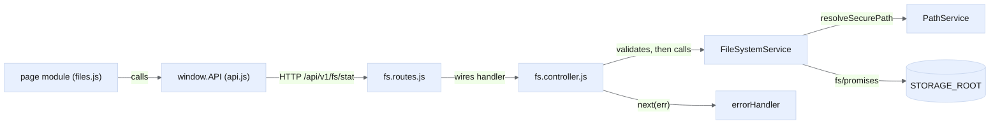

# First Contribution

This note walks through one change end to end, following the "When You Change Code" section of `AGENTS.md`. It adds a new filesystem endpoint and then a frontend call to it. The running example is a hypothetical read endpoint, `GET /api/fs/stat`, that returns size and mtime for one path. Adapt the names to your own change.

> [!tip] Prerequisites
> - A working local setup ([[Getting Started]]).
> - CommonJS `require()`. The project is `"type": "commonjs"`, so there is no `import`.
> - Express 5 middleware basics: `(req, res, next)` and `next(err)`.

## The layered flow

## Step 1: Route (`src/routes/fs.routes.js`)

Add one line that wires the verb and path to a controller function. Routes do no filesystem work at all.

- Do **not** add a version segment. `src/routes/api.js` mounts the fs router, and `server.js` mounts that assembly once at `['/api/v1', '/api']` (ADR-007).
- Authentication and CSRF are already applied once in `api.js`, after `/health` and `/auth`. Your route inherits them, so do not add them again.
- A brand-new *resource router* would be mounted inside `api.js`, never with its own `app.use` in `server.js`.

## Step 2: Controller (`src/controllers/fs.controller.js`)

1. Parse the input and validate it with `validateClientPath` / `validateFileName` from `src/utils/validators.js`. Do not hand-roll regexes.
2. Call a service. Never call `fs` from a controller.
3. Shape the response according to rule 6:
   - A **read** returns a bare shape, such as `{ path, size, modifiedAt }`.
   - A **mutation** returns `{ success: true, ... }`. A bulk mutation reports per-item failures in `data.failed`.
4. Follow the existing pattern: `try { ... } catch (e) { next(e) }`.
5. Throw `new AppError(message, status)` for expected failures. Never call `res.status(...).json(...)` for an error inline.
6. Metadata side effects (`addActivity`, `incrementDownload`) are fire-and-forget: use `.catch(() => {})`, never `await` them on the critical path.

## Step 3: Service (`src/services/FileSystemService.js` or a new service)

- Resolve every client path with `PathService.resolveSecurePath()`. It is the only traversal guard. Absolute paths (`securePath`) never leave the service, and responses speak only in client paths (`/media/clip.mp4`).
- Use async I/O only: `fs/promises` or streams.
- Map errno codes to **static** `AppError` messages so no absolute path or errno reaches the client. See [[Error Contract and Sanitization]].
- A new service follows the static-class or instance singleton pattern. See [[Singleton Services]].
- If the operation could grow without limit, cap it. See [[Bounded Work Budgets]].

> [!warning] Known gap
> `PathService` is **lexical**, so an in-root symlink or junction can redirect a write outside `STORAGE_ROOT`. This is the one high-severity issue (`mutations-lexical-guard-only`; see [[Health Summary]]). If you add a mutation, do not assume the guard resolves symlinks.

## Step 4: Contract (`docs/CONTRACTS.md`)

Document the endpoint's method, path, parameters, success shape and error statuses **in the same change**. Also update `docs/REPO_MAP.md` if you added files. AGENTS.md treats stale docs as bugs. Within v1, changes are **additive only**: a new endpoint, a new optional field, or a new optional parameter that defaults to current behaviour.

## Step 5: Tests

`npm test` runs `node:test` over `test/**/*.test.js`. Add your tests to the suite that matches the layer:

- `test/services/` for the service logic.
- `test/api/fs.contract.test.js` for the live-server contract. Use `test/helpers/authenticated.js` to log in, and point `MetadataService.dbPath` at a temp file before requiring `server.js`. If you touch settings, also repoint `SettingsService.dbPath` and clear its cache.
- `test/api/versioning.contract.test.js` freezes the endpoint set, so a new endpoint must be added there too.

The suite must stay hermetic: no `.env` and no dev-only packages.

## Step 6: Frontend through `window.API`

1. Add a named method in `public/assets/js/api.js`, for example `API.statPath(path)`. Only `api.js` may build API URLs. Page modules contain no `/api` literal, no `API.BASE_URL` concatenation and no ad hoc `fetch`. `test/integration/repo-guardrails.test.js` enforces this. A non-fetch transport (an ``, iframe or form) gets a named URL builder.
2. Call it from the page module. Pass `{ silent: true }` if the page reports the failure itself, and classify failures from `err.status` or `err.kind`, never from the message text.
3. Escape every filesystem-derived string with `AFM.escapeHtml` before it reaches markup. CSP is disabled. `Modal.prompt` and `Modal.confirm` insert raw HTML.
4. The page's `init()` can run many times. Every `window` or `document` listener and timer it adds must be removed in `destroy()`. See [[Re-entrant Page Lifecycle]].
5. Add no control without a working handler, and no success toast for something that did not happen. A value that is unknown renders as `—`, not `0`. See [[Truthful Reporting and Unavailability]].
6. A downloads change goes through `API.downloadFile` / `downloadMultipleFiles` / `downloadZip`, never `window.open`.
7. A new icon-only control needs an `aria-label` and, where it would clip, a `data-tip-pos`.

## Non-negotiable checklist

- [ ] Layering kept: `routes → controllers → services → fs`.
- [ ] Every client path passes `validateClientPath`/`validateFileName` **and** `PathService.resolveSecurePath`.
- [ ] No absolute OS path in any response or error message.
- [ ] Errors are `AppError`, serialized only by `errorHandler`.
- [ ] Envelope matches the read-vs-mutation row (rule 6).
- [ ] Async I/O only. `getHealthMetrics` stays synchronous and fs-free.
- [ ] Metadata writes are fire-and-forget.
- [ ] Rename stays same-directory. Deleting the root stays blocked. Filename rules are not loosened.
- [ ] Upload multipart order: `destination` and `overwrite` **before** `file`.
- [ ] Only additive changes within `/api/v1`. The `/api` alias stays.
- [ ] No fabricated metric, no `0` for unknown, no unbacked control.
- [ ] Frontend calls go only through `window.API`. Every interpolation is escaped. `destroy()` cleans up.
- [ ] Tests never touch real stores and need no `.env`.

## Docs that must stay in sync

| Doc | When |
|---|---|
| `docs/CONTRACTS.md` | Any endpoint, payload or page-module contract change |
| `docs/REPO_MAP.md` | Any file added, moved or repurposed |
| `AGENTS.md` | A rule or test count changes |
| `docs/decisions/ADR-*.md` | A foundational choice changes (a new ADR, not an edit) |
| `docs/DEPLOYMENT.md` + `scripts/deploy.sh` `EXPECT_API_VERSION` | `apiVersion` changes (ADR-008) |
| `graphify-out/` | Run `graphify update .` after code changes |
