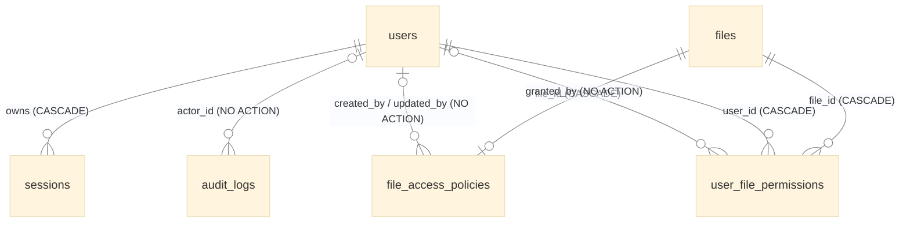

# DATABASE.md — Persistence Reference

> Every byte the server persists outside `STORAGE_ROOT`. Three stores, one directory, no ORM.
> The SQLite schema is defined in `src/db/schema.js`; the JSON document shapes are API contracts and
> live in `docs/CONTRACTS.md` → *Data Schemas*. Change this file in the same commit as the code.

## Overview

All three stores sit side by side under `AFM_DATA_DIR` (default `<cwd>/data`, **required** when
`NODE_ENV=production`; resolved by `src/config/dataDir.js`). None of them lives inside a release
directory (ADR-008), and `data/*` is git-ignored.

| Store | File | Owner | Holds | Engine |
|---|---|---|---|---|
| Admin database | `admin.sqlite` | `src/db/connection.js` (`AdminDatabase`) + `src/db/repositories/*` | users, sessions, audit log, file-access policies | `node:sqlite` (`DatabaseSync`), synchronous |
| Metadata store | `metadata.json` | `MetadataService` | download counts, stars, activity feed | JSON document, async atomic writes |
| Settings store | `settings.json` | `SettingsService` | operator settings (3 keys) | JSON document, async atomic writes |

The filesystem itself is the database for **files**: there is no table mirroring the tree. The
`files` table below is deliberately **sparse** — a row exists only for a path an administrator has
put a policy on (ADR-009 design D2).

The stores are independent. No transaction spans two of them, and metadata writes are
fire-and-forget (AGENTS.md rule 7): a failed metadata or policy-path write never fails the
filesystem operation it accompanies.

---

## Admin database — `admin.sqlite` (ADR-009)

### Connection

`src/db/connection.js` exports one `AdminDatabase` instance.

- **Opened eagerly at boot.** `server.js` calls `AdminDatabase.get()` right after
  `config.validateStartup()`, so a migration failure stops the process before `listen`, like a bad
  `STORAGE_ROOT` does. It is never discovered lazily on the first request.
- **One connection, one process.** `get()` opens once and caches the handle.
- **`PRAGMA foreign_keys = ON`** on every open. SQLite defaults it off; every `REFERENCES` clause
  below is enforced only because of this line.
- **Rollback-journal mode, not WAL.** WAL buys concurrent cross-process readers/writers this app
  never has, costs two sidecar files, and destabilised parallel test runs on Windows. Rationale in
  the comment at `connection.js:41-48`.
- **Synchronous API.** `node:sqlite` has no promise form. This is a deliberate exception to
  AGENTS.md rule 4 (async I/O only), argued the same way as `FileSystemService.getHealthMetrics`:
  the statements are small, local and indexed. Every query in the repositories is a single-row or
  small-set statement on an indexed column.
- **`reset()`** closes the handle and clears the cache so the next `get()` re-opens against the
  current `dbPath`. It is a test hook only.

### Schema

All timestamps are **integer milliseconds since the epoch** (`Date.now()`), the same unit the API
uses. Booleans are `INTEGER` `0`/`1`. Every table has `id INTEGER PRIMARY KEY AUTOINCREMENT`.

#### `users` (migration 1)

| Column | Type | Constraints | Notes |
|---|---|---|---|
| `id` | INTEGER | PK | |
| `username` | TEXT | NOT NULL, **UNIQUE COLLATE NOCASE** | `Admin` and `admin` are the same account. Trimmed by `UserService` before insert. |
| `email` | TEXT | UNIQUE COLLATE NOCASE, nullable | Optional; multiple `NULL`s are allowed. |
| `password_hash` | TEXT | NOT NULL | `"<salt hex>:<scrypt hash hex>"` — 16-byte random salt, 64-byte key (`src/utils/crypto.js`). Never leaves `UserService`. |
| `role` | TEXT | NOT NULL, CHECK `admin`\|`user`, default `user` | The entire authorization model: `requireAdmin` compares this one column. |
| `status` | TEXT | NOT NULL, CHECK `active`\|`disabled`, default `active` | A disabled user cannot log in and every existing session stops validating. |
| `failed_login_count` | INTEGER | NOT NULL, default 0 | Incremented per wrong password; reset to 0 on success. |
| `locked_until` | INTEGER | nullable | Set to now + 15 min at the 10th consecutive failure. |
| `created_at`, `updated_at` | INTEGER | NOT NULL | Every repository mutation refreshes `updated_at`. |

#### `sessions` (migration 1)

| Column | Type | Constraints | Notes |
|---|---|---|---|
| `id` | INTEGER | PK | |
| `token_hash` | TEXT | NOT NULL, UNIQUE | SHA-256 hex of the opaque 32-byte token. **The raw token is never stored** — it exists only in the client's cookie / bearer header. |
| `user_id` | INTEGER | NOT NULL, FK → `users.id` **ON DELETE CASCADE** | |
| `csrf_secret` | TEXT | NOT NULL | 16 random bytes, hex. Stored raw: it is compared against the `X-CSRF-Token` header, and `GET /auth/me` re-issues it to a reloaded page. |
| `created_at`, `last_seen_at` | INTEGER | NOT NULL | `last_seen_at` is rewritten on **every** authenticated request (`SessionService.validateSession` → `touch`). |
| `expires_at` | INTEGER | NOT NULL | `created_at + 24 h`. Flat expiry — no sliding renewal (design D3). |
| `revoked_at` | INTEGER | nullable | Set by logout, disable, password reset, revoke-sessions, delete. |
| `ip`, `user_agent` | TEXT | nullable | Recorded at login only. |

Indexes: `idx_sessions_user_id (user_id)`, `idx_sessions_expires_at (expires_at)`.

A session is **active** iff `revoked_at IS NULL AND expires_at > now` (`findActiveByTokenHash`)
**and** its user's `status = 'active'` (checked in `SessionService`).

#### `audit_logs` (migration 1)

| Column | Type | Constraints | Notes |
|---|---|---|---|
| `id` | INTEGER | PK | |
| `actor_id` | INTEGER | FK → `users.id`, **no ON DELETE action**, nullable | The admin who acted. |
| `action` | TEXT | NOT NULL | See the action vocabulary below. |
| `outcome` | TEXT | NOT NULL, CHECK `success`\|`failure` | Failures are recorded too. |
| `target_type` | TEXT | nullable | `user` or `file`. |
| `target_id` | INTEGER | nullable | User id for `user.*` actions; unused for `file.*`. |
| `detail` | TEXT | nullable | The client path for `file.*` actions. |
| `ip`, `user_agent` | TEXT | nullable | |
| `created_at` | INTEGER | NOT NULL | |

Indexes: `idx_audit_logs_actor_id (actor_id)`, `idx_audit_logs_created_at (created_at)`.

**Action vocabulary** (the complete set written today, all from the admin controllers):

| Action | Written by | `target_type` | Target |
|---|---|---|---|
| `user.create` | `POST /admin/users` | `user` | `target_id` = new user id (null on failure) |
| `user.status` | `POST /admin/users/:id/status` | `user` | `target_id` |
| `user.reset_password` | `POST /admin/users/:id/reset-password` | `user` | `target_id` |
| `user.revoke_sessions` | `POST /admin/users/:id/revoke-sessions` | `user` | `target_id` |
| `user.delete` | `DELETE /admin/users/:id` | `user` | `target_id` |
| `file.policy.update` | `PUT /admin/files/policy` | `file` | `detail` = client path |
| `file.policy.delete` | `DELETE /admin/files/policy` | `file` | `detail` = client path |
| `file.permission.grant` | `POST /admin/files/permissions` | `file` | `detail` = client path |
| `file.permission.revoke` | `DELETE /admin/files/permissions` | `file` | `detail` = client path |

Login, logout and filesystem operations are **not** audited here. Filesystem activity goes to the
metadata store's activity feed instead (below). There is no API that reads the audit log yet;
`AuditLogRepository.list()` exists with no caller.

#### `files` (migration 2)

| Column | Type | Constraints | Notes |
|---|---|---|---|
| `id` | INTEGER | PK | |
| `client_path` | TEXT | NOT NULL, UNIQUE | A client path (`/docs/a.pdf`), validated by `validateClientPath`. **Never** an absolute OS path. |
| `is_directory` | INTEGER | NOT NULL, default 0 | Supplied by the admin, not read from disk. |
| `created_at`, `updated_at` | INTEGER | NOT NULL | |

Sparse by design: a row is created only by `upsertPolicy`. It is kept in step with the filesystem
on a best-effort basis (see *Lifecycle*).

#### `file_access_policies` (migration 2)

| Column | Type | Constraints | Notes |
|---|---|---|---|
| `id` | INTEGER | PK | |
| `file_id` | INTEGER | NOT NULL, **UNIQUE**, FK → `files.id` ON DELETE CASCADE | At most one policy per file. |
| `access_mode` | TEXT | NOT NULL, CHECK `public`\|`authenticated`\|`restricted`, default `restricted` | |
| `is_published` | INTEGER | NOT NULL, default 0 | |
| `is_locked` | INTEGER | NOT NULL, default 0 | |
| `available_from`, `available_until` | INTEGER | nullable | Epoch ms; `from ≤ until` is checked by the service, not the schema. |
| `default_level` | TEXT | NOT NULL, CHECK `view`\|`download`, default `download` (migration 4) | Level the policy's portal audience gets on a non-restricted policy. |
| `created_by`, `updated_by` | INTEGER | FK → `users.id`, no ON DELETE action | |
| `created_at`, `updated_at` | INTEGER | NOT NULL | |

> [!IMPORTANT]
> **Policies govern the File Portal only.** The portal reads these tables read-only and enforces
> them; this app never consults them. A policy on a directory path covers everything below it; the
> lowest level on a path wins. The full rules are in `docs/CONTRACTS.md` → "What a policy does".
> `renamePath`/`deletePath` act on the path **and every row below it**, so a folder rename never
> strands a descendant's policy on a path that no longer exists.

#### `user_file_permissions` (migration 2)

| Column | Type | Constraints | Notes |
|---|---|---|---|
| `id` | INTEGER | PK | |
| `file_id` | INTEGER | NOT NULL, FK → `files.id` ON DELETE CASCADE | |
| `user_id` | INTEGER | NOT NULL, FK → `users.id` ON DELETE CASCADE | |
| `permission` | TEXT | NOT NULL, CHECK `grant`\|`deny` | |
| `level` | TEXT | NOT NULL, CHECK `view`\|`download`, default `download` (migration 4) | Ignored for a deny. |
| `granted_by` | INTEGER | FK → `users.id`, no ON DELETE action | |
| `created_at` | INTEGER | NOT NULL | Not updated when an existing grant is changed. |
| | | **UNIQUE (`file_id`, `user_id`)** | One row per pair; a second grant updates it. |

Index: `idx_ufp_user_id (user_id)` (the unique constraint already covers `file_id`-first lookups).

A permission requires a `files` row, so it requires a policy first (`409` otherwise).

#### `user_groups`, `user_group_members`, `group_file_permissions` (migration 4)

- `user_groups`: `id` PK, `name` TEXT NOT NULL **UNIQUE COLLATE NOCASE**, `description` TEXT,
  `created_at`, `updated_at`.
- `user_group_members`: `group_id` FK → `user_groups.id` ON DELETE CASCADE, `user_id` FK →
  `users.id` ON DELETE CASCADE, `created_at`; **PRIMARY KEY (`group_id`, `user_id`)**; index
  `idx_ugm_user_id (user_id)`.
- `group_file_permissions`: same shape as `user_file_permissions` with `group_id` (FK →
  `user_groups.id` ON DELETE CASCADE) in place of `user_id`; **UNIQUE (`file_id`, `group_id`)**;
  index `idx_gfp_group_id (group_id)`.

A user's grant on a file is folded with every grant reaching them through a group: any deny wins,
otherwise the highest level. The file portal reads these tables read-only in its snapshot (it
understands schema ≤ 4 — upgrade the portal before this admin release).

#### `schema_migrations`

`version INTEGER PRIMARY KEY, applied_at INTEGER NOT NULL` — one row per applied migration.

### Migrations

`src/db/schema.js` holds an ordered `MIGRATIONS` array; `migrate(db)` runs on every open.

1. Creates `schema_migrations` if missing and reads `MAX(version)`.
2. **Refuses to start** if the stored version is newer than the newest one this release knows
   (`Admin database schema (vN) is newer than this release understands (vM).`). This makes a
   rollback to an older release after a schema upgrade fail loudly instead of running against
   tables it does not understand.
3. Applies each newer migration inside its own `BEGIN … COMMIT`, recording it in
   `schema_migrations` in the same transaction; any error rolls that migration back and stops boot.

| Version | Adds |
|---|---|
| 1 | `users`, `sessions`, `audit_logs` + indexes (ADR-009 phase 1) |
| 2 | `files`, `file_access_policies`, `user_file_permissions` + index (ADR-009 phase 2) |
| 3 | `portal_nav_folders` (File portal navbar links) |
| 4 | `file_access_policies.default_level`, `user_file_permissions.level`, `user_groups`, `user_group_members`, `group_file_permissions` + indexes (access levels and groups) |
| 5 | `integration_settings(key, value)`: values shared with the File Portal (ADR-010). Keys: `volume_id` (UUID, also in `STORAGE_ROOT/.dimension-volume`), `release_client_path`, `portal.auth_session_minutes`, `portal.max_failed_attempts`, `portal.lockout_minutes`. Logical values only, never a host path. The portal accepts schema ≤ 5. |

**Adding a migration:** append `{ version: N+1, sql }` — never edit an applied one; a deployed
database will not re-run it. Prefer additive DDL (`CREATE TABLE`, `ALTER TABLE … ADD COLUMN`).
SQLite cannot drop or alter a constraint in place; that needs the create-copy-drop-rename recipe in
one migration. Then document the change here and extend `test/db/schema.test.js`.

### Repositories

Each table group has one singleton repository in `src/db/repositories/`. They hold all SQL; no SQL
and no `node:sqlite` type crosses into services or controllers. Every statement is parameterised
(`?` placeholders) — there is no string-built SQL anywhere.

| Repository | Operations | Called by |
|---|---|---|
| `UserRepository` | `create`, `findById`, `findByUsername` (NOCASE), `list` (by `created_at`), `setStatus`, `setPasswordHash`, `recordLoginFailure`, `resetLoginFailures`, `lockUntil`, `delete`, `count` | `UserService`, `SessionService`, `FileAccessPolicyService`, `bootstrap.js` |
| `SessionRepository` | `create`, `findById`, `findActiveByTokenHash`, `touch`, `revoke`, `revokeAllForUser` | `SessionService` |
| `AuditLogRepository` | `record`, `list({limit})`, `prune(olderThanMs)` | admin controllers (`record` only) |
| `FileAccessPolicyRepository` | `findFileByPath`, `findPolicyByPath`, `listPolicies` (by path), `upsertPolicy` (transactional), `renamePath`, `deletePath`, `deletePolicy` | `FileAccessPolicyService` |
| `UserFilePermissionRepository` | `upsert`, `revoke`, `listForFile`, `listForUser` | `FileAccessPolicyService` |
| `GroupRepository` | `list` (members inline), `findById`, `findByName`, `create`, `update`, `remove`, `setMembers` (transactional), `upsertPermission`, `revokePermission`, `listPermissionsForFile`, `listPermissionsForUser` | `GroupService`, `FileAccessPolicyService` |
| `IntegrationSettingsRepository` | `get(key)`, `setMany({key: value\|null})` (transactional; `null` deletes) | `IntegrationSettingsService` |

`upsertPolicy` is the only multi-statement write; it creates the `files` row if absent and inserts
or updates the policy inside one `BEGIN … COMMIT`. `UserFilePermissionRepository.upsert` is a
select-then-write without a transaction; it is safe only because the process is single-threaded and
the API is synchronous.

### Lifecycle

**Bootstrap admin.** On boot, if `users` is empty, `ensureBootstrapAdmin` creates one `admin` from
`AFM_BOOTSTRAP_ADMIN_USERNAME` / `AFM_BOOTSTRAP_ADMIN_PASSWORD` (both required together, password
≥ 8 characters, checked by `validateStartup`). With either unset it logs a warning and the admin
panel is unreachable. Once any account exists the variables are ignored, so they can (and should)
be removed from the environment file after first boot. No default credential exists.

**Login.**
1. `findByUsername` (case-insensitive). Missing or `disabled` → failure.
2. `locked_until > now` → failure, even with the right password.
3. Wrong password → `failed_login_count + 1`; at 10, `locked_until = now + 15 min`.
4. Success → reset counter and lock; insert a `sessions` row with the token **hash**, a fresh CSRF
   secret and `expires_at = now + 24 h`.

Every failure produces the same `401` body.

**Each authenticated request.** Hash the presented token → `findActiveByTokenHash` → load the user
→ require `status = 'active'` → `touch` (`UPDATE last_seen_at`).

**Revocation.** Rows are marked, never deleted: `revoked_at = now`. Logout revokes the calling
session; disable, password reset, revoke-sessions and user delete revoke every session of that user.

**Filesystem hooks.** `fs.controller.js` calls `FileAccessPolicyService.onPathRenamed` after a
successful rename (`:286`) or move (`:336`), and `onPathDeleted` after a delete (`:453`). Both
swallow every error. Copy does not touch policies: a copy is a new, ungoverned item.

**Retention.** None runs today. Expired and revoked `sessions` rows and all `audit_logs` rows
accumulate indefinitely; `AuditLogRepository.prune` exists but nothing calls it. At this
application's scale (one operator, 24 h sessions) that is kilobytes per year, but there is no upper
bound.

### Known defects (tracked in `docs-vault/Health/Code Review.md`)

| Defect | Effect |
|---|---|
| `audit_logs.actor_id`, `file_access_policies.created_by/updated_by` and `user_file_permissions.granted_by` reference `users(id)` with **no ON DELETE action**, while `foreign_keys = ON`. | Deleting a user who has ever performed an audited admin action, or set a policy/grant, fails the `DELETE` with a constraint error → raw `500`. Fix: `ON DELETE SET NULL` (needs a table-rebuild migration). |
| No last-admin guard. | An admin can disable or delete the last active admin, after which nobody can reach the admin panel until a manual database edit. |
| `failed_login_count` is not reset when a lock expires. | After one lockout, a single further failure re-locks the account for another 15 minutes. |
| `renamePath` / `deletePath` match the exact `client_path` only. | Renaming or deleting a **folder** leaves policies on its descendants pointing at paths that no longer exist. A rename onto a path that already has a row hits the `UNIQUE` constraint, which the best-effort hook swallows. |
| Policy booleans are coerced by truthiness in the repository. | The string `"false"` sent by a client is stored as `1`. |

### Operations

- **Backup:** with the server stopped, copy `admin.sqlite`. While running, use
  `sqlite3 admin.sqlite ".backup admin.bak"` (an online-consistent copy) — a plain file copy taken
  mid-write can be torn. There is no `-wal` file to include.
- **Inspect:** `sqlite3 "$AFM_DATA_DIR/admin.sqlite" ".schema"`; `SELECT * FROM schema_migrations;`.
- **Lost admin password:** set a new hash directly, e.g. compute `hashPassword('new-pass')` with
  `node -e "console.log(require('./src/utils/crypto').hashPassword(process.argv[1]))" 'new-pass'`
  and `UPDATE users SET password_hash = '<output>', failed_login_count = 0, locked_until = NULL WHERE username = 'admin';`.
  The bootstrap variables do not help once any account exists.
- **Release rollback** across a schema upgrade is refused at boot (see *Migrations*). Restore the
  pre-upgrade backup, or roll forward.

### Tests

Suites never touch the real file. `test/helpers/authenticated.js` → `redirectAdminDb(path)` points
`AdminDatabase.dbPath` at a temp file and calls `reset()` before `server.js` is required — the same
pattern as `MetadataService.dbPath` / `SettingsService.dbPath`. `test/db/schema.test.js` pins the
migrations.

---

## Metadata store — `metadata.json`

Shape: `docs/CONTRACTS.md` → *Data Schemas* → `data/metadata.json`. In short: `downloads`
(client path → count), `starred` (client paths), `activities` (newest first, capped at 50).

- **Owner:** `MetadataService` (instance singleton; `dbPath`, in-memory `cache`).
- **Read:** first access loads and caches the whole document; a missing file is created with empty
  defaults; a corrupt or unreadable one throws `AppError(500)` and is not repaired.
- **Write:** every mutation rewrites the whole document to `metadata.json.tmp` and renames it over
  the original (atomic replace on one volume). No `fsync`.
- **Consistency:** eventually consistent and best-effort (AGENTS.md rule 7). Callers fire and
  forget (`.catch(() => {})`); a failed metadata write never fails the file operation.
- **Path hooks:** `renamePath` / `deletePath` migrate or drop entries for the exact path.
- **Known defects:** concurrent writers share one fixed `.tmp` name; the cache is mutated before
  the write, so a failed write leaves memory ahead of disk; folder rename/delete orphans entries
  for descendants; `downloads` keys are never pruned.

## Settings store — `settings.json`

Shape and validation: `docs/CONTRACTS.md` → `GET`/`PUT /api/settings` and *Data Schemas*;
decision record: ADR-006.

- **Owner:** `SettingsService` (instance singleton, cached), same read/atomic-write mechanics as
  the metadata store, same fixed-`.tmp` caveat.
- **Full replace only:** `PUT /api/settings` validates the whole document and replaces it.
- **Corruption is fatal to the request:** a corrupt file is a `500`, never silently defaulted.
- **No secrets, ever** (ADR-006).

---

## Which store do I use?

| You need to persist… | Use |
|---|---|
| Anything about identity, sessions, roles, permissions, or an audit trail | `admin.sqlite`, via a new repository method and a migration if the shape changes |
| A per-file counter or flag that may be lost without harm | `metadata.json` via `MetadataService` |
| An operator preference with a real consumer | `settings.json` via `SettingsService` (and ADR-006's rule: no key without a consumer) |
| Data about the files themselves | Nothing — read it from the filesystem |
